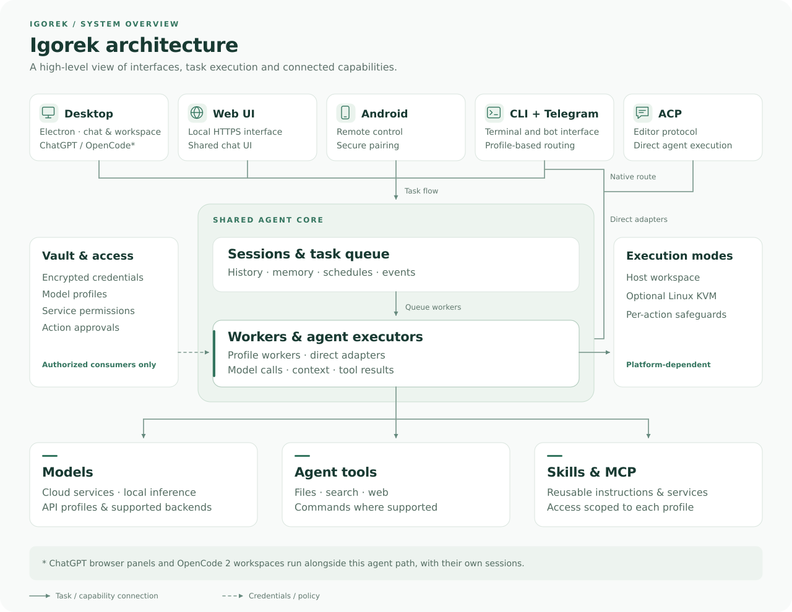

<p align="center">
  <a href="README.ru.md">Русский</a> · <a href="README.md">English</a>
</p>

<p align="center">
  
</p>

# Igorek Harness

**A personal AI agent: Electron desktop, Android, and terminal.**

[Quick start](#quick-start) · [Features](#features) · [Android](#android-and-web-ui) ·
[Security](#data-and-security-boundaries) · [Documentation](#documentation)

Igorek is an Electron desktop application for working with an AI agent:
conversations, files, tools, action approvals, browser tabs, and connection
settings in one workspace. Igorek Remote for Android controls the same agent
from your phone. Terminal, local Web UI, Telegram, and ACP interfaces are also
available.

Documentation updated **October 15, 2026**. The Python/desktop version is in
[`pyproject.toml`](pyproject.toml); Android has its own version in
[`android/app/build.gradle.kts`](android/app/build.gradle.kts).

## What defines Igorek

Igorek is built around a personal workspace: the conversation, actions, and
task results stay together. Its character comes from combining these capabilities.

| Approach | Practical benefit |
| --- | --- |
| Computer and phone work together | Android uses the same sessions and selected profile; browser previews and tab selection stay synchronized with desktop |
| Chat sits beside the work | Browser, files, code changes, terminal, and an independent side chat are available in one application |
| The model is a choice | Cloud connections and local endpoints share the interface; Vault and profiles manage credentials and permissions |
| Actions remain visible | History shows tools, approvals, and results; file changes can be reviewed and restored |
| Work can continue outside an open chat | While the executor is running, schedules execute tasks and return results to the associated session |

## Quick start

### Linux desktop

The primary workflow is to open the application, configure a model connection,
and complete your first task. A prepared Linux x86_64 snapshot can be installed
with the project installer. Replace the example path with your extracted build:

```bash
python3 /path/to/igorek-desktop/install-linux.py --snapshot /path/to/igorek-desktop
```

Open or create a Vault, add a model connection, select a workspace, and start
the executor. Send a small task in the chat and check its result. Provider
credentials are configured inside the application.

Development from a fresh checkout requires Linux x86_64, `uv`, and Node.js/npm:

```bash
npm --prefix desktop ci
uv run python desktop/packaging/build-runtime.py
desktop/run.sh --managed
```

See [Desktop](#desktop) for packaging and Electron sandbox requirements.

### Phone and terminal

| Interface | First step |
| --- | --- |
| Android | Install Igorek Remote and scan the QR code from desktop settings |
| CLI/TUI | Install the host tool, run `igorek-factory init`, and configure a profile |
| Telegram | Configure a bot token, an explicit owner allowlist, and a working profile |
| Local browser | Start the HTTPS interface with `igorek-factory web` |

## Features

- **Chats and projects.** Multiple sessions, history, search, archive, pinning,
  continuation, and an independent side chat. Attachments and file changes
  are available alongside the conversation.
- **Models and connections.** ChatGPT/Codex sign-in, API profiles, and local
  OpenAI-/Anthropic-compatible servers. Save, verify, edit, rename, or disable
  connections. Subscription, API, and voice connections are configured separately.
- **Agent tools.** File reading, writing and editing, search, commands,
  web tools, skills, and MCP. Action approvals and checkpoints provide
  control over execution and file changes.
- **Desktop browser.** Website tabs, navigation, downloads, in-page search,
  and a separate ChatGPT panel. Remote pages run without Node.js or
  administrative application interfaces.
- **GitHub.** Pull request descriptions, changes, discussions, checks, and
  chat attachment. Merging requires separate approval bound to the account
  and current PR commit; the configured GitHub CLI is used.
- **Plugins and access.** OpenAI Docs, read-only Gmail, Google Calendar, and
  MCP connections. Permissions are set per model profile. Calendar writes
  require confirmation in the chat.
- **Voice.** WebRTC conversations and spoken replies from the selected agent,
  with a separate OpenAI Realtime voice connection.
- **Schedules.** Create, pause, resume, or manually run background tasks.
  Desktop supports repetition every N hours with a chosen first start time.
- **OpenCode 2.** The official interface in a separate desktop tab, with
  an isolated service and verified model profiles. See
  [`docs/integrations/OPENCODE.md`](docs/integrations/OPENCODE.md) for its architecture and limits.
- **Completion sound.** One sound after a successful task when the desktop
  window is inactive or minimized. The persistent toggle is under
  **Settings → Notifications**.

- **Desktop updates.** Check stable GitHub releases from the update icon and
  download the matching Linux or Windows installer with SHA-256 verification.
  Installation remains an explicit user action; portable AppImages are replaced
  manually after download.

## Interface

The Electron desktop brings together Igorek chat, a separate OpenCode 2
workspace, and a ChatGPT browser panel. ChatGPT/Codex model sign-in is
configured separately from the browser panel.

The shared desktop and Web UI chat. Captured from 0.1.889 with demonstration
data and the Russian UI; no personal conversations, credentials, or owner
settings were used.


<details>
<summary>First run and connection Vault</summary>


</details>

## Project structure



Vault provides credentials and connection settings to authorized consumers.
Desktop owns its managed backend and data directory; CLI and Telegram do not
require an open graphical window.

| Path | Responsibility |
| --- | --- |
| [`desktop/`](desktop) | Electron, preload, settings, browser, installer, packaging |
| [`android/`](android) | Kotlin/Compose client, pairing, voice, sessions |
| [`factory/core/`](factory/core) | Sessions, worker, profiles, tools, approvals, memory, CLI/TUI |
| [`factory/core/mobile_bridge/`](factory/core/mobile_bridge) | Phone and local Web UI transport |
| [`factory/web_ui/`](factory/web_ui) | HTTPS server and the shared desktop chat UI |
| [`factory/core/vault/`](factory/core/vault) | Encrypted credentials and access controls |
| [`factory/core/isolation/`](factory/core/isolation) | KVM, host/guest channels, network, broker, terminals |
| [`factory/mcp_servers/`](factory/mcp_servers) | Built-in MCP servers and integrations |
| [`factory/api_server_core/`](factory/api_server_core) | Separate inference API/workflow implementation |
| [`factory/api_server_core/server.py`](factory/api_server_core/server.py) | Compatible inference server entrypoint |
| [`tests/`](tests) and [`factory/tests/`](factory/tests) | Python checks; desktop and Android also have their own suites |

Large tool results use `tool_result_store.py`; context compaction is implemented
by `session_compaction.py` and the backend loop. CC-backend system rules are
centralized in `factory/core/prompt_assembly.py`; the separate inference server
uses its own prompt modules.

## Desktop

Linux **x86_64** packaging includes bundled Python/Electron, a portable snapshot,
and a DEB installer. The current target environment is Ubuntu 26.04.
Windows x64 has preview packaging through the shared Electron builder. Hosted Windows installation, first-task/restart and reinstallation/uninstallation
checks pass. Manual clean-machine acceptance and publisher signing remain open.
This is a preview, not a stable release.
See [cross-platform builds](docs/development/CROSS_PLATFORM_DESKTOP.md).
A stable release requires accepted Linux, Android and Windows builds; source
publication and preliminary downloads are separate milestones.

The initial setup opens or creates Vault, adds and verifies a model connection,
and starts the executor. Profiles, conversation history, and workspaces persist.
The settings owner window controls sensitive actions; interface locking and
Vault locking are separate states.

`desktop/run.sh` launches the source application. `--managed` uses a prepared
bundled runtime. The launcher reports required Electron sandbox setup on
affected Linux systems.

Packaging tools:

- `desktop/packaging/build-runtime.py` — Python, dependencies, project wheel;
- `desktop/packaging/package-linux.py` — snapshot and integrity manifest;
- `desktop/packaging/package-deb.py` — DEB from a verified snapshot;
- `desktop/packaging/verify-package.py` — files, permissions, and symlinks;
- `desktop/packaging/install-linux.py` — install, switch builds, roll back, uninstall.

Build output lives in ignored `build/`. An integrity manifest is separate
from a publisher signature.

## Android and Web UI

Igorek Remote connects to an existing desktop or mobile bridge. It supports
sessions, progress, approvals, files, changes, voice, and previews of the
computer's browser tabs. Selecting a tab on the phone also selects it on desktop.

Use desktop **Mobile devices** settings to enable phone access, then scan
the QR code in Android. The QR code contains an HTTPS address, a one-time code,
and the certificate fingerprint. Existing QR pairing already uses HTTPS;
an ordinary APK update does not require pairing again.

Manual addresses default to `https://`. Android blocks credential transmission
over HTTP and HTTPS-to-HTTP redirects. Previously saved HTTP connections remain
in stored data, but requests are blocked. A paired device has owner permissions
and can be revoked.

```bash
igorek-factory web --help
igorek-factory mobile serve --help
igorek-factory mobile pair
```

The standalone bridge listens on loopback by default. Access from another
device needs a reachable address and TLS certificate. Managed desktop provides
this configuration through its owner settings.

## CLI Telegram and ACP

The Python project requires Python 3.13+. The host installer selects the
interpreter pinned in `.python-version`. Dependencies are in `pyproject.toml`
and `uv.lock`.

```bash
factory/scripts/install_host_tool.sh
igorek-factory init
igorek-factory doctor --read-only
```

After configuring a profile:

```bash
igorek-factory run --profile <profile>
igorek-factory chat --profile <profile>
```

`igorek-factory gateway --profile <profile>` starts the gateway stack.
Additional queues use `FACTORY_WORKER_PROFILES` or separate worker processes.
Each queued profile needs its own worker; do not start duplicate workers
through both mechanisms.

Useful commands include `launch-help`, `env-help`, `telegram --help`, `mcp list`,
and `skills list`. The TUI's `/help` describes the current client commands.
`factory-acp` is a stdio protocol adapter for compatible editors.

The single CLI uses Rich/prompt_toolkit with a fullscreen conversation and
mouse support. Older Textual/plain interfaces and their launch switches have
been removed; use `igorek-factory chat --profile <profile>`.
The `igorek-factory ask` command supports machine-readable output through `--json`.

The legacy monitor and `igorek-factory monitor` command have been removed.
`run_local.sh` and `run_lan.sh` now start only Factory API.

Telegram requires a bot token and a nonempty owner user-ID allowlist,
including direct CLI startup. Attachments remain constrained to allowed
workspaces; a path mentioned in a response does not itself grant file access.

## Data and security boundaries

Vault encrypts credential values. Chat history, metadata, logs, and working
files are not automatically encrypted. Credential recovery and a full workspace
backup are separate operations.

Desktop recovery uses `igorek-vault-recovery-v1` and a recovery phrase.
The older `hvbackup-v1` format is a record export, not a complete portable
recovery backup. Chat history and pairing tokens are not part of Vault backup.
A key already delivered to a process is not automatically removed from memory
when a broker decision expires.

CLI data usually lives under `~/.igorek-agent-factory/` independently on each
machine. `IGOREK_FACTORY_HOME`, `FACTORY_DATA_DIR`, and `FACTORY_ENV_FILES_DIR`
control relevant locations. Managed desktop has its own data directory;
actual paths are shown in settings. Developer and mini-PC checkouts have
independent locations and configurations. Git transfers source, not user Vaults
or site authentication.

Implemented controls include API keys on protected Factory API routes,
Host/Origin checks and pairing cookies in Web UI, constrained file paths,
artifact opening without symlink traversal, trusted Electron IPC senders,
and action approvals. Salvage parsing, fact checking, post-turn guards, and
skill write contracts protect different stages of agent execution.

### Execution isolation

CC-backend supports host execution and isolated KVM sessions. KVM uses an
explicit workspace, restricted networking, host-side credential access, and
typed broker operations. Bubblewrap is an additional guest-side layer.
Unavailable KVM must not silently become host execution.

CLI isolation is enabled with `IGOREK_ISOLATION_MODE=kvm`; its default is `off`.
Desktop stores its execution choice separately. Policy levels are not standalone
OS boundaries, and CC-backend KVM behavior should not be assumed for external
Claude or Codex backends. See [`docs/architecture/ISOLATION.md`](docs/architecture/ISOLATION.md) and
[`docs/architecture/POLICY.md`](docs/architecture/POLICY.md) for details.

## Tests

From the repository root:

```bash
uv sync --locked --dev
uv run --no-sync python -u tools/run_tests.py --coverage
npm --prefix desktop test
```

With Android's JDK and SDK configured:

```bash
cd android
./gradlew --console=plain testDebugUnitTest assembleDebug
```

The suite covers Python execution/security and terminal behavior, Electron/Node
controllers, Android JVM behavior, packaging and optional native scenarios.
Exact counts, line/branch coverage and remaining gaps are recorded in
[`docs/TESTING.md`](docs/TESTING.md). Collected cases and subtests are reported
separately; native UI and device acceptance are separate evidence.

## Documentation

Technical documentation is maintained in English. The complete Russian project
overview is available in [README.ru.md](README.ru.md):

- [`docs/PROJECT_LAYOUT.md`](docs/PROJECT_LAYOUT.md) — module map and organization;
- [`docs/development/FIRST_RUN_ACCEPTANCE.md`](docs/development/FIRST_RUN_ACCEPTANCE.md) — first-run behavior and acceptance;
- [`docs/TESTING.md`](docs/TESTING.md) and [`docs/development/TestLOG.md`](docs/development/TestLOG.md) — test inventory and results;
- [`docs/integrations/desktop-plugins.md`](docs/integrations/desktop-plugins.md) — desktop integrations;
- [`docs/development/DEBUGGING_PLAYBOOK.md`](docs/development/DEBUGGING_PLAYBOOK.md) — structured troubleshooting;
- [`docs/development/TRACE_EVENTS.md`](docs/development/TRACE_EVENTS.md) — inference API/workflow events;
- [`docs/architecture/RICH_CLI_RENDERING_EXPLAINED.md`](docs/architecture/RICH_CLI_RENDERING_EXPLAINED.md) — terminal UI implementation;
- [`docs/architecture/ISOLATION.md`](docs/architecture/ISOLATION.md), [`docs/architecture/POLICY.md`](docs/architecture/POLICY.md) — isolation and policy;
- [`docs/development/RELEASE_CHECKLIST.md`](docs/development/RELEASE_CHECKLIST.md) — source and release readiness.

## Contributing and license

Original contributions are licensed under [Apache-2.0](LICENSE). See
[contribution guidance](docs/CONTRIBUTING.md), [security reporting](docs/SECURITY.md)
and [third-party notices](docs/THIRD_PARTY_NOTICES.md).
