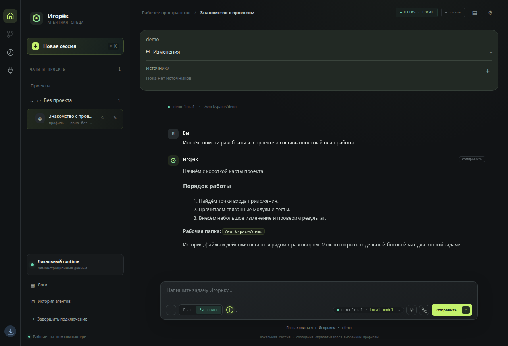
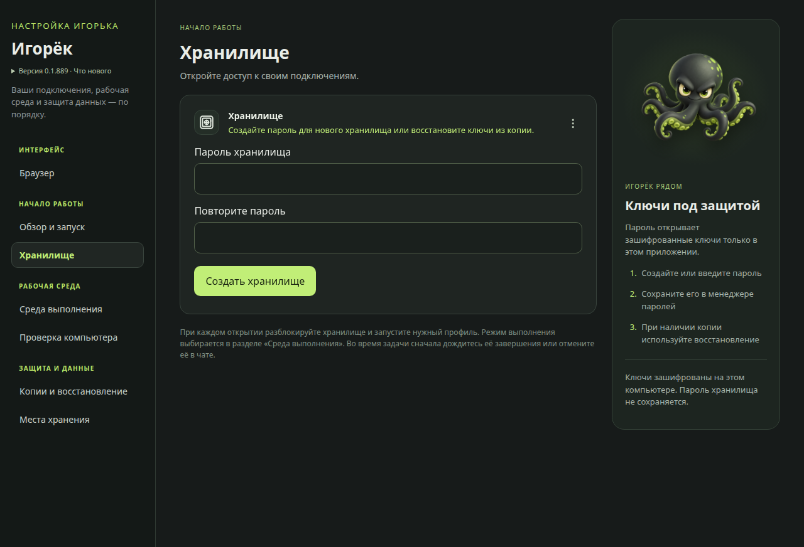
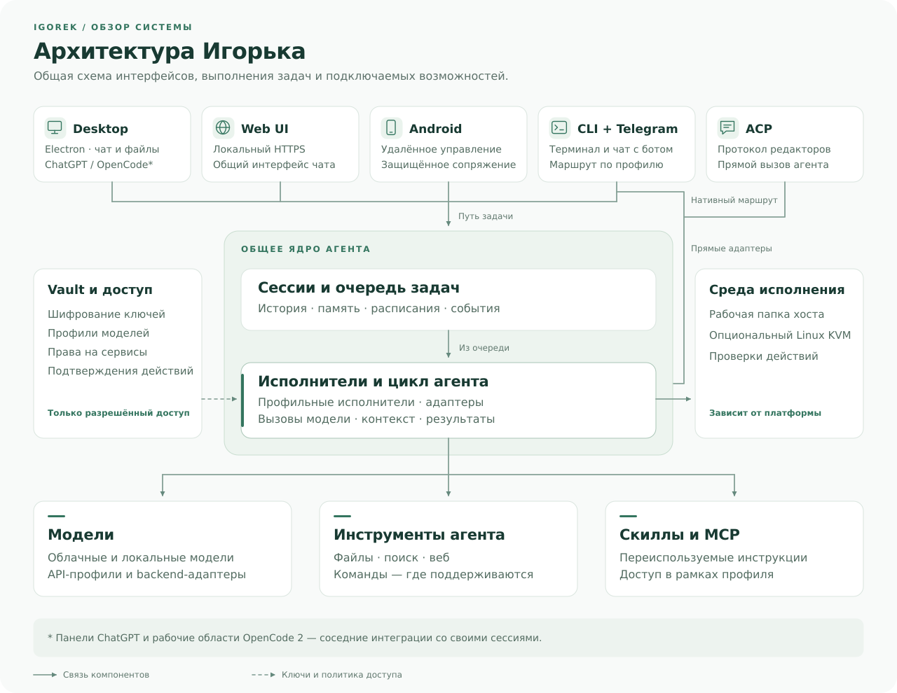

<p align="center">
  <a href="README.ru.md">Русский</a> · <a href="README.md">English</a>
</p>

<p align="center">
  
</p>

# Igorek Harness

Документация проверена: 30.10.2026.

**Персональный AI-агент: desktop на Electron, Android и терминал.**

[Быстрый старт](#быстрый-старт) · [Возможности](#что-умеет-приложение) ·
[Android](#android-и-web-ui) · [Безопасность](#данные-и-границы-защиты) ·
[Документация](#документация) · [Подготовка релиза](docs/development/RELEASE_CHECKLIST.md)

Игорёк — персональное приложение для работы с AI-агентом на своём компьютере.
Основной интерфейс — desktop-приложение на Electron: чаты, файлы, инструменты,
подтверждения действий, браузерные вкладки и настройки подключений. Android-клиент
Igorek Remote позволяет управлять тем же агентом с телефона. Также сохранены
терминальный клиент, локальный Web UI, Telegram-мост и ACP-адаптер.

Состояние документа: **30 октября 2026 года**. Версия Python/desktop указана в
[`pyproject.toml`](pyproject.toml), версия Android — в
[`android/app/build.gradle.kts`](android/app/build.gradle.kts).

Исправления локальных моделей используют подтверждённый llama.cpp и возможности выбранной модели; облачный localhost-прокси и неизвестный backend их не включают. Обрезанные ответы сохраняют частичный текст и явно отмечаются незавершёнными. Результаты инструментов оцениваются по статусам и кодам выхода; обычные финальные ответы остаются допустимыми. Подробнее — [границы обработки ответов](docs/architecture/MODEL_BACKEND_GUARDS.md). Подтверждённый локальный llama.cpp получает нативную историю инструментов между задачами; сжатие сохраняет связанные вызовы и результаты.

В JSON-профиле cc-backend можно задать точный бюджет одного ответа: `"max_output_tokens": 65536`. Без поля или с `null` сохраняется автоподбор. Бюджет включает reasoning и не меняет контекст модели. См. [настройку бюджета вывода](docs/configuration/PROFILE_OUTPUT_BUDGET.md).

Во встроенном браузере Desktop есть консоль **>_**: сообщения страницы и выполнение JavaScript. Агент может изучать DOM/canvas и читать ошибки через тот же браузерный инструмент. См. [консоль браузера](docs/configuration/BROWSER_CONSOLE.md).

Подтверждённый локальный llama.cpp завершает задачу сигналом в основном ответе: незавершённые действия продолжаются без отдельного запроса проверяющему. Облачный путь не меняется. См. [контроль завершения](docs/configuration/LOCAL_COMPLETION_CONTROL.md). В Desktop есть видимая кнопка озвучивания ответов через настраиваемый TTS-сервер (ошибка загрузки плеера из 0.2.41 исправлена); см. [настройки озвучки](docs/configuration/TEXT_TO_SPEECH.md).

## Что определяет Игорька

Игорёк строится вокруг личной рабочей среды: разговор, действия и результат
задачи доступны рядом. Его характер задаёт сочетание нескольких возможностей.

| Подход | Что это даёт в работе |
| --- | --- |
| Компьютер и телефон связаны | Android работает с теми же сессиями и выбранным профилем; просмотр и выбор браузерной вкладки синхронизируются с desktop |
| Чат рядом с рабочими инструментами | Браузер, файлы, изменения кода, терминал и отдельный боковой чат доступны в одном приложении |
| Модель можно выбирать | Облачные подключения и локальные endpoints используют общий интерфейс; ключи и разрешения настраиваются через Vault и профили |
| Действия можно проследить | История показывает инструменты, подтверждения и результаты, а изменения файлов доступны для просмотра и восстановления |
| Задача продолжается вне открытого чата | При работающем исполнителе расписания выполняют задания и возвращают результаты в связанную сессию |

## Быстрый старт

### Desktop на Linux

Основной сценарий — открыть приложение, настроить подключение модели
и выполнить первую задачу. Для Linux x86_64 готовый snapshot устанавливается
штатным установщиком; путь указывает на распакованную сборку:

```bash
python3 /path/to/igorek-desktop/install-linux.py --snapshot /path/to/igorek-desktop
```

После запуска откройте или создайте Vault, добавьте модель, выберите рабочую
папку и запустите исполнитель. В чате дайте небольшую задачу и проверьте её
результат. Ключи провайдера задаются в приложении.
Свободный desktop-чат выбирает исполнитель, запущенный в настройках. В поле
ввода можно сменить профиль и сразу выбрать его модель. Запущенный исполнитель
нельзя сменить, пока у него есть задания в очереди или в работе.
Введите `/` в поле сообщения, чтобы выбрать команду, включая `/help` и
знакомство с Игорьком через `/demo`. Под формой ввода больше нет лишних подписей.

Для разработки из свежего checkout нужны Linux x86_64, `uv` и Node.js/npm:

```bash
npm --prefix desktop ci
uv run python desktop/packaging/build-runtime.py
desktop/run.sh --managed
```

Подробности сборки, песочницы Electron и установки — в разделе [Desktop](#desktop).

### Телефон и терминал

| Как работать | Первый шаг |
| --- | --- |
| Android | Установить Igorek Remote и отсканировать QR в настройках desktop |
| CLI/TUI | Установить host tool и запустить `igorek`; первый запуск предложит настройку профиля |
| Telegram | Настроить bot token, owner allowlist и рабочий профиль |
| Локальный браузер | Запустить HTTPS Web UI через `igorek-factory web` |

Подробные команды: [Android и Web UI](#android-и-web-ui),
[CLI, Telegram и ACP](#cli-telegram-и-acp).

## Что умеет приложение

- **Чаты и проекты.** Несколько сессий, история, поиск, архив, закрепление,
  продолжение работы и отдельный боковой чат. Вложения и изменения файлов
  доступны рядом с разговором.
- **Модели и подключения.** Вход через ChatGPT/Codex, API-профили и локальные
  OpenAI-/Anthropic-совместимые серверы. Профиль можно сохранить, проверить,
  переименовать, изменить или отключить. Подписка, API-ключ и голосовое
  подключение настраиваются отдельно. Доступную модель ChatGPT/Codex можно
  выбрать в чате; при недоступности списка сохраняется модель профиля по умолчанию.
- **Инструменты агента.** Чтение, запись и редактирование файлов, поиск,
  команды, web-инструменты, skills и MCP. Опасные действия проходят через
  существующий механизм подтверждения; изменения файлов можно просматривать
  и откатывать через checkpoints.
- **Браузер в desktop.** Вкладки сайтов, навигация, история загрузок, поиск
  по странице и отдельная панель ChatGPT. Веб-страницы работают без доступа
  к Node.js и административным интерфейсам приложения.
- **GitHub.** Список Pull Request, описание, изменения, обсуждения и проверки,
  привязка к чату. Слияние требует отдельного подтверждения с проверкой
  аккаунта и текущего коммита PR; используется настроенный GitHub CLI.
- **Плагины и доступ.** OpenAI Docs, Gmail для чтения, Google Календарь и
  другие MCP-подключения. Владелец задаёт права отдельно для каждого профиля.
  Создание и перенос событий календаря требуют подтверждения в чате.
- **Голос.** WebRTC-интерфейс для речи и озвучивания ответов выбранного агента.
  Голосовое подключение использует отдельный профиль OpenAI Realtime.
- **Расписания.** Создание, включение, выключение и ручной запуск отложенных
  задач из desktop и мобильного интерфейса.
  В desktop можно задать повтор каждые N часов и время первого запуска.
- **OpenCode 2.** Официальный интерфейс в отдельной вкладке desktop,
  собственная изолированная служба и проверенные профили моделей.
  Устройство интеграции и ограничения описаны в [`docs/integrations/OPENCODE.md`](docs/integrations/OPENCODE.md).
- **Звук завершения.** Один сигнал после успешной задачи, когда desktop-окно
  неактивно или свёрнуто. Переключатель находится в
  **Настройки → Уведомления** и сохраняется между запусками.

- **Обновления desktop.** Значок обновления проверяет GitHub-релизы и скачивает
  сборку для Linux или Windows с проверкой SHA-256. Кнопка «Установить и
  перезапустить» запускает обновление; активная задача блокирует установку.
  Подключения и история сохраняются. Предварительные сборки получают и новые
  предварительные релизы.

## Интерфейс

Desktop на Electron объединяет основной чат Игорька, отдельную среду
OpenCode 2 и браузерную панель ChatGPT. Вход ChatGPT/Codex для модели
настраивается отдельно от браузерной панели.

Общий чат desktop и Web UI. Изображения сняты из 0.1.889 с демонстрационными
данными; личные переписки, ключи и настройки владельца не использовались.



<details>
<summary>Первый запуск и хранилище подключений</summary>



</details>

## Как устроен проект



Vault предоставляет разрешённым потребителям ключи и параметры подключений.
Desktop имеет собственный управляемый backend и каталог данных; запуск CLI
или Telegram не требует открытого графического окна.

| Каталог / файл | Назначение |
| --- | --- |
| [`desktop/`](desktop) | Electron, главный процесс и preload, настройки, браузер, Linux-установщик и упаковка |
| [`android/`](android) | Kotlin/Compose-клиент Igorek Remote, защищённое сопряжение, голос и управление сессиями |
| [`factory/core/`](factory/core) | Сессии, worker, профили, инструменты, approvals, память, trace и CLI/TUI |
| [`factory/core/mobile_bridge/`](factory/core/mobile_bridge) | HTTP/SSE/WebSocket-мост для телефона и локального Web UI |
| [`factory/web_ui/`](factory/web_ui) | Локальный HTTPS-интерфейс и общая страница чата desktop |
| [`factory/core/vault/`](factory/core/vault) | Зашифрованные credentials, права потребителей и восстановление |
| [`factory/core/isolation/`](factory/core/isolation) | KVM, каналы guest/host, сеть, broker и терминалы |
| [`factory/mcp_servers/`](factory/mcp_servers) | Штатные MCP-серверы и интеграции |
| [`factory/api_server_core/`](factory/api_server_core) | Совместимый API/workflow-слой для inference-сервера |
| [`factory/api_server_core/server.py`](factory/api_server_core/server.py) | Отдельный совместимый inference/API server; не основной desktop-процесс |
| [`factory/cli.py`](factory/cli.py) | Команды `igorek-factory` |
| [`tests/`](tests) и [`factory/tests/`](factory/tests) | Python-проверки; рядом с desktop и Android находятся их собственные тесты |

Большие результаты инструментов сохраняются через `tool_result_store.py`;
сжатие контекста и сохранение недавней истории реализованы в
`session_compaction.py` и цикле backend. Системные правила централизованы в
`factory/core/prompt_assembly.py`; отдельный API-server использует свои
`prompts.py` и `prompt_builder.py`.

## Desktop

В репозитории есть Linux-сборка для **x86_64**, комплектные Python/Electron,
portable snapshot и DEB-установщик. Текущее целевое Linux-окружение — Ubuntu 26.04.
Для Windows x64 добавлена предварительная упаковка через общий Electron builder.
В CI пройдены установка на Windows, первая задача, перезапуск, переустановка
и удаление. Ручная проверка чистой системы и подпись издателя остаются открытыми.
Это предварительная сборка, а не стабильный релиз.
Команды описаны в [руководстве по сборкам](docs/development/CROSS_PLATFORM_DESKTOP.md).
Для стабильного релиза нужны принятые сборки Linux, Android и Windows.
Публикация исходников и предварительных сборок — отдельный этап.

При первом запуске пользователь создаёт или открывает Vault, добавляет
подключение модели, проверяет его и запускает исполнитель. Настройки, история
и выбранная рабочая папка сохраняются. Для смены чувствительных параметров
используется отдельный защищённый контекст внутри основного окна. Кнопка
«Назад к чату» возвращает к прежней переписке и черновику. Блокировка интерфейса
и блокировка Vault имеют отдельные состояния.

Для разработки Electron-зависимости определены в `desktop/package.json`.
`desktop/run.sh` запускает исходники; режим `--managed` использует подготовленный
комплектный runtime. Скрипт сообщает, если для песочницы Electron нужна
системная настройка. Запуск без песочницы не является штатным обходным путём.

Сборку обслуживают:

- `desktop/packaging/build-runtime.py` — Python, зависимости и wheel проекта;
- `desktop/packaging/package-linux.py` — snapshot с манифестом целостности;
- `desktop/packaging/package-deb.py` — DEB из проверенного snapshot;
- `desktop/packaging/verify-package.py` — проверка файлов, прав и симлинков поставки;
- `desktop/packaging/install-linux.py` и графический установщик — установка,
  переключение сборок, откат и удаление с выбором судьбы данных.

Результаты сборки находятся в `build/` и не отслеживаются Git. Проверка
локальной целостности пакета не является цифровой подписью издателя.

## Android и Web UI

Igorek Remote подключается к существующему desktop/мосту. Он показывает сессии,
ход работы, подтверждения, файлы и изменения; поддерживает голосовые разговоры
и просмотр открытой браузерной вкладки компьютера. Выбор вкладки на телефоне
переключает её также на desktop.

Штатное сопряжение: **Настройки desktop → Мобильные устройства → подключение
телефона**, затем сканирование QR-кода в Android. QR содержит HTTPS-адрес,
одноразовый код и отпечаток сертификата. Готовое QR-подключение уже использует
HTTPS; повторное сопряжение после обычного обновления APK не требуется.

Ручной адрес без схемы дополняется `https://`. Android не отправляет код или
bearer-токен по HTTP и не следует переходу с HTTPS на HTTP. Уже сохранённые
HTTP-подключения остаются в данных, но запросы по ним блокируются.
Сопряжённое устройство получает полномочия владельца; его можно отозвать.

Для отдельного локального HTTPS Web UI:

```bash
igorek-factory web --help
igorek-factory mobile serve --help
igorek-factory mobile pair
```

`mobile serve` по умолчанию слушает loopback. Для доступа с другого устройства
нужны доступный адрес и TLS-сертификат; управляемый desktop настраивает этот
путь через раздел настроек в основном окне.

## CLI, Telegram и ACP

Для установленного CLI требуется Python 3.13+; штатный установочный скрипт
выбирает интерпретатор из `.python-version`. Зависимости описаны в
`pyproject.toml` и `uv.lock`.

```bash
factory/scripts/install_host_tool.sh
igorek-factory init
igorek-factory doctor --read-only
```

Чат и необходимый ему worker запускаются в одном терминале:

```bash
igorek
igorek --profile <profile>
```

Последний выбранный профиль запоминается. В чате `/profile` показывает профили,
а `/profile ИМЯ` переключает текущий сеанс. Ctrl+C закрывает этот клиент;
другие CLI-клиенты и десктоп продолжают работать. Подробнее: [жизненный цикл CLI](docs/development/CLI_LAUNCH.md).
Прежние команды `igorek-factory run`, `chat` и `gateway` остаются доступны.

`igorek-factory gateway --profile <profile>` запускает полный gateway-стек.
Дополнительные очереди обслуживаются через `FACTORY_WORKER_PROFILES` либо
отдельные worker-процессы. Для одного профиля не следует одновременно
включать оба способа. Профилю с очередью нужен собственный worker.

Справка и дополнительные интерфейсы:

```bash
igorek-factory launch-help
igorek-factory env-help
igorek-factory telegram --help
igorek-factory mcp list
igorek-factory skills list
```

Для ACP-совместимого редактора `factory-acp` запускается как отдельный
stdio-процесс протокольного адаптера.

Старый отдельный веб-монитор и команда `igorek-factory monitor` удалены.
Актуальный браузерный интерфейс запускается через `igorek-factory web`;
desktop и Android используют собственный Web UI и мобильный мост.
Скрипты `run_local.sh` и `run_lan.sh` теперь запускают только Factory API.

Telegram-мост требует bot token и явный список разрешённых user_id.
Пустой список владельцев запрещён, в том числе при прямом CLI-запуске.
Вложения ограничиваются разрешёнными рабочими папками; произвольный путь
в тексте ответа не предоставляет агенту доступ к файлу.

В TUI доступны команды управления сессиями, профилями, моделями, skills,
памятью и диагностикой. Точный список для запущенного клиента показывает `/help`.
Используется единый CLI на Rich/prompt_toolkit с полноэкранным диалогом и
мышью. Старые Textual/plain UI и их параметры запуска удалены;
обычная команда — `igorek-factory chat --profile <profile>`.
Машинный JSON-вывод поддерживается у команды `igorek-factory ask` через `--json`.

## Данные и границы защиты

Vault шифрует значения credentials. История чатов, метаданные, журналы и
рабочие файлы не становятся зашифрованными автоматически. Копия ключей
и копия всей рабочей среды — отдельные операции.

Desktop использует формат восстановления `igorek-vault-recovery-v1` с отдельной
фразой восстановления. Старый `hvbackup-v1` является экспортом записей и
не заменяет самостоятельную переносимую копию. История и токены сопряжения
не входят в копию Vault. Выданный процессу ключ не исчезает автоматически
из его памяти только из-за истечения TTL broker-решения.

Пути зависят от способа запуска:

| Окружение | Репозиторий / данные |
| --- | --- |
| Основной ПК разработки | Рабочая копия в выбранном каталоге; путь не задаётся жёстко в приложении |
| Мини-ПК | Собственная рабочая копия и конфигурация; пути основного ПК не переносятся автоматически |
| Установленный CLI, каждая машина отдельно | Обычно `~/.igorek-agent-factory/`; `IGOREK_FACTORY_HOME` / `FACTORY_DATA_DIR` переопределяют каталог данных, `FACTORY_ENV_FILES_DIR` — расположение env-файлов |
| Управляемый desktop | Собственный каталог данных экземпляра; фактические пути видны в **Настройки → Места хранения** |

При запуске из checkout runtime также поддерживает размещение данных рядом
с исходниками; итоговые пути нужно проверять для конкретного окружения.
Git переносит исходники, а не рабочие Vault, настройки или авторизацию двух машин.

Из реализованных защит:

- Factory API использует `X-API-Key` для защищённых маршрутов;
  отдельными публичными маршрутами остаются health/ready;
- Web UI проверяет Host/Origin и использует защищённую HttpOnly-cookie;
- поиск и файловые инструменты проверяют разрешённые корни; скачивание
  артефактов Factory API открывает компоненты без следования симлинкам;
- desktop проверяет источник IPC, а удалённые страницы не получают Node.js;
- salvage parser, fact-checker, post-turn guards и структурные контракты
  skills (`must_write: true`) проверяют разные этапы исполнения;
- большие результаты сохраняются отдельно, checkpoints поддерживают
  восстановление изменений, trace остаётся источником фактов для диагностики.

### Изоляция исполнения

Для `cc-backend` поддержаны host-режим и отдельные KVM-сессии. В KVM используется
выбранная рабочая папка, ограниченная сеть, host-side выдача разрешённых
credentials и типизированные операции broker. Bubblewrap является
дополнительным слоем внутри гостя. Если выбран KVM и необходимые компоненты
недоступны, задача не должна молча переключаться на host.

В CLI режим включается через `IGOREK_ISOLATION_MODE=kvm`; по умолчанию он `off`.
Desktop хранит выбор среды отдельно и проверяет подготовленный образ и
системные компоненты. Уровни `strict`, `standard`, `trusted`, `full` — настройки
политики, а не самостоятельная граница ОС. KVM-механизм `cc-backend` не следует
автоматически приписывать внешним backend-ам `claude` и `codex`.

Подробности и ограничения: [`docs/architecture/ISOLATION.md`](docs/architecture/ISOLATION.md),
[`docs/architecture/POLICY.md`](docs/architecture/POLICY.md) и непосредственно `factory/core/isolation/`.

## Проверки

Python:

```bash
uv sync --locked --dev
uv run --no-sync python -u tools/run_tests.py --coverage
```

Desktop:

```bash
npm --prefix desktop test
```

Android при настроенных JDK и Android SDK:

```bash
cd android
./gradlew --console=plain testDebugUnitTest assembleDebug
```

Для узкой правки сначала запускают связанные файлы тестов. Состав проверок,
результаты конкретных выпусков и известные ограничения тестовой среды
фиксируются в [`docs/development/TestLOG.md`](docs/development/TestLOG.md).
Размер полного набора, подтверждённые прогоны и пробелы покрытия описаны
в [`docs/TESTING.md`](docs/TESTING.md).
Набор проверяет исполнение и безопасность Python, терминал, контроллеры
Electron/Node, Android JVM и упаковку. Точные количества, покрытие строк/ветвей
и пробелы указаны в [`docs/TESTING.md`](docs/TESTING.md). Отдельно учитываются
subtests, нативный UI и проверки на физическом устройстве.

## Документация

- [`docs/development/DEBUGGING_PLAYBOOK.md`](docs/development/DEBUGGING_PLAYBOOK.md) — расследование циклов,
  approvals, пропавших ответов и tool calls по структурным событиям.
- [`docs/development/TRACE_EVENTS.md`](docs/development/TRACE_EVENTS.md) — события отдельного API/workflow-слоя.
  Для CC-backend действуют `domain.action` из `factory/core/trace_taxonomy.py`.
- [`docs/architecture/RICH_CLI_RENDERING_EXPLAINED.md`](docs/architecture/RICH_CLI_RENDERING_EXPLAINED.md) — карта
  действующего терминального интерфейса и его модулей.
- [`docs/integrations/desktop-plugins.md`](docs/integrations/desktop-plugins.md) — настройка desktop-плагинов.
- [`docs/architecture/ISOLATION.md`](docs/architecture/ISOLATION.md), [`docs/architecture/POLICY.md`](docs/architecture/POLICY.md) — изоляция и политика.
- [`AGENTS.md`](AGENTS.md), [`CLAUDE.md`](CLAUDE.md) — инструкции агентам.
- [`docs/development/RELEASE_CHECKLIST.md`](docs/development/RELEASE_CHECKLIST.md) —
  проверки исходников, сборок, подписей и приёмки перед релизом.
- [`docs/PROJECT_LAYOUT.md`](docs/PROJECT_LAYOUT.md) — карта модулей и границы упаковки.
- [`docs/development/FIRST_RUN_ACCEPTANCE.md`](docs/development/FIRST_RUN_ACCEPTANCE.md) — первый запуск и сценарии приёмки.

## Участие и лицензия

Оригинальный код проекта распространяется по [Apache-2.0](LICENSE).
[Участие в разработке](docs/CONTRIBUTING.md), [сообщение об уязвимости](docs/SECURITY.md)
и [сторонние лицензии](docs/THIRD_PARTY_NOTICES.md) описаны в документации.
