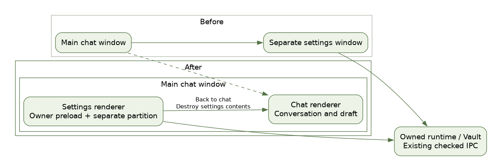
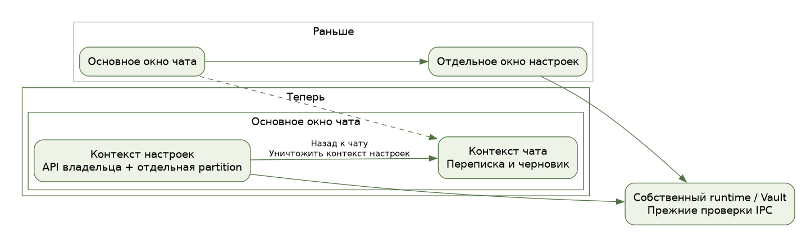

# Settings in the main desktop window

Desktop settings use a sandboxed owner renderer in a `WebContentsView` attached to the active chat `BrowserWindow`. The chat renderer stays loaded underneath it, so returning does not recreate the conversation, current project or unsent draft. The shared title/menu bar stays available. The settings sidebar has a Back to chat action available before and after unlocking Vault.

`desktop/settings-view.cjs` owns the view and its lifecycle. It retains the owner preload and separate session partition; popups, redirects, navigation, webviews and permissions remain denied. `isOwnerFrame` still requires the specific owner webContents, exact main frame and owner URL. The chat renderer does not receive the owner bridge. Native file dialogs use the containing BrowserWindow; notification/window IPC registers the owner renderer separately. Closing settings detaches and destroys its webContents, removes listeners and clears temporary private-MCP setup state. A late load completion cannot focus an old panel.

Browser, ChatGPT and OpenCode layout checks include the settings overlay. Closing the panel restores attached native surfaces using their existing layout APIs. Existing modal overlays remain independent.

The Node suite covers renderer identity, permission/navigation denial, content bounds, parent shutdown, renderer loss, repeated focus/close, late loads and layout routing. The native Electron scenario exercises actual main/preload/IPC/backend/Vault/Worker paths with a synthetic local provider, back navigation, retained drafts and reopening. It does not use owner credentials or live inference. Hosted platform and package acceptance is recorded separately in TestLOG.
