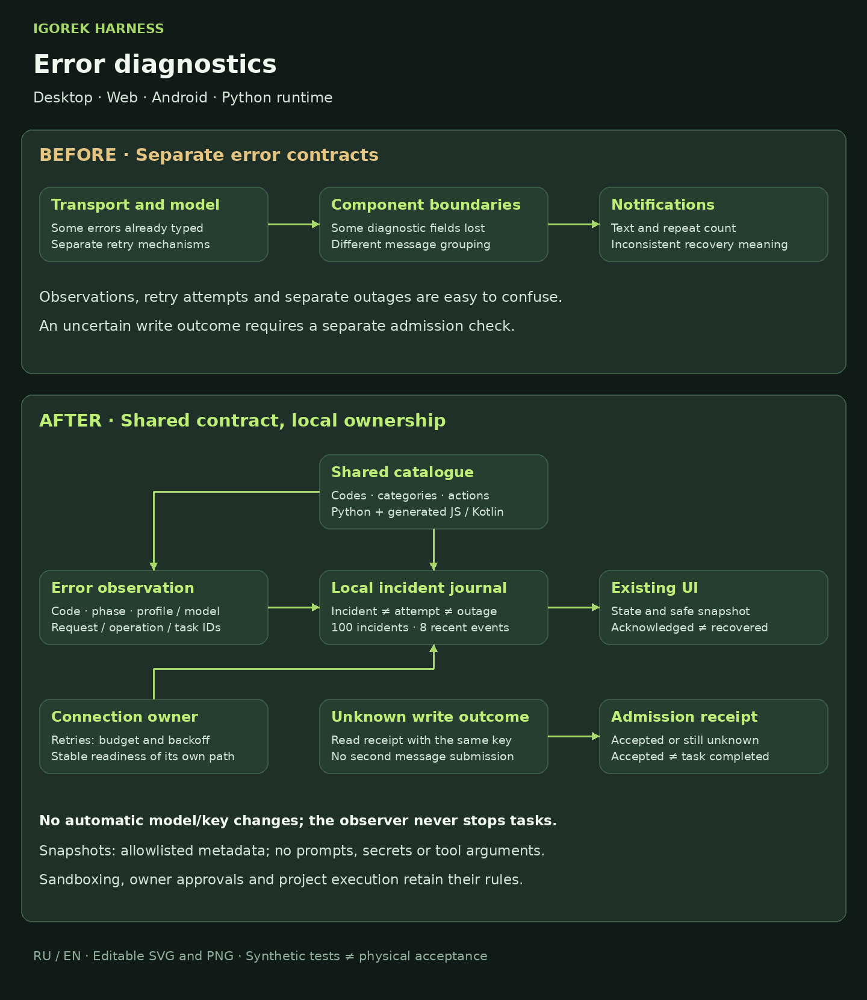
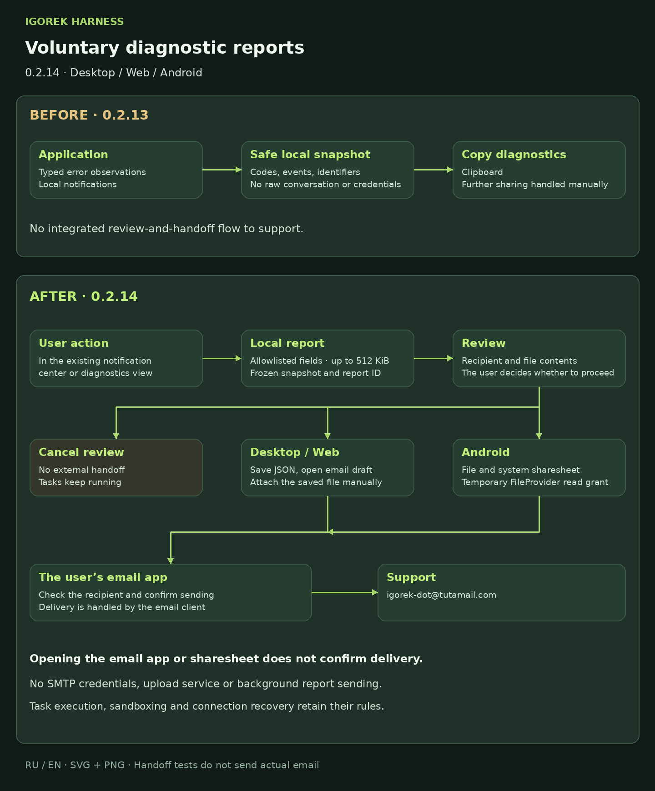

# Error diagnostics

## Contract and ownership

The canonical catalogue is `factory/config/error-catalog.json`. Run `python3 tools/generate_error_contract.py` after changing it or the shared browser implementation; `--check` verifies the generated desktop, web and Android copies. Schema version 1 is additive: legacy `error`, `message`, `code` and task-status fields retain their existing meaning. CC trace `domain.action` events and API/workflow events remain separate families.

Each observation carries a code, category, severity, recommended action, component, capability owner, endpoint role, operation, UTC timestamp and an event ID. Where available it retains session, task, tool-use, client-operation, HTTP-request and provider-request identifiers. A provider request ID is not an approval ID. Profile/model identity is captured at failure time; later selection changes do not relabel it. Native exception classes, transport phases and HTTP status drive classification. Browser fetch failures cannot reliably identify DNS, TLS or VPN causes and therefore preserve an unspecified transport failure.

## Incidents and recovery

An incident groups observations by owner, endpoint role, component, code and operation safety class. The observation count is not the number of distinct server outages and is not the automatic retry count. Attempts include the initial call and have their own attempt/next-retry fields. A recurrent failure after recovery creates a new incident. Reading a notification acknowledges it without resolving it; a further observation in that incident does not make it unread again.

Notification rows use the persistent incident ID, never the displayed text, as their UI identity. Separate incidents may have identical descriptions; acknowledgment, translation and history restoration preserve their IDs.

States are `observed`, `recovering`, `needs_owner` and `recovered`. The owning capability may recover its own incidents after five seconds of stable readiness, or after successful completion of the exact read operation. Merely opening a socket is insufficient. An HTTP success does not recover an unrelated event stream or model failure. Unknown write outcomes require an operation receipt instead of generic connectivity recovery. Stored recovery proof distinguishes readiness, completed reads and confirmed admission.

Activity snapshots report observed duration, recent progress and waiting for owner input. After 120 seconds without an observed progress event the snapshot says progress is unconfirmed; after 180 seconds of active work with recent events it may report long-running work. These are observer facts, not a diagnosis of a hung model. The monitor never stops, restarts or changes a user task.

## Retry and delivery safety

A logical operation has one retry owner. The common transient-read budget is three attempts including the initial request, a 30-second deadline, capped jittered backoff and a bounded `Retry-After`. A long server-directed delay can exhaust the deadline and prevent another attempt. Certificate rejection, authentication failure, cancellation, policy rejection and quota exhaustion are not blindly retried. No automatic model/key rotation or whole-task replay is added.

Android retries explicitly safe GET/HEAD operations with SDK connection retries disabled. Event streams have one reconnect loop, stable-ready confirmation and a cooldown after a short burst. Desktop/web use one event-stream reconnect owner. Closing or losing the client does not terminate admitted server work. An incomplete model stream cannot execute partially received tool arguments.

Delivery is `not_sent`, `accepted`, `rejected` or `unknown`; outcome is tracked separately. Losing the response to a write does not prove failure. An uncaught server exception during a write also preserves uncertainty. After a lost message response, web/Android perform a read-only receipt lookup using the same idempotency key. A matching recorded receipt confirms admission without sending the write again. Admission does not mean task completion. A missing receipt stays unknown. Manual retries of the same retained pending message reuse its key; only a bounded digest/key map is stored, without message text. Receipt retention and crash gaps do not constitute a universal exactly-once guarantee for arbitrary tools.

## Existing interfaces and diagnostics

The existing notification panels show a stable code/reference, incident state, first/last observation, count and known retry information. There is no additional permanent diagnostics panel. Desktop/web's existing diagnostic-copy action includes a safe snapshot; Android copies only the selected incident by long-pressing an existing notification; its overall report is a separate action. Localized descriptions do not determine incident identity.

Authenticated endpoints:

- `GET /mobile/v1/diagnostics`: bounded incident history, observer/writer health, version and observed task activity. Web proxy: `/api/diagnostics`.
- `GET /mobile/v1/operations/{key}?session_id={session_id}`: matching recorded admission receipt, or `recorded: false` / `status: unknown`. Web proxy: `/api/operations/{key}`. It neither admits nor replays work.

Diagnostics are local and owner-controlled. Journals retain at most 100 incidents and eight recent observations per incident, with bounded serialized output and retention/drop counters. Android stores history and pending keys in encrypted preferences per connection. The browser stores safe history in session storage and only pending-operation digests/keys in local storage. Desktop and backend write bounded local history. Backend incident files use private permissions and atomic replacement. Corrupt or unwritable storage appears in writer health; logging/formatting failures must not replace the original operation error.

Exports contain allowlisted metadata rather than raw prompts, tool arguments, response bodies, cookies, credentials, local endpoint URLs or private paths. Existing owner execution/approval inputs retain their original bytes and signatures; diagnostic redaction applies to diagnostic copies. Local diagnostic references are for correlation and are not authentication credentials. No external telemetry or paste service is introduced.

## Validation and limits

Shared classification fixtures run in Python, Node and Kotlin. Regression coverage includes certificate rejection, rate limiting and server errors, malformed responses, interrupted streams, admitted-write reconciliation without replay, retry budgets, flapping, ownership, acknowledgment, retention, corrupt history, failed storage and redaction. Android transport tests use a separate pinned local TLS fixture. Synthetic faults and hosted native builds are reported separately from physical-device VPN switching and Windows 11 acceptance. No classifier proves which VPN or remote network component caused an unspecified transport failure.

## Voluntary support reports

Users may explicitly prepare a diagnostic report for `igorek-dot@tutamail.com`. The destination is public project support contact metadata in the canonical catalogue; generated JS/Kotlin copies keep the platforms aligned. No mailbox credentials, SMTP client, upload service or automatic email delivery are added.

The report is a separate versioned, allowlisted JSON document with a report ID, UTC capture time, app version, surface and local/server snapshot availability. It includes bounded typed incidents, recent observations, writer health and observed activity where collected. It excludes arbitrary snapshot fields, raw messages, prompts, tool arguments, credentials, endpoint URLs and local paths. Unknown/missing snapshot availability stays explicit. Reports retain at most 100 incidents and eight recent observations per incident and are limited to 512 KiB; omissions are disclosed. File and email-subject references use the same report ID. Capturing a report does not acknowledge incidents, resolve errors or change task execution.

Desktop and Web expose the action inside the existing diagnostics/dashboard and notification surfaces. The user first reviews the exact frozen report and recipient. Desktop validates the main frame/origin, uses the native Save dialog, creates a new JSON file without overwriting existing files, then opens a fixed-recipient `mailto` draft. The email body contains only attachment instructions and the report reference. Users attach the saved file themselves. Cancelled/closed previews are checked before saving and before external handoff. A missing email handler leaves a saved report and a manual-send instruction. Standalone Web requests a JSON download and then offers an explicit email link; browsers cannot reliably attach a local file through `mailto`. Opening the preview alone never saves or sends a report. A failed/unreachable backend does not prevent the local report; the server snapshot read has a 2.5-second deadline.

Android retains long-press copying and adds an action inside the existing notification center. The preview is local and shows the destination and file contents. Only after the user chooses sharing does it write UTF-8 JSON into a dedicated app-private cache directory and create a FileProvider content URI. The system sharesheet receives an `ACTION_SEND` intent with the JSON URI, subject and recipient hint; the receiving app receives temporary read permission only. Users select a compatible app, check the recipient and confirm sending there. Cache retention is limited to ten report files. Closing the preview during preparation cancels the external handoff.

`composer_opened` and system sharing mean handoff, not delivery. Neither the application nor a model claims that an email reached the support inbox. Tests intercept the composer/chooser boundary and do not send actual mail. Physical mail-app/Tuta behavior and delivery require separate owner-driven acceptance.

## Android compact exports (0.1.117 / 118)

Notification long-press exports only that incident, with an 8 KiB UTF-8 bound. The separate overview preview/copy/share path uses schema version 2 and a 32 KiB bound: at most ten unresolved details (unknown outcomes and owner attention first), twelve grouped summaries, and recovered history from the last 24 hours. Each detailed incident retains the latest observation and at most four earlier observations encoded as fields differing from that latest observation; explicit null marks a field absent in the earlier event. Correlation references, actual observation counts, UTC times, recovery proof and writer health remain available. Empty metadata and duplicate latest events are omitted. Truncation, missing detail/event/group counts and excluded older recoveries are explicit; the bounds do not mark failures recovered or alter task state. The existing bounded journal and internal schema-1 snapshot remain available to local diagnostic code; desktop/web export contracts are unchanged.

## Android notification admission (0.1.118 / 119)

Timeline rendering is passive: history loading and session navigation never admit diagnostic observations. The bridge observes failures only after the stream's replay boundary and persisted processed-sequence guard. A known nonempty event ID cannot resurrect its recovered incident. Typed source diagnostics retain their identity; legacy live task failures use ERROR.UNKNOWN with task/session/source references rather than INTERNAL.UNEXPECTED presentation errors. Terminal task events do not duplicate an existing diagnostic for that same task. Explicit user-input/MCP failures enter the same persistent journal at the operation boundary. On restoration, only legacy local_ui/display/presentation records with ui:timeline: owners are removed; original task history and genuine typed incidents remain. Acknowledgment does not assert recovery, and replay/navigation after clearing does not recreate past events.
