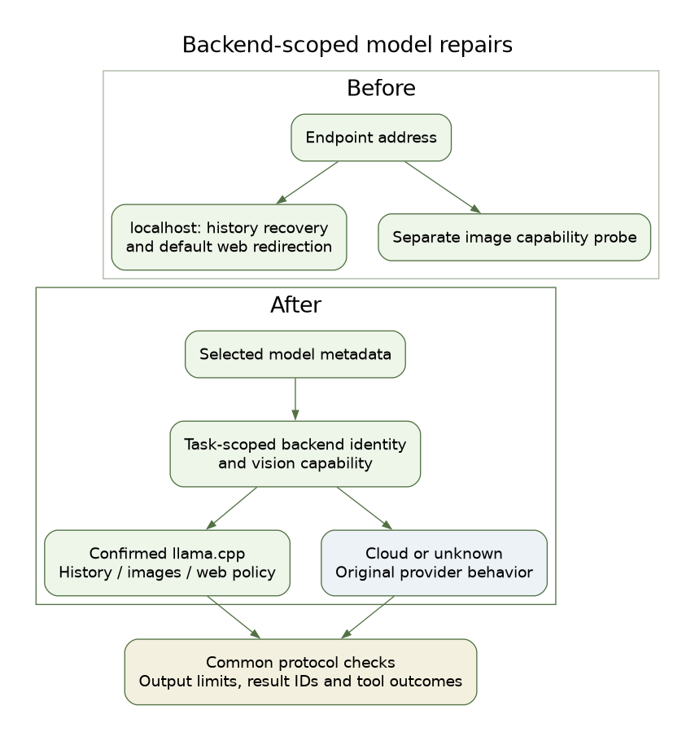
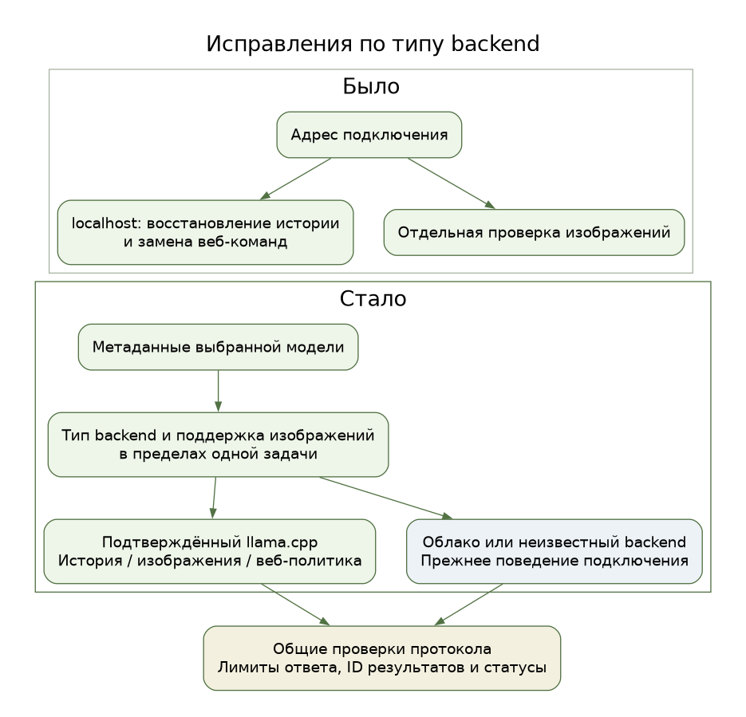
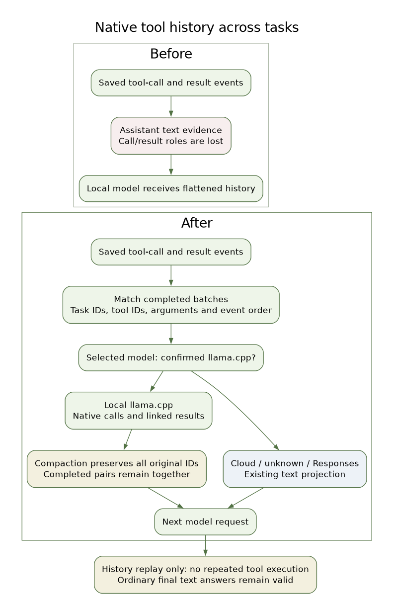
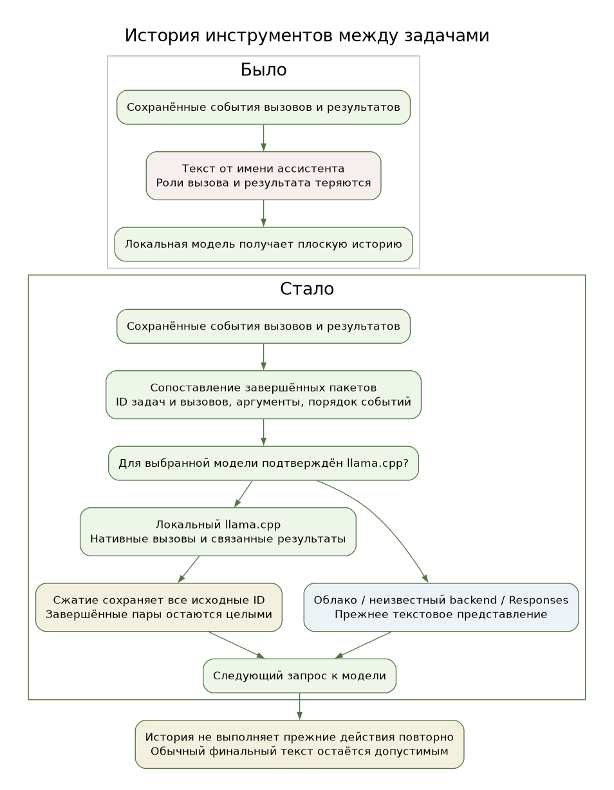

# Model backend identity and runtime outcomes

[Editable English SVG](backend-guards-en.svg). [Editable Graphviz source](backend-guards-en.dot).

The executor owns one task-scoped capability resolver for the selected model.
A matching llama.cpp model record identifies the engine independently of vision
support. A selected cloud model, an ambiguous record or a mismatched model
cannot inherit unrelated server-wide properties. The props fallback requires a
matching selected alias and llama.cpp fields. Unknown metadata leaves local
repairs inactive. Observations are cached within the task and do not invoke
generation; there is no global capability cache.

The descriptor binds identity to the model and endpoint path. History recovery,
image policy and default Bash web redirection consume the same observation.
The executor passes it to SSE processing before any visible text delta. The
stream transport performs no independent address-based inference. Existing
explicit web-redirection profile policy remains available. Supported API formats
and loopback transport scope remain unchanged; this is not a LAN capability
extension. No new environment toggle or model-name/phrase heuristic is used.

Common protocol invariants are independent of these local corrections. An
output-limit state retains partial text and usage, stops incomplete tool calls
and returns an explicit incomplete outcome. A synthesis response determines its
own terminal task status. Already completed artifact operations retain factual
fallback acknowledgements. Native result receipts and explicit envelope fields
supply success/failure; opaque content remains unknown. An unknown outcome does
not become failure because it is short. Error results keep their native call ID.

The lexical fact checker is retired from execution; compatibility imports
abstain rather than claiming that free-form prose is factually verified.
Compaction protects unconsumed tool/result pairs and uses exact delivered-result
IDs from completed model requests to release its preservation guards. Historical
trace formats remain readable. Existing approval and cancellation boundaries,
ordinary text-only final answers and configured loop budgets remain in place.

## Russian diagram

[Редактируемый SVG](backend-guards-ru.svg). [Исходник Graphviz](backend-guards-ru.dot).

The diagrams describe backend selection and data flow. They do not claim a
universal correctness guarantee for model answers or automatic recovery from
promise-only replies. Verification uses synthetic provider metadata, real local
HTTP/SSE test servers and compatibility tests; live cloud accounts and physical
devices are separate acceptance boundaries.

## Native tool history across tasks in 0.2.37

[Editable English SVG](native-tool-history-en.svg). [Graphviz source](native-tool-history-en.dot).

Durable tool-request and result events carry typed history sidecars alongside
existing text evidence. The executor projects complete batches into native
calls and results only for the selected model's confirmed loopback llama.cpp.
Cloud connections, unidentified backends and Responses keep the existing text
projection. No model/user prose is parsed into historical calls, and replaying
history does not execute completed actions.

Pairing checks task/tool identity, arguments, event order and delivery anchor.
Wire IDs are namespaced across tasks; batch order and explicit error outcomes
are retained. Missing, duplicated, ambiguous, interleaved or partly summarized
batches keep their existing evidence instead of inventing a native exchange.
Compaction tracks every original record behind a projected batch and archives
those origins, preventing covered records from returning in later tasks.

Ordinary text-only final answers remain valid. There is no promise-phrase
filter or forced tool choice. Structural and HTTP/SSE tests establish history
preservation; no live-model generation A/B establishes that every premature
text-only completion disappears.

[Редактируемый SVG](native-tool-history-ru.svg). [Исходник Graphviz](native-tool-history-ru.dot).
