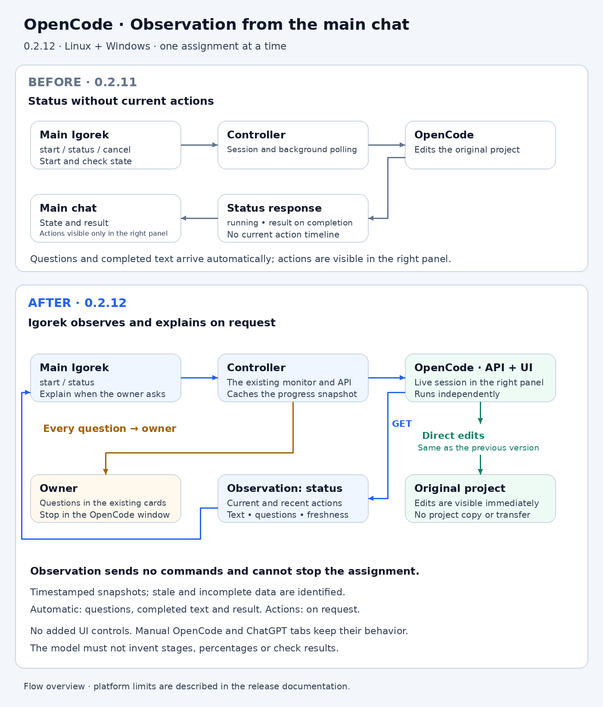

# OpenCode delegation

Linux and Windows x64 desktop can delegate one explicitly requested task to the installed
OpenCode 2.0.27 service while keeping the main conversation available. The
`opencode_task` tool supports start, status and cancellation. It never exposes
an operation for answering owner questions or granting permissions to the model.

The Python runtime captures the current Git workspace, including tracked dirty
files and nonignored untracked files, in an independent repository without
remotes or shared Git metadata. Private control paths, local context, environment
secrets and ignored artifacts are excluded. Symlinks and submodules are refused
instead of silently exporting a partial or externally writable tree. Snapshot
size and file-count limits apply.

The Electron parent validates the source against existing owner project grants.
It starts a separate OpenCode process sandbox with a disposable task copy and
a separate profile capability. Linux uses bubblewrap mounts and a private
network namespace. Windows uses a restricted token, low mandatory integrity,
a private desktop, explicit inherited standard handles and a kill-on-close
process Job Object. The Windows runner grants writes to its disposable workspace
and service data; it does not add write grants to the original project. Where
required, it grants non-inheriting metadata/traversal access to ancestor
directories so native path resolution works, without listing their contents.
These temporary grants are revoked when the process sandbox closes. It opens that exact session in the existing
right panel. The session title is `Поручение: <title>`; no extra panel or status
bar is added. Opening OpenCode manually restores its original service and saved
navigation. Manual service configuration and running sessions are preserved.

The Windows x64 runtime includes a native pipe adapter in these sandboxed
processes and their x64 children. Default named pipes receive the restricted
token's default DACL, allowing captured command output without granting the
token access to private host files. Explicit pipe descriptors are preserved.
The adapter does not change token restrictions or file permissions. A child
whose adapter cannot be loaded is terminated before its entry point runs.

Delegations are durable records, not active tasks in the main conversation queue.
A runtime monitor reads the session outcome, message timeline, pending forms and
permission requests. Every pending request is displayed through the existing
chat input-card mechanism. Answers use the exact run, session and request IDs;
plain conversation messages cannot accidentally answer OpenCode. Replying in
OpenCode resolves the corresponding main-chat card. Form values retain their
types, and permission replies are limited to one-time approval or rejection.

Completed assistant text is relayed without classifying its importance or trying
to recognize questions in prose. External text is historical evidence, not a
source of instructions or permissions. After successful execution, changed
files are compared against the captured source baseline before application.
Conflicting source files stop the entire transfer. The copy remains available
when transfer fails. A single result turn is queued after the current main-chat
turn completes; it reports the outcome without starting more delegated work.

Transient transport failures re-read the existing session rather than submitting
another prompt. Stable request keys protect repeated tool delivery. Closing the
panel does not stop the service. Owner lock and application exit stop delegated
services. Restarted runtimes mark unfinished records interrupted and do not
relaunch them: OpenCode pending forms are process-local and cannot be recovered
after a server restart. Cancellation interrupts execution without resuming queued
input, and does not roll back files already changed in the task copy.

This path requires host desktop execution, an installed OpenCode binary, Git in
PATH, an already granted Git project and an available verified provider profile.
The existing OpenCode settings install the pinned official platform binary with
SHA-512 verification. Windows uses authenticated loopback API/profile transports;
provider secrets remain in the host proxy. Windows does not provide the Linux
network namespace or KVM isolation. Host-services MCP and KVM modes remain
Linux-only. Delegation does not support arbitrary non-Git directories.

The Windows manual route uses its own service and owner-selected projects, with
separate temporary filesystem grants that are revoked on shutdown. It runs at
medium integrity to preserve direct project editing. Assignment processes use
low integrity and a separate copy. Choosing OpenCode manually restores manual
navigation and does not attach typing to the assignment session.

The diagrams show the prior independent manual route and the new automatic
assignment flow. ChatGPT tabs remain independent; this feature does not add an
automatic ChatGPT worker.

[Editable English SVG](../images/opencode-delegation-en.svg) ·
[Russian diagram](../images/opencode-delegation-ru.png) ·
[Editable Russian SVG](../images/opencode-delegation-ru.svg)
