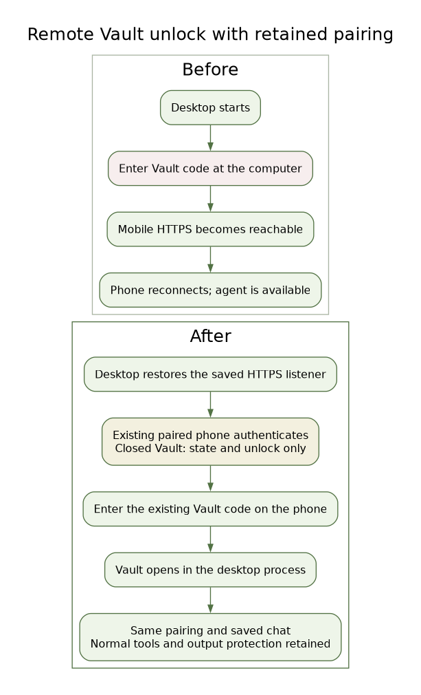
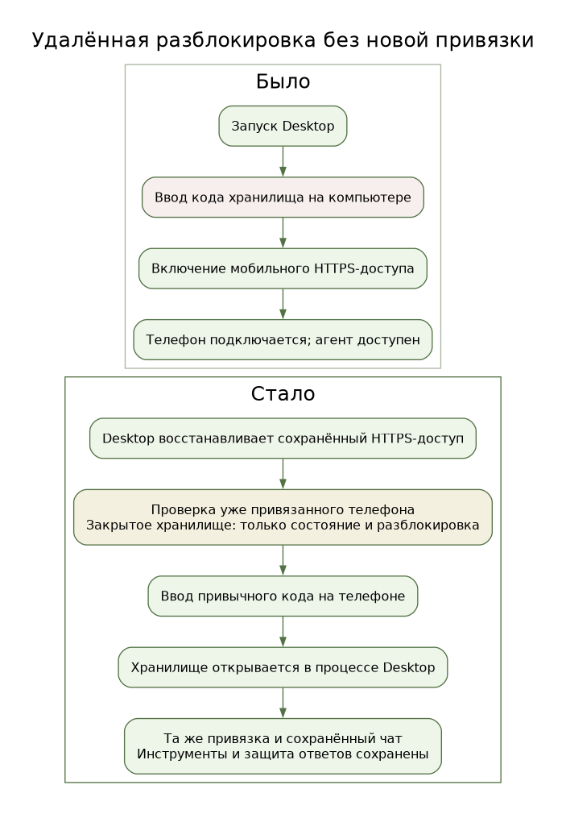

# Remote Vault unlock

Desktop 0.2.44 and Android 0.1.140 (141) let an existing paired phone unlock
the Vault after Desktop restarts. The code is the same one used at the desktop;
there is no separate remote password and no new QR pairing.

[Editable SVG](remote-vault-unlock-en.svg) · [Graphviz source](remote-vault-unlock-en.dot).

## Connection and authorization

Desktop restores only previously enabled mobile access, with its saved address,
port, certificate and device-token database. These transport identities already
live independently of the Vault encryption key. An app restart does not enable
mobile access that the owner disabled. The local desktop Web UI still starts
through its existing owner path.

An authenticated phone can read `GET /mobile/v1/vault/status`. A closed Vault
permits only this state endpoint and native HTTPS
`POST /mobile/v1/vault/unlock` with an exact `{password: <existing code>}` object.
The server refuses anonymous/revoked devices, browser Origins and plaintext
unlock requests. Closed-state pairing, history, files, tools and event replay
remain blocked. Remote creation or recovery is not exposed.

The existing owner lifecycle performs decryption, serialized with owner
operations. Five failed unlock attempts within sixty seconds temporarily block
further guesses; successful bearer authentication does not reset this limit.
Vault control requests use a separate connection pool with no idle sockets, so
a restarted Desktop cannot leave an obsolete socket available for the unlock
write. TLS pinning remains unchanged; unlock writes are not automatically
retried. The response contains only minimal Vault state. Passwords are not placed in
URLs, chat messages, preferences, diagnostic events or release artifacts. The
input clears on submission and is not saved across activity recreation.

After opening, the phone reconnects to the ordinary event stream and retained
chat. No code prompt appears for an ordinary network reconnect while the Vault
remains open. A later Desktop restart or explicit full Vault lock requires the
same code again. Full lock closes privileged voice/terminal channels and event
streams while keeping the restricted unlock listener reachable.

## Upgrade order

Install the Android update first; it remains compatible with an older Desktop
that returns 404 for Vault state. Then update and restart Desktop. Existing
pairing and certificate pinning are retained. Do not restart a remote owner's
Desktop until the new phone client is installed and this flow has passed
acceptance. The owner enters the code in the native phone form, never in chat.

Desktop must be running and its configured network address reachable. This
feature does not provide operating-system startup or recovery after a machine
power failure. Normal tool permissions and the 0.2.43 internal-history output
guard remain in force.

## Verification

Regression coverage uses a temporary encrypted Vault, real HTTPS, persisted
paired-device authentication, denied data routes, wrong codes, throttling,
concurrent unlocks and owner-state propagation. The native Android acceptance
uses the real UI and a separate actual desktop backend process, restarts that
process, then unlocks again without replacing pairing or losing the saved
session. The native helper is retained for acceptance; the existing CI runs the
new Python and Android unit regressions alongside its Linux/Windows platform
and package checks. Synthetic accounts and an emulator are distinct from
physical-device acceptance.

[Редактируемый SVG](remote-vault-unlock-ru.svg) · [Исходник Graphviz](remote-vault-unlock-ru.dot).
