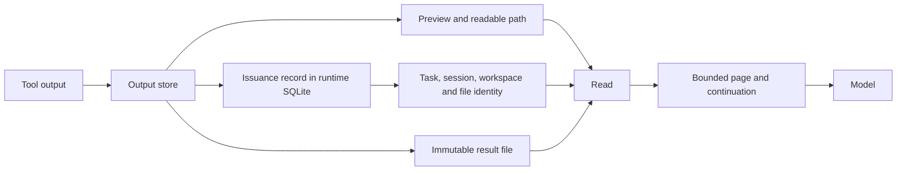
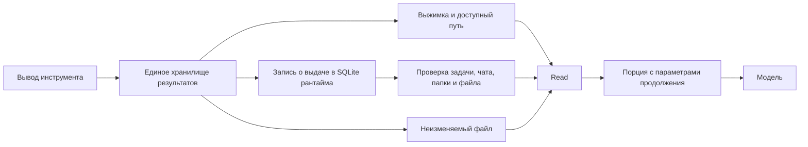

# Bounded reads and recoverable tool output

The output store owns archived results and their issuance records. `Read` owns
bounded text delivery. Provider adapters receive the same ordinary tool results;
they do not implement their own archive or permission policy.

Previously, the store could advertise a runtime path outside the project while
workspace-mode `Read` rejected that path. Reading a large result through another
tool could save the same text again. Oversized reads could also return only an
error, forcing the caller to guess a smaller range.

The SQLite `tool_result_archives` table is initialized lazily by the output
owner in the existing runtime database. It binds a path to its issuing task,
session, canonical workspace and regular-file identity. An explicit executor
`data_root` selects its durable database, including isolated execution. It is
runtime context, never an argument accepted from the model.

A registered result may extend workspace-mode reading for its task or a later
task in the same nonempty session and workspace. Existing control-path checks
still run. Opening pins the regular file and rejects changed identities,
symlinks and special files. The grant does not affect mutation tools or widen
the workspace. User-selected broader filesystem modes retain their policy.

Older per-result archives are enrolled only from an owning runtime's structured
spill event. A matching task/session and workspace, the runtime artifact root,
an actual reduced result and the advertised path must agree. The legacy scan
is bounded to 16 MiB of the trace; plain tool/model/user text cannot grant
access. Legacy aggregate-only pointers without such evidence are not enrolled.

`Read` keeps zero-based line offsets. Its optional character cursor continues
inside the starting line. Pages preserve Unicode and normalized newline
semantics, include continuation inside their character budget, and respect
explicit line limits. Complete small reads remain plain text. The default cap
is 16,000 characters, rising to 32,000/64,000 for 100k/200k context windows;
small windows and the round's shared output allowance can lower it.

Read output is already bounded and is excluded from repeated persistence.
Internal bounded-result metadata is removed before provider serialization.
Other tool outputs retain the existing threshold and preview behavior.

An archive is reused only for identical bytes. A reused invocation identity
with different bytes produces a different archive rather than replacing an
earlier reference. Saving and issuance registration must succeed before the
runtime promises a readable path. Failure reports unavailable full output and
does not imply that the original action failed or should be replayed.

Workspace cleanup retains new archives while the owning task or session is in
durable history. Legacy execution directories with archives are protected while
their task remains recorded. Removing history permits normal age-based cleanup;
explicit external deletion is reported as unavailable output, not a permission
grant or an automatic replay request.

## Русская схема

