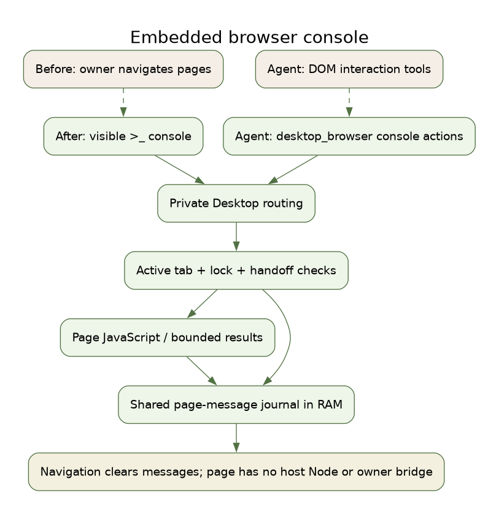

# Embedded browser console

Desktop 0.2.39 adds a compact console to ordinary embedded browser tabs.
Open a browser tab and click **>_** in its toolbar. Page messages appear above
a JavaScript input. Enter submits; Shift+Enter inserts a newline. Clear removes
the page-message journal and the panel's current command history. Closing the
panel stops polling; switching tabs destroys its view. The page remains open.

The active agent uses the existing `desktop_browser` tool:

```json
{"action":"console","expression":"({title:document.title, canvas:document.querySelector('canvas')?.getBoundingClientRect()})"}
{"action":"console_messages","level":"error","limit":200,"after":0}
{"action":"console_clear"}
```

`console` evaluates JavaScript in the active page's main world and awaits a
returned Promise. It can inspect or change the DOM and call page APIs, including
`console.log`. This is not a host shell: the page receives neither Node nor the
owner application's IPC bridge. Top-level `await` statements should be wrapped
in an async function, for example `(async()=>{return await fetch('/data').then(r=>r.json())})()`.
Normal website/network behavior still applies to code executed in that page.

Expressions are limited to 16000 characters. `timeout_ms` defaults to 3000 and
accepts integers from 100 through 5000. Results use bounded JSON serialization:
cycles, accessors, functions, large/deep objects and unsupported values have
compact representations rather than unlimited inspection. Elements expose a
short DOM summary; DOM rectangles expose x/y/width/height. This console does
not provide breakpoints, a network inspector, a full object explorer or
persistent DevTools sessions. Close a debugger already attached to that tab
before evaluating expressions through this console.

`console_messages` reads copies of journal entries in ascending sequence order.
Optional `after` is a nonnegative safe integer, `limit` is 1..200, and `level` is
`debug`, `info`, `warning` or `error`. Entries contain sequence, normalized level,
message, source path and line number; source URL credentials, query and fragment
are removed. The journal retains at most 200 entries, truncates each message at
4000 characters and reports overflow. `console_clear` preserves sequence order.
The journal lives in RAM and clears on main-frame navigation and destruction.
Normal chat/tool trace retention remains unchanged; sensitive page data should
be handled with the same care as other browser-tool results.

Both owner and agent paths verify the active tab and current page. Locking,
navigating or switching tabs invalidates pending results. Existing manual
handoff settings still apply to agents; the owner can use the console while
holding manual control. A timeout stops the owned evaluation and releases its
debugger, allowing later commands. This does not undo side effects already
performed by JavaScript.

After upgrading, fully quit and relaunch Desktop, then reopen chat to load the
new runtime/tool schema. Restart a separately managed runtime/gateway first.
No profile reimport or model-server restart is required for this feature.



[Editable SVG](../architecture/browser-console-en.svg).
[Graphviz source](../architecture/browser-console-en.dot).
