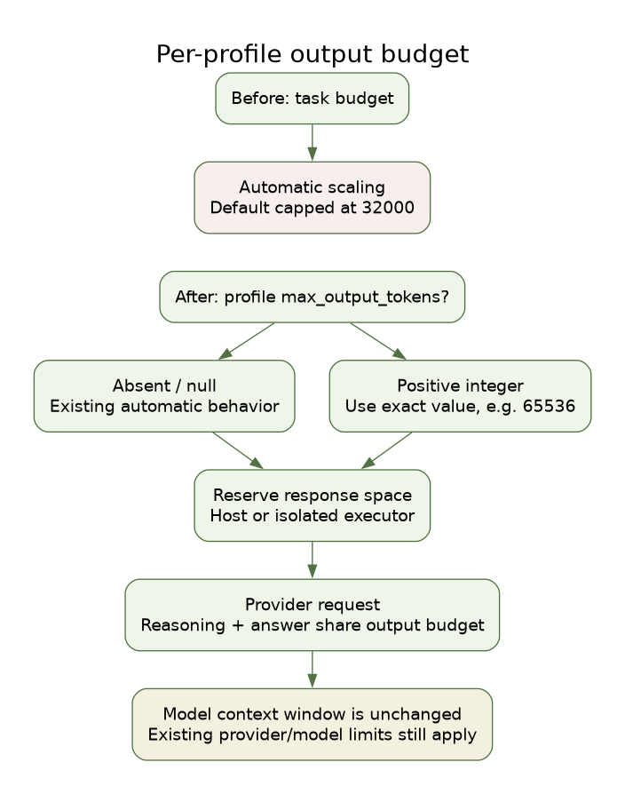

# Per-profile model output budget

Since 0.2.38, a `cc-backend` JSON profile may set a top-level
`max_output_tokens` field:

```json
{
  "name": "example-model",
  "backend": "cc-backend",
  "provider": "custom",
  "model": "example-model",
  "base_url": "http://127.0.0.1:8081/v1",
  "api_format": "openai",
  "max_output_tokens": 65536
}
```

The value is an exact positive integer budget for **each model response**,
including reasoning, visible text and tool-call output. It overrides the task's
legacy output budget and bypasses its automatic scaling, including for values
below 4000. There is no application cap of 32000 or 65536 on explicit values.
Model/provider constraints still apply. This option does not limit reasoning
separately or guarantee that a complete answer fits in the budget.

Omit the field or set it to `null` to preserve previous automatic budgeting.
Boolean values, strings, fractions, zero and negative values are rejected.
No profile is rewritten automatically. Other backends keep their own settings.

The worker forwards the option through both host and isolated execution. The
executor converts it to the selected protocol's normal output-budget field;
for OpenAI Chat Completions this is `max_tokens`. Subsequent model rounds keep
the same budget. Internal context-summary and short auxiliary requests retain
their separate budgets. Compaction reserves at least the configured response
space. The provider's context window must still accommodate the prompt and
response together; the setting neither enlarges that window nor allocates KV
cache. Excessive settings may leave insufficient input space or be refused by
the provider; they are not silently reduced to a guessed limit.

After installing the new version, fully restart Desktop to load its bundled
runtime and reopen chat. Restart separately managed runtime/gateway processes
before chat. Then edit the desired profile and start a new task with that
profile. An in-flight request keeps its original budget. No model conversion,
llama.cpp rebuild or llama-server restart is required for this client option.



[Editable SVG](../architecture/profile-output-budget-en.svg).
[Graphviz source](../architecture/profile-output-budget-en.dot).
