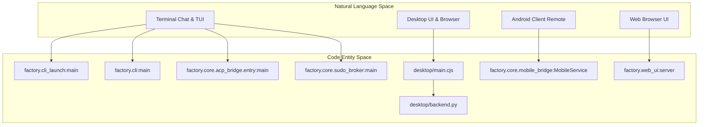
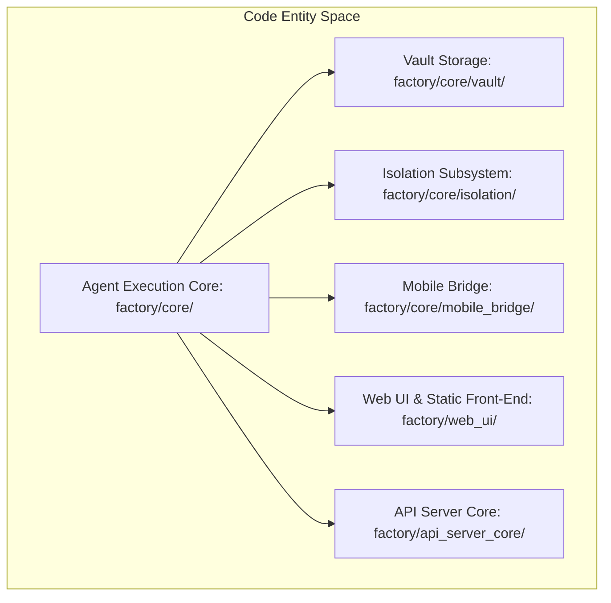

# Overview

Relevant source files

The following files were used as context for generating this wiki page:

- [AGENTS.md](AGENTS.md)
- [README.md](README.md)
- [README.ru.md](README.ru.md)
- [desktop/release-updates.cjs](desktop/release-updates.cjs)
- [docs/PROJECT_LAYOUT.md](docs/PROJECT_LAYOUT.md)
- [docs/architecture/ISOLATION.md](docs/architecture/ISOLATION.md)
- [docs/architecture/POLICY.md](docs/architecture/POLICY.md)
- [docs/architecture/RICH_CLI_RENDERING_EXPLAINED.md](docs/architecture/RICH_CLI_RENDERING_EXPLAINED.md)
- [docs/architecture/cli-after.png](docs/architecture/cli-after.png)
- [docs/architecture/cli-after.svg](docs/architecture/cli-after.svg)
- [docs/architecture/cli-before-after.png](docs/architecture/cli-before-after.png)
- [docs/architecture/cli-before.png](docs/architecture/cli-before.png)
- [docs/architecture/cli-before.svg](docs/architecture/cli-before.svg)
- [docs/development/CROSS_PLATFORM_DESKTOP.md](docs/development/CROSS_PLATFORM_DESKTOP.md)
- [docs/development/FIRST_RUN_ACCEPTANCE.md](docs/development/FIRST_RUN_ACCEPTANCE.md)
- [factory/core/cc_backend_executor.py](factory/core/cc_backend_executor.py)
- [factory/core/cc_backend_trace.py](factory/core/cc_backend_trace.py)
- [factory/core/openai_responses.py](factory/core/openai_responses.py)
- [pyproject.toml](pyproject.toml)
- [tests/test_openai_responses.py](tests/test_openai_responses.py)

Igorek-Harness is a personal AI agent platform featuring multiple user interfaces—including an Electron desktop application (`desktop/`), an Android client (`android/`), terminal CLI/TUI modes (`factory/core/`), and an HTTPS web UI (`factory/web_ui/`)—all backed by a unified Python core (`factory/`) [README.md:16-20](), [docs/PROJECT_LAYOUT.md:6-28](). 

The system provides robust agent execution loops, task scheduling, encrypted credential management via Vault [factory/core/vault/](), and sandbox isolation subsystems [factory/core/isolation/]().

### System Architecture & Entrypoints

The following diagram maps high-level user interaction spaces to concrete code entry points and execution entrypoints in the codebase:

Sources: [pyproject.toml:47-52](), [docs/PROJECT_LAYOUT.md:30-35]()

### Core Python Subsystems & UI Layers

Sources: [docs/PROJECT_LAYOUT.md:6-18]()

---

## 1.1. Getting Started & Project Layout

The Igorek-Harness project is managed using `uv` for Python dependencies (`pyproject.toml`, `uv.lock`) and `npm` for the Electron desktop application. Project entrypoints are registered under `[project.scripts]` in `pyproject.toml`, exposing `igorek`, `igorek-factory`, `factory-acp`, and `igorek-sudo` [pyproject.toml:25-52](). 

The repository separates runtime code into dedicated directories: `factory/core/` houses agent execution logic, `desktop/` handles Electron main processes and rendering, `android/` contains the Kotlin/Compose mobile application, and `docs/` stores comprehensive architecture references [docs/PROJECT_LAYOUT.md:6-28]().

For detailed installation guides, dependency specifications, and a complete repository layout map, see [Getting Started & Project Layout](#1.1).

Sources: [pyproject.toml:1-61](), [docs/PROJECT_LAYOUT.md:1-30]()

---

## 1.2. Repository Conventions & Contribution Rules

Development on the repository follows strict guidelines outlined in `AGENTS.md`. Key policies include English as the primary language for code comments, documentation, and commit messages, alongside strict privacy boundaries (never staging private keys, Vault data, or logs) [AGENTS.md:1-24](). Verification requires locked dependency sync (`uv sync --locked --dev`) and running test suites with test result tracking in `docs/development/TestLOG.md` [AGENTS.md:64-74]().

For complete contribution rules, release checklists, documentation structures, and third-party license notices, see [Repository Conventions & Contribution Rules](#1.2).

Sources: [AGENTS.md:1-120]()
