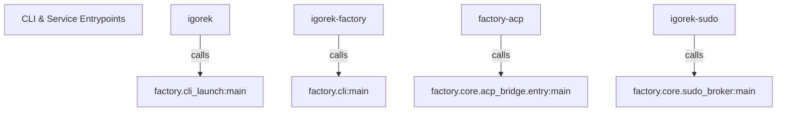
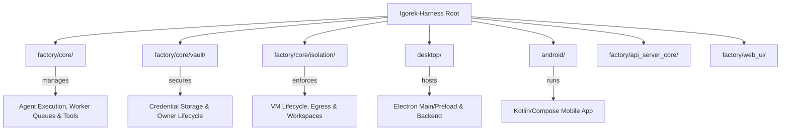

# Getting Started & Project Layout

Relevant source files

The following files were used as context for generating this wiki page:

- [docs/PROJECT_LAYOUT.md](docs/PROJECT_LAYOUT.md)
- [docs/architecture/ISOLATION.md](docs/architecture/ISOLATION.md)
- [docs/architecture/POLICY.md](docs/architecture/POLICY.md)
- [docs/architecture/RICH_CLI_RENDERING_EXPLAINED.md](docs/architecture/RICH_CLI_RENDERING_EXPLAINED.md)
- [docs/development/CROSS_PLATFORM_DESKTOP.md](docs/development/CROSS_PLATFORM_DESKTOP.md)
- [docs/development/FIRST_RUN_ACCEPTANCE.md](docs/development/FIRST_RUN_ACCEPTANCE.md)
- [factory/cli_launch.py](factory/cli_launch.py)
- [factory/core/cc_backend_executor.py](factory/core/cc_backend_executor.py)
- [factory/core/cc_backend_trace.py](factory/core/cc_backend_trace.py)
- [factory/core/openai_responses.py](factory/core/openai_responses.py)
- [pyproject.toml](pyproject.toml)
- [tests/test_openai_responses.py](tests/test_openai_responses.py)
- [uv.lock](uv.lock)

## Purpose and Scope

This page covers the installation procedures, dependency management via `pyproject.toml` [pyproject.toml:1-61]() and `uv.lock` [uv.lock:1-733](), application entry points (`igorek`, `igorek-factory`, `factory-acp`, `igorek-sudo`), the repository's directory layout, and the core documentation map. It provides the foundational technical orientation required to build, run, and navigate the Igorek-Harness codebase.

---

## 1. Installation & Dependencies

Igorek-Harness requires **Python >=3.13** [pyproject.toml:32-32]() and utilizes [uv](https://github.com/astral-sh/uv) for deterministic, fast virtual environment creation and dependency locking via `uv.lock` [uv.lock:1-733]().

### Dependency Configuration (`pyproject.toml`)

The build system relies on `setuptools` [pyproject.toml:1-3]() with packaging configured for the `factory` package namespace [pyproject.toml:8-10](). Bundled assets (such as profiles, YAML configs, web static files, and MCP server scripts) are explicitly declared under package data [pyproject.toml:13-23]().

Key runtime dependencies managed in `pyproject.toml` include:
* `agent-client-protocol` (>=0.9.0,<1.0) [pyproject.toml:41-41]() for ACP integration.
* `cryptography` (>=42.0.0) [pyproject.toml:39-39]() for Vault encryption and secure storage.
* `pydantic` (>=2.7.0) [pyproject.toml:40-40]() for structured configuration and payload validation.
* `rich` [pyproject.toml:36-36]() and `prompt-toolkit` [pyproject.toml:37-37]() for terminal user interface rendering.
* `pywinpty` (==3.0.5) conditionally loaded for Windows (`sys_platform == 'win32'`) [pyproject.toml:44-44]() to support ConPTY terminal hosting.

Development dependencies (`dev` dependency group) include testing frameworks and code-quality tools (`pytest`, `pytest-cov`, `ruff`, `tree-sitter`) [pyproject.toml:53-61]().

Sources: [pyproject.toml:1-61](), [uv.lock:1-733]()

---

## 2. Command-Line and Service Entrypoints

The project exposes four primary console scripts declared in `pyproject.toml` [pyproject.toml:47-52](). Each script maps directly to a specific Python execution target handling CLI lifecycle, TUI chat, ACP bridging, or privileged isolation tasks.

*Figure 1: Natural Language Space to Code Entity Mapping for Console Entrypoints*

### Entrypoint Catalogue
1. **`igorek`**: Maps to `factory.cli_launch:main` [pyproject.toml:48-48](). Serves as the primary user-facing terminal invocation for starting interactive CLI chat sessions and daemon controllers.
2. **`igorek-factory`**: Maps to `factory.cli:main` [pyproject.toml:49-49](). Invokes the full agent factory management interface and profile configurations.
3. **`factory-acp`**: Maps to `factory.core.acp_bridge.entry:main` [pyproject.toml:50-50](). Implements the Agent Client Protocol bridge for editor integrations.
4. **`igorek-sudo`**: Maps to `factory.core.sudo_broker:main` [pyproject.toml:51-51](). Operates the privileged isolation and host operations broker required for restricted sandbox executions.

Sources: [pyproject.toml:47-52]()

---

## 3. Repository Layout & Directory Structure

The repository separates runtime core components, desktop applications, mobile clients, and testing harnesses into distinct directories [docs/PROJECT_LAYOUT.md:1-29]().

*Figure 2: Code Domain Mapping of Project Directories*

### Directory Responsibility Summary

| Directory | Responsibility |
| --- | --- |
| `factory/core/` | Agent execution loops, worker queues, prompts, sessions, and core policies [docs/PROJECT_LAYOUT.md:8-15] |
| `factory/core/vault/` | Credential storage, cryptographic keys, owner lifecycle, and broker permissions [docs/PROJECT_LAYOUT.md:9-9] |
| `factory/core/isolation/` | Sandbox VM lifecycle, host/guest protocol, egress controls, and workspace boundaries [docs/PROJECT_LAYOUT.md:10-10] |
| `factory/core/mobile_bridge/` | Authenticated mobile REST/WS session API [docs/PROJECT_LAYOUT.md:11-11] |
| `factory/core/realtime_voice/` | Voice session handlers and transport layers [docs/PROJECT_LAYOUT.md:12-12] |
| `factory/core/acp_bridge/` | Editor integration through the Agent Client Protocol [docs/PROJECT_LAYOUT.md:14-14] |
| `factory/core/tui/` | Terminal rendering widgets, cells, frame buffers, and mouse controllers [docs/PROJECT_LAYOUT.md:15-15] |
| `factory/web_ui/` | HTTPS server and shared desktop/Web UI chat renderers [docs/PROJECT_LAYOUT.md:16-16] |
| `factory/api_server_core/` | Separate inference API and workflow orchestration implementations [docs/PROJECT_LAYOUT.md:17-17] |
| `desktop/` | Electron main process, preload scripts, UI controllers, and managed Python backend [docs/PROJECT_LAYOUT.md:21-21] |
| `android/` | Kotlin/Compose client, JVM unit tests, and instrumented device tests [docs/PROJECT_LAYOUT.md:25-25] |
| `tools/` | Repository compliance checks, isolated test runners, and clean-source build helpers [docs/PROJECT_LAYOUT.md:27-27] |
| `docs/` | Architecture guides, developer runbooks, integration specs, and operational guides [docs/PROJECT_LAYOUT.md:28-28] |

Sources: [docs/PROJECT_LAYOUT.md:1-29]()

---

## 4. Documentation Map & Core Architecture Specs

The `docs/` tree defines the operational and architectural contracts of the system:
* **`docs/architecture/POLICY.md`**: Defines inference API policies, executable guard modes (`strict`, `standard`, `trusted`, `full`), and file/command controls [docs/architecture/POLICY.md:1-46]().
* **`docs/architecture/ISOLATION.md`**: Outlines host/guest isolation boundaries, virtiofs workspace mounting, egress rules, and sandbox verification procedures [docs/architecture/ISOLATION.md:1-100]().
* **`docs/development/FIRST_RUN_ACCEPTANCE.md`**: Details the bootstrap acceptance guidelines for unlocking the Vault, establishing model connections, and executing the first verified task [docs/development/FIRST_RUN_ACCEPTANCE.md:1-56]().
* **`docs/development/CROSS_PLATFORM_DESKTOP.md`**: Outlines platform contracts between primary Linux x64 targets and Windows x64 preview targets (including Vault leasing, DACLs, and ConPTY integration) [docs/development/CROSS_PLATFORM_DESKTOP.md:1-91]().

Sources: [docs/architecture/POLICY.md:1-46](), [docs/architecture/ISOLATION.md:1-100](), [docs/development/FIRST_RUN_ACCEPTANCE.md:1-56](), [docs/development/CROSS_PLATFORM_DESKTOP.md:1-91]()
