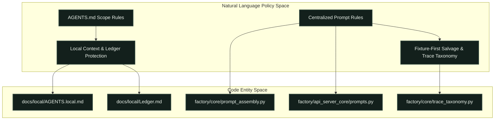
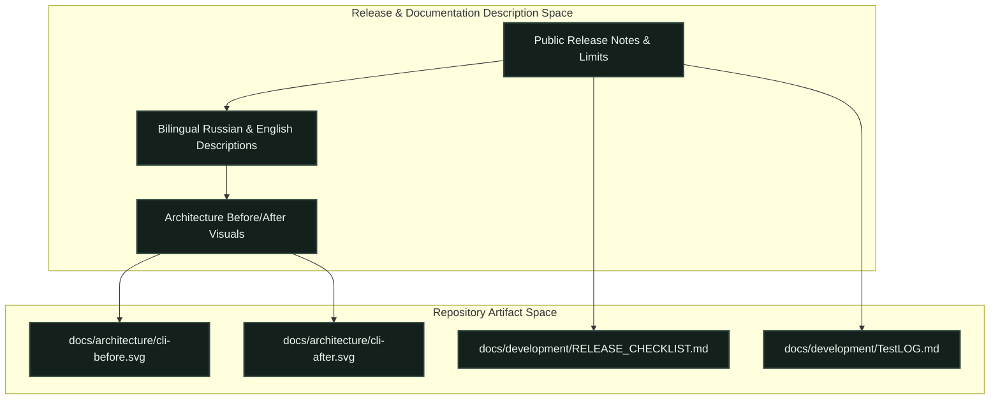
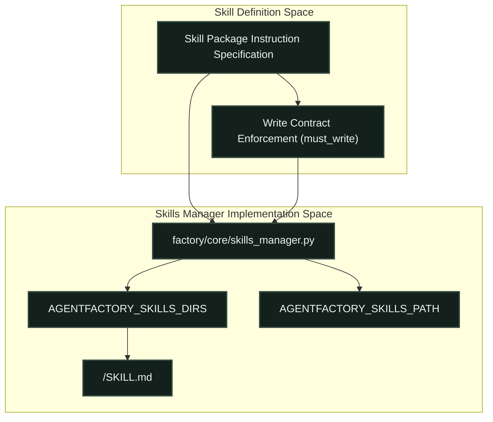

# Repository Conventions & Contribution Rules

<details>
<summary>Relevant source files</summary>

The following files were used as context for generating this wiki page:

- [AGENTS.md](AGENTS.md)
- [docs/architecture/cli-after.png](docs/architecture/cli-after.png)
- [docs/architecture/cli-after.svg](docs/architecture/cli-after.svg)
- [docs/architecture/cli-before-after.png](docs/architecture/cli-before-after.png)
- [docs/architecture/cli-before.png](docs/architecture/cli-before.png)
- [docs/architecture/cli-before.svg](docs/architecture/cli-before.svg)
- [docs/development/RELEASE_CHECKLIST.md](docs/development/RELEASE_CHECKLIST.md)
- [docs/development/SKILLS.md](docs/development/SKILLS.md)
- [docs/images/README.md](docs/images/README.md)
- [docs/licenses/DETOURS-LICENSE.txt](docs/licenses/DETOURS-LICENSE.txt)

</details>


This page defines the canonical conventions, operational rules, documentation standards, skill packaging specifications, release validation checklists, and third-party license management policies governing the Igorek-Harness codebase.

---

## AGENTS.md Operational Rules & Scope Boundaries

The root `AGENTS.md` file [AGENTS.md:1-129]() establishes mandatory behavioral guidelines for human contributors and automated agents working within the repository. English is designated as the primary language for source code comments, docstrings, reusable skills, commit messages, and technical documentation [AGENTS.md:3-5]. User-facing translations and responses must preserve the user's spoken language [AGENTS.md:5].

Operational boundaries strictly limit unverified task execution:
* **Subagent Restrictions**: Automated agents are prohibited from launching subagents or external agent tasks without explicit user authorization [AGENTS.md:10].
* **Local Context Protection**: Ignored machine-specific records (`docs/local/AGENTS.local.md`, `docs/local/handoff.md`, and `docs/local/Ledger.md`) contain unfinished work and previous checks [AGENTS.md:17-19]. Contributors must preserve deferred work locally and never stage archive paths, cryptographic keys, Vault data, databases, logs, personal task artifacts, or toolchains [AGENTS.md:20-21].
* **Staging Hygiene**: Contributors must stage specific reviewed file paths individually; wildcard staging (`git add .`) is strictly forbidden [AGENTS.md:22].


*Title: Policy to Code Entity Mapping*
Sources: `AGENTS.md:7-61`, `factory/core/prompt_assembly.py`, `factory/api_server_core/prompts.py`, `factory/core/trace_taxonomy.py`

---

## Documentation Structure & Public Release Requirements

Public documentation belongs in `docs/`, while root READMEs and discovery files remain in standard locations [AGENTS.md:27]. Public release notes must describe user-visible behavior, usage patterns, supported platforms, and strict operational limits without exposing private engineering discussions, internal reference comparisons, or unapproved origin notes [AGENTS.md:104-108].

When an architectural change occurs, maintainers must embed a clear before/after diagram alongside a technical explanation within the release descriptions [AGENTS.md:119-121]. Release descriptions must be provided in concise Russian and English with matching semantic meaning [AGENTS.md:116].


*Title: Documentation & Architecture Diagram Association*
Sources: `AGENTS.md:102-121`, `docs/development/RELEASE_CHECKLIST.md:1-54`, `docs/architecture/cli-before.svg`, `docs/architecture/cli-after.svg`

---

## Skills Packaging and Discovery Architecture

Skills are modular instruction packages loaded by `factory/core/skills_manager.py` [docs/development/SKILLS.md:3-5]. Installed user skills and optional integrations reside separately from the core source package [docs/development/SKILLS.md:4-5].

### Package Format & Discovery
Every skill package must keep its entry point at `<skill-name>/SKILL.md` [docs/development/SKILLS.md:9-10]. Supporting scripts and assets remain adjacent to the entry point [docs/development/SKILLS.md:10-11]. Frontmatter YAML blocks inside `SKILL.md` declare metadata and execution contracts, such as `must_write: true`, which enforces a write tool call verification requirement before completion acceptance [docs/development/SKILLS.md:14-24].

Package discovery is managed by evaluating `AGENTFACTORY_SKILLS_DIRS` or the legacy `AGENTFACTORY_SKILLS_PATH` environment overrides [docs/development/SKILLS.md:28-30]. If no overrides are set, the manager scans the local data directory's `skills/` folder [docs/development/SKILLS.md:29-31].


*Title: Skill Discovery and Loading Data Flow*
Sources: `docs/development/SKILLS.md:1-41`, `factory/core/skills_manager.py`

---

## Release Readiness & Verification Checklist

Stable product releases and source publications are distinct milestones managed via `docs/development/RELEASE_CHECKLIST.md` [docs/development/RELEASE_CHECKLIST.md:1-4].

### CI Commands & Locked Dependencies
Contributors must execute tests using locked dependencies under identical conditions to CI [AGENTS.md:64-71]:
```bash
uv sync --locked --dev
uv run --no-sync python -u tools/run_tests.py --coverage
npm --prefix desktop ci
npm --prefix desktop test
```

Test results, collected subtests, code coverage metrics, and native UI checks must be permanently recorded in `docs/development/TestLOG.md` [AGENTS.md:73-75]. Skipping or removing test failures to manufacture a green test suite is strictly prohibited [AGENTS.md:75].

---

## Third-Party Notices and Component Licenses

Igorek-Harness integrates selective third-party codebases, tools, and headers, which require strict preservation of copyright notices and license files beside their associated assets [AGENTS.md:28, 109]. 

For example, Windows binary injection and function hooking utilize Microsoft Detours, governed by the MIT License [docs/licenses/DETOURS-LICENSE.txt:1-24]. Contributors must never strip license notices, copyright headers, or third-party attribution blocks when modifying or packaging vendored runtime components [AGENTS.md:109].

Sources: `docs/licenses/DETOURS-LICENSE.txt:1-24`, `AGENTS.md:28`
