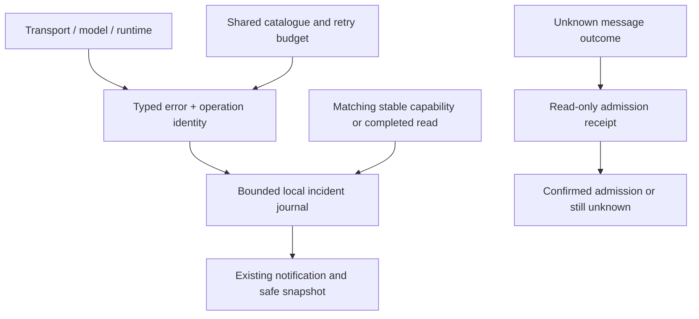

# Error diagnostics and unreliable networks

Igorek separates a failed operation, an interrupted connection and an unknown outcome. A disconnected phone or desktop does not imply that an admitted task stopped on the server.

## What does the count mean?

“100 observations” means that the application registered the same incident repeatedly. It does not establish 100 separate server outages. An incident has first/last observation times and a separate state; automatic attempts have their own counters and next-attempt time when known. A new failure after recovery starts a new incident.

Separate incidents can have identical descriptions. Android keeps their persistent identifiers distinct when displaying the notification center, including after an application update; clearing application data is unnecessary.

## What happens automatically?

Safe reads may retry within a bounded budget. Event streams reconnect with backoff and a cooldown. Recovery requires stable readiness or completion of the exact failed read; one working connection cannot clear another capability's error. Rejected certificates and authorization/policy errors require attention rather than repeated attempts. The system does not automatically switch your model, rotate credentials or restart your task.

A lost response to sending a message leaves the outcome unknown. The client checks a read-only server receipt using the original operation key. A matching receipt confirms admission without resending the message; it does not mean the task finished. If no receipt can be established, the result stays unknown. Retained manual retries reuse the pending key. This is not a universal exactly-once guarantee for arbitrary writes or tools.

## What can I see?

On Android, recovered incidents disappear automatically from the notification list and bell count, including incidents saved before the update. Recent recoveries remain in a grouped overview; its action is available even when the list is empty. Unresolved incidents remain visible.

Existing notifications show codes, references, state and known attempt information. Reading a notification does not mark the connection recovered. Diagnostic activity distinguishes recent progress, waiting for your answer, long-running work and unconfirmed progress; the observer cannot stop work. The current model/profile identity remains attached to its original failure.

Use the existing diagnostic-copy action on desktop/web. On Android, long-press a notification to copy only that incident as readable, structured JSON. The snapshot contains bounded metadata, recent observations and diagnostic-writer health, without raw prompts, tool input, tokens or private connection addresses. No automatic diagnostic upload is configured.

Android 0.1.117 (118): a card long-press copies one incident, at most 8 KiB, with a plain-language explanation, state, UTC times, correlation IDs and up to four earlier events. The latest event is stored once; earlier events contain only differing fields (null means absent in that earlier event). Empty fields are omitted and missing references are never invented. A short confirmation explicitly says that only this incident was copied.

The separate **Overall diagnostic report** action previews a report of at most 32 KiB. It includes up to ten unresolved incidents, prioritizes unknown outcomes and incidents needing attention, and groups recovered incidents from the last 24 hours by typed error/component/endpoint/status/native type. Groups contain occurrence counts and first/last times rather than repeated full events. At most twelve groups are included; omitted details/events/groups and excluded older recoveries are counted. The local journal still retains at most 50 incidents and eight observations per incident. **Copy overall report** copies the exact preview; sharing remains a separate explicit action.

### Historical events and read state on Android

Android 0.1.118 (119): opening a saved chat or switching between sessions does not create new failure observations. Notification admission occurs at the live-event boundary, after stream replay and processed-sequence checks. Known event IDs cannot reopen recovered incidents. Task failures without typed diagnostics are reported as an unknown task error, not an invented internal display failure. The update removes only legacy notification copies whose structural origin is timeline presentation; original chat/task history and genuine model/transport diagnostics remain.

**Mark read** acknowledges the notification and removes it from the unread count. It does not assert that a failed task succeeded or that a connection recovered. Read state survives navigation and history restoration. **Clear** removes retained notifications; reopening old history or replaying its events does not recreate them. A genuinely new failure still appears. Input/attachment errors use the same persistent journal as other notifications, so the overall report and bell refer to the same entries.

## Data flow

The canonical [contract](https://github.com/Endorpheen/Igorek-Harness/blob/main/docs/architecture/ERROR_DIAGNOSTICS.md) specifies the codes, retention, API and limits. The authenticated bridge exposes `GET /mobile/v1/diagnostics` and `GET /mobile/v1/operations/{key}?session_id={session_id}`. The web UI proxies them through `/api/diagnostics` and `/api/operations/{key}`. These endpoints do not restart or replay work.

## Acceptance boundaries

Python, Node and Android tests exercise deterministic faults, receipt matching, redaction, storage failure and retry limits. Android also uses a pinned local TLS transport fixture. Physical VPN transitions and physical Windows 11 acceptance require separate testing; synthetic tests do not prove them. An unspecified browser transport error does not identify the VPN as its cause.

## Send a report to support voluntarily

The support address is **igorek-dot@tutamail.com**. Nothing is uploaded automatically. Use **Send diagnostics** inside the existing notification center or diagnostics/dashboard, review the report and recipient, and then choose whether to continue. Existing copying remains available.

- **Linux / Windows:** choose a new JSON filename in the Save dialog. Igorek opens an email draft; attach the saved file and describe the problem. If there is no configured email app, the file remains saved for manual sending.
- **Web:** request the JSON download, then use the displayed email link and attach the saved file yourself.
- **Android:** open the notification center and choose its diagnostics action. Review the local report, then choose **Share report**. Select an email app in the system sharesheet, check the recipient and confirm sending there. Other share targets may ignore the recipient hint.

Reports contain version/platform references, typed error codes and operation IDs, profile/model identity, bounded incident history and writer health. Raw conversation text, tool arguments, keys, private endpoint URLs and local file paths are excluded. Desktop/web support files remain limited to 512 KiB. Android overall reports are limited to 32 KiB and selected-incident copies to 8 KiB; omitted history is marked. A disconnected backend does not prevent exporting local observations. Cancelling the preview does not send a report.

Opening the email app or sharesheet is **not delivery confirmation**. Igorek does not log in to the support mailbox or send mail on your behalf. Actual email delivery and physical mail-app/Tuta behavior are not covered by synthetic tests.

## Android error presentation

System and task failure messages are displayed only in the notification center. Chats, session lists and operation dialogs do not repeat them inline. The bell is also available outside a chat, including the connection screen. Connection state, approval requests and ordinary task progress remain in their existing places. Quiet background event-stream timeouts retain their existing visibility policy and remain available in diagnostics.

### MCP tool failures

Upstream MCP tool results marked `isError=true` retain that status in the grep.app stdio bridge. Failure text is not prefixed with a claim that real search results were returned. The live service can still reject requests; this is reported as unavailable, not as a successful search.
