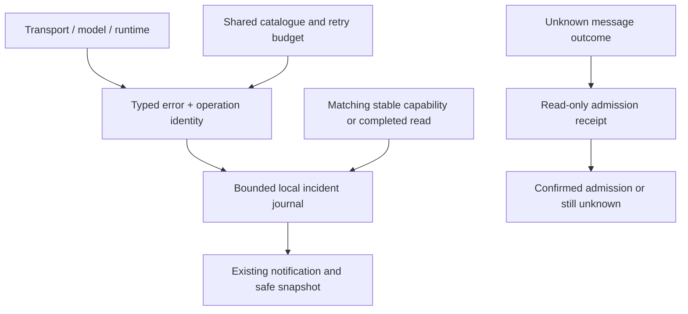

# Error diagnostics and unreliable networks

Igorek separates a failed operation, an interrupted connection and an unknown outcome. A disconnected phone or desktop does not imply that an admitted task stopped on the server.

## What does the count mean?

“100 observations” means that the application registered the same incident repeatedly. It does not establish 100 separate server outages. An incident has first/last observation times and a separate state; automatic attempts have their own counters and next-attempt time when known. A new failure after recovery starts a new incident.

## What happens automatically?

Safe reads may retry within a bounded budget. Event streams reconnect with backoff and a cooldown. Recovery requires stable readiness or completion of the exact failed read; one working connection cannot clear another capability's error. Rejected certificates and authorization/policy errors require attention rather than repeated attempts. The system does not automatically switch your model, rotate credentials or restart your task.

A lost response to sending a message leaves the outcome unknown. The client checks a read-only server receipt using the original operation key. A matching receipt confirms admission without resending the message; it does not mean the task finished. If no receipt can be established, the result stays unknown. Retained manual retries reuse the pending key. This is not a universal exactly-once guarantee for arbitrary writes or tools.

## What can I see?

Existing notifications show codes, references, state and known attempt information. Reading a notification does not mark the connection recovered. Diagnostic activity distinguishes recent progress, waiting for your answer, long-running work and unconfirmed progress; the observer cannot stop work. The current model/profile identity remains attached to its original failure.

Use the existing diagnostic-copy action on desktop/web. On Android, long-press a notification to copy the local safe snapshot. The snapshot contains bounded metadata, recent observations and diagnostic-writer health, without raw prompts, tool input, tokens or private connection addresses. No automatic diagnostic upload is configured.

## Data flow

The canonical [contract](https://github.com/Endorpheen/Igorek-Harness/blob/main/docs/architecture/ERROR_DIAGNOSTICS.md) specifies the codes, retention, API and limits. The authenticated bridge exposes `GET /mobile/v1/diagnostics` and `GET /mobile/v1/operations/{key}?session_id={session_id}`. The web UI proxies them through `/api/diagnostics` and `/api/operations/{key}`. These endpoints do not restart or replay work.

## Acceptance boundaries

Python, Node and Android tests exercise deterministic faults, receipt matching, redaction, storage failure and retry limits. Android also uses a pinned local TLS transport fixture. Physical VPN transitions and physical Windows 11 acceptance require separate testing; synthetic tests do not prove them. An unspecified browser transport error does not identify the VPN as its cause.
