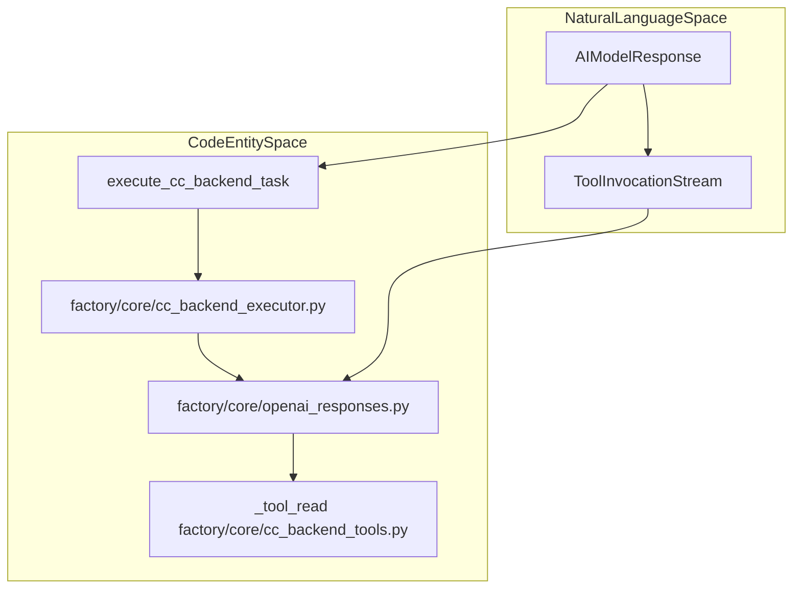
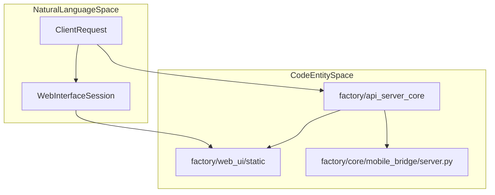

# Python Agent Core (factory/)

Relevant source files

The following files were used as context for generating this wiki page:

- [desktop/tests/session-summary.test.cjs](desktop/tests/session-summary.test.cjs)
- [docs/images/session-sources-flow.png](docs/images/session-sources-flow.png)
- [docs/images/session-sources-flow.svg](docs/images/session-sources-flow.svg)
- [factory/core/cc_backend_executor.py](factory/core/cc_backend_executor.py)
- [factory/core/cc_backend_tools.py](factory/core/cc_backend_tools.py)
- [factory/core/cc_backend_trace.py](factory/core/cc_backend_trace.py)
- [factory/core/mobile_bridge/server.py](factory/core/mobile_bridge/server.py)
- [factory/core/openai_responses.py](factory/core/openai_responses.py)
- [factory/core/worker.py](factory/core/worker.py)
- [pyproject.toml](pyproject.toml)
- [tests/test_cc_backend_read_tool.py](tests/test_cc_backend_read_tool.py)
- [tests/test_openai_responses.py](tests/test_openai_responses.py)

The `factory/` package houses the Python backend for Igorek-Harness, serving as the execution engine for AI agent tasks, secure workspace isolation, credential management, web APIs, and background processing. It coordinates interactions between local/remote language models, tool invocation loops, and operating system sandboxes.

For details on individual subsystems, see the child sections below:
- [Model Execution Loop and Wire Adapters](#2.1)
- [Isolation Subsystem & Checkpoints](#2.2)
- [Vault & Secrets](#2.3)
- [API Server Core & Web UI](#2.4)
- [Workers, Scheduler and Runtime](#2.5)

---

## 2.1 Model Execution Loop and Wire Adapters

The model execution subsystem manages multi-turn tool interaction loops, translating provider payloads and handling streaming responses. The core execution loop is driven by `execute_cc_backend_task` in `factory/core/cc_backend_executor.py`, which dispatches requests to compatible endpoints, processes `tool_use` blocks, and feeds execution results back to the model until a terminal response is reached [factory/core/cc_backend_executor.py:1-6](). 

Wire adapters such as `factory/core/openai_responses.py` transform internal message structures into provider-specific Server-Sent Events (SSE) payloads while filtering unsupported options [factory/core/openai_responses.py:1-60](). The module also implements diagnostic routines for TLS failures, transport timeouts, and structured tracing via `factory/core/cc_backend_trace.py` [factory/core/cc_backend_trace.py:28-50]().

Sources: [factory/core/cc_backend_executor.py:1-6](), [factory/core/openai_responses.py:1-60](), [factory/core/cc_backend_trace.py:28-50](), [factory/core/cc_backend_tools.py:1-10]()

For details, see [Model Execution Loop and Wire Adapters](#2.1).

---

## 2.2 Isolation Subsystem & Checkpoints

The isolation subsystem located in `factory/core/isolation/` provides robust workspace boundaries using containerization primitives like Bubblewrap (`bwrap`) on Linux, restricted security tokens on Windows, and strict network egress controls. It implements broker mechanisms for host operations, workspace snapshots, and checkpoint management to roll back uncommitted changes or apply readonly git views [factory/core/worker.py:71-76]().

For details, see [Isolation Subsystem & Checkpoints](#2.2).

Sources: [factory/core/worker.py:71-76]()

---

## 2.3 Vault & Secrets

The `factory/core/vault/` package handles encrypted storage of API keys and environment variables, featuring cryptographic utilities, content scanning detectors for secrets leakage, log redaction engines, and secure environment importing [factory/core/worker.py:77-79]() [pyproject.toml:39](). It prevents accidental credential exposure across logs, sub-agent traces, and network requests.

For details, see [Vault & Secrets](#2.3).

Sources: [factory/core/worker.py:77-79](), [pyproject.toml:39]()

---

## 2.4 API Server Core & Web UI

The API layer inside `factory/api_server_core` implements provider runtimes (Anthropic, OpenRouter), workflow engines, and security policy evaluators. It interfaces directly with the static front-end assets and server controllers bundled under `factory/web_ui/` [pyproject.toml:19-23]().

Sources: [pyproject.toml:19-23](), [factory/core/mobile_bridge/server.py:1-30]()

For details, see [API Server Core & Web UI](#2.4).

---

## 2.5 Workers, Scheduler and Runtime

Background processing is managed by worker loops defined in `factory/core/worker.py`. The worker daemon leases queue tasks, maintains runtime mutex locks, runs scheduled agent assignments, and reclaims stuck or dead tasks using database-backed transaction controls [factory/core/worker.py:3-17]().

For details, see [Workers, Scheduler and Runtime](#2.5).

Sources: [factory/core/worker.py:3-17]()
