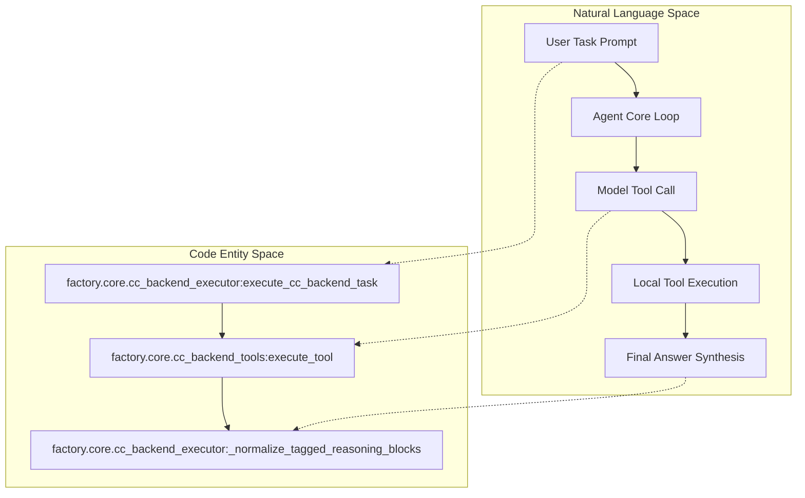
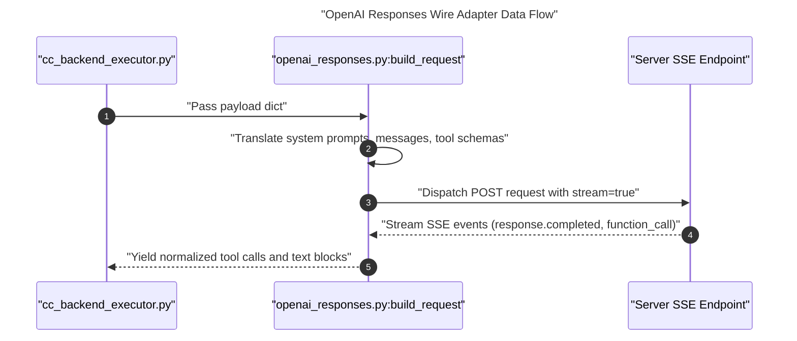

# Model Execution Loop and Wire Adapters

Relevant source files

The following files were used as context for generating this wiki page:

- [factory/core/cc_backend_executor.py](factory/core/cc_backend_executor.py)
- [factory/core/cc_backend_trace.py](factory/core/cc_backend_trace.py)
- [factory/core/openai_responses.py](factory/core/openai_responses.py)
- [pyproject.toml](pyproject.toml)
- [tests/fixtures/context_overflow/llama_server.json](tests/fixtures/context_overflow/llama_server.json)
- [tests/test_cc_backend_context_window.py](tests/test_cc_backend_context_window.py)
- [tests/test_openai_responses.py](tests/test_openai_responses.py)

## Purpose and Scope

This page covers the model execution loop and protocol adapters that drive LLM interactions within the Python agent core (`factory/`). The core orchestrator manages multi-turn tool execution, translates wire formats via SSE adapters, evaluates transport failure diagnostics, and emits trace events.

As a parent page, this section provides a high-level architectural overview. For deep implementation details on context management or tool policies, refer to the child pages:
- [Context Compaction & Session History](#2.1.1)
- [Tools, Prompts and Policy](#2.1.2)

Sources: `factory/core/cc_backend_executor.py:1-6`, `factory/core/openai_responses.py:1-3`

---

## Multi-Turn Execution Loop (`execute_cc_backend_task`)

The core execution engine is centered around `execute_cc_backend_task` in `factory/core/cc_backend_executor.py`. This function manages the multi-turn conversation lifecycle by issuing requests to the LLM backend, receiving `tool_use` directives, executing local tools via `execute_tool`, and passing outputs back in a loop until the model yields a text-only or terminating response [factory/core/cc_backend_executor.py:1-6]().

*Figure 1: Mapping high-level agent turns to execution loop code entities.*

Sources: `factory/core/cc_backend_executor.py:1-181`, `factory/core/cc_backend_tools.py:1-30`

---

## OpenAI Responses SSE Wire Adapter

The `factory/core/openai_responses.py` module acts as a specialized wire adapter for the OpenAI Responses API format, translating native internal structures (such as tool inputs, messages, reasoning blocks, and images) into compliant SSE requests while filtering out unsupported Chat Completions knobs [factory/core/openai_responses.py:1-60]().

*Figure 2: Sequence of request translation and SSE response handling.*

Sources: `factory/core/openai_responses.py:1-137`, `tests/test_openai_responses.py:56-78`

---

## Retries, TLS & Transport Diagnostics

Transport failures and network irregularities are handled via resilient retry logic and diagnostic helpers. The function `_is_transient_network_error` in `factory/core/cc_backend_executor.py` inspects error codes and string patterns to determine if a connection drop, name resolution failure, or timeout is safe to retry [factory/core/cc_backend_executor.py:117-150]().

For detailed diagnostics, `model_failure_diagnostics` in `factory/core/cc_backend_trace.py` extracts structured telemetry on TLS error types (`tls_error_type`, `tls_reason`), transport phases, and HTTP status categories [factory/core/cc_backend_trace.py:28-50]().

Sources: `factory/core/cc_backend_executor.py:110-150`, `factory/core/cc_backend_trace.py:12-50`

---

## Tracing and Telemetry

Execution telemetry is managed through context variables and scoped decorators. The `scoped_agent_trace` wrapper in `factory/core/cc_backend_trace.py` injects hierarchical session identifiers (`root_session_id`, `agent_session_id`, `subagent_id`) into execution contexts [factory/core/cc_backend_trace.py:86-112](). Trace events are appended asynchronously via `append_cc_backend_trace` adhering to the `CcTraceEvent` taxonomy [factory/core/cc_backend_executor.py:26]().

Sources: `factory/core/cc_backend_trace.py:86-112`, `factory/core/cc_backend_executor.py:26`

---

## Child Pages

For more information on specific subsystem components, refer to the following child pages:
- **[Context Compaction & Session History](#2.1.1)** — Covers reactive compaction, context window token resolution, changes tracking, and automated summaries.
- **[Tools, Prompts and Policy](#2.1.2)** — Covers `cc_backend_tools`, prompt assembly, approval and permission workflows, command guards, and file access policies.

Sources: `factory/core/cc_backend_executor.py:30-52`
