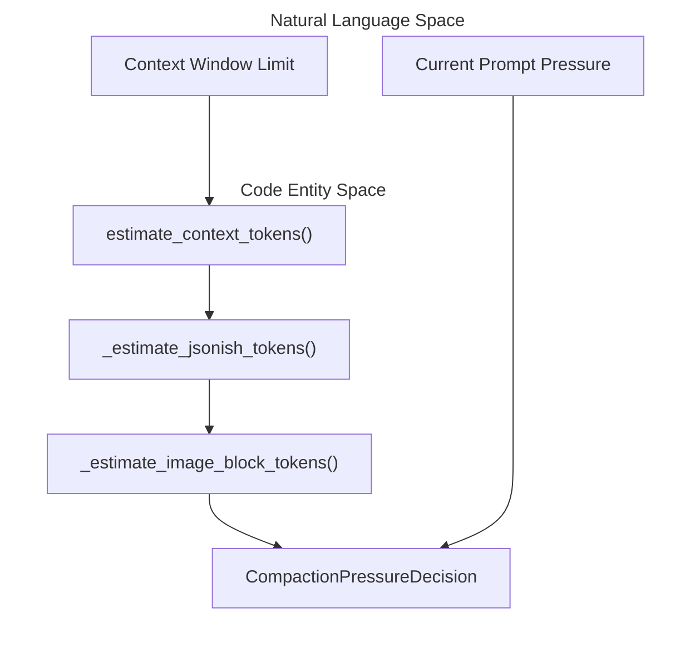
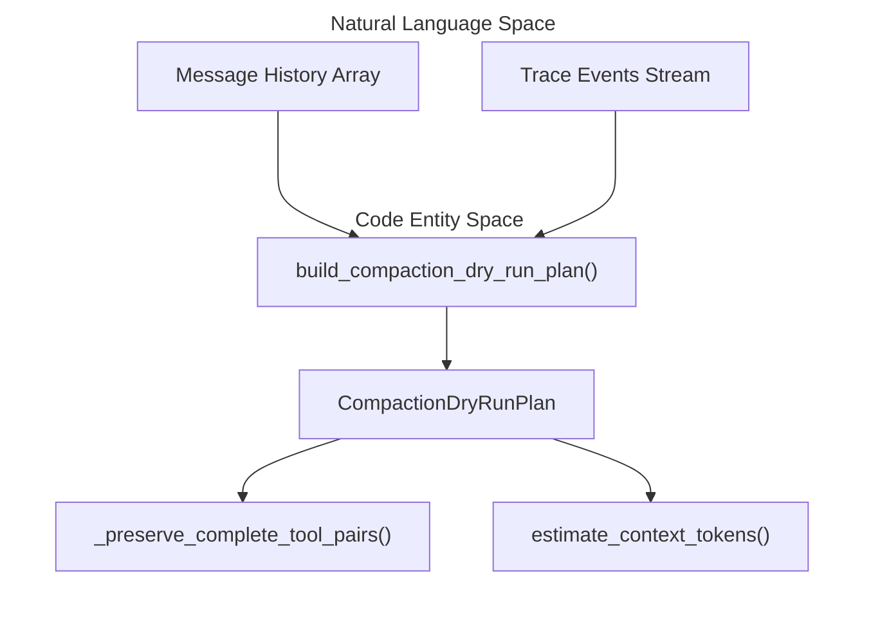

# Context Compaction & Session History

<details>
<summary>Relevant source files</summary>

The following files were used as context for generating this wiki page:

- [desktop/tests/composer-model.test.cjs](desktop/tests/composer-model.test.cjs)
- [desktop/tests/text-stream.test.cjs](desktop/tests/text-stream.test.cjs)
- [factory/core/runtime.py](factory/core/runtime.py)
- [factory/core/session_changes.py](factory/core/session_changes.py)
- [factory/core/session_compaction.py](factory/core/session_compaction.py)
- [factory/core/session_history.py](factory/core/session_history.py)
- [tests/fixtures/context_overflow/llama_server_98k.json](tests/fixtures/context_overflow/llama_server_98k.json)

</details>


## Purpose and Scope

The context compaction and session history subsystem is responsible for managing the token lifetime, context window pressure, historical event condensation, and per-task code modification tracking within the Python agent core (`factory/core/`). As long-running coding agent sessions accumulate turns, tool results, and large file diffs, this subsystem dynamically evaluates context pressure, plans and executes safe compactions without discarding pending approvals or unresolved tool errors, maintains provider-neutral session history, and serializes granular file change metrics for downstream consumers like the mobile bridge and UI frontends.

Sources: `factory/core/session_compaction.py:1-70`, `factory/core/session_history.py:1-44`, `factory/core/session_changes.py:1-30`

---

## Context Window Resolution & Pressure Assessment

The agent runtime continuously monitors request size against available model context windows using heuristic token estimators that avoid hard dependencies on heavy external tokenizers. Token counting is implemented in `estimate_context_tokens()` and `_estimate_jsonish_tokens()`, which approximate text, JSON structures, and base64-encoded image payloads [factory/core/session_compaction.py:72-123]().


*Sources: `factory/core/session_compaction.py:72-123`*

Context pressure is encapsulated by `CompactionPressureDecision`, which evaluates actions against configurable thresholds (`DEFAULT_DRY_RUN_THRESHOLD`, `DEFAULT_MANUAL_THRESHOLD`, `DEFAULT_REACTIVE_THRESHOLD`) [factory/core/session_compaction.py:24-26, 59-70]():

| Threshold Constant | Default Ratio | Trigger Action | Description |
| :--- | :--- | :--- | :--- |
| `DEFAULT_DRY_RUN_THRESHOLD` | `0.72` | `dry_run` | Performs a non-mutating check to evaluate upcoming compaction boundaries. |
| `DEFAULT_MANUAL_THRESHOLD` | `0.82` | `manual` | Recommends or initiates user-requested session compaction. |
| `DEFAULT_REACTIVE_THRESHOLD` | `0.90` | `reactive` | Automatically triggers reactive compaction to prevent context overflow errors. |

Sources: `factory/core/session_compaction.py:24-26`, `factory/core/session_compaction.py:59-70`

---

## Session Compaction Planning & Dry Runs

When context pressure breaches safety margins, the planner builds a conservative compaction plan via `build_compaction_dry_run_plan()` [factory/core/session_compaction.py:125-139](). The planner ensures that critical operational state is never summarized away. Specifically, the planner checks for blocking reasons such as:
- `pending_approval`: Active tool execution waiting for user confirmation [factory/core/session_compaction.py:16]().
- `unresolved_failed_tool_result`: Tool executions that resulted in errors requiring agent correction [factory/core/session_compaction.py:17]().
- `unresolved_post_turn_guard`: Active post-turn command or file policy guards [factory/core/session_compaction.py:18]().
- `no_compactable_messages`: Insufficient message depth to warrant summarization [factory/core/session_compaction.py:19]().


*Sources: `factory/core/session_compaction.py:125-188`*

If the session can be compacted, the resulting `CompactionArtifact` bundles the summary text, boundary metadata, and the list of covered historical IDs into a durable record [factory/core/session_compaction.py:51-57]().

Sources: `factory/core/session_compaction.py:31-57`, `factory/core/session_compaction.py:125-188`

---

## Durable Session History & Working History Construction

Session persistence and cross-turn continuation evidence are managed in `factory/core/session_history.py`. The function `read_history()` parses line-delimited JSON records from disk, filtering for valid roles (`user`, `assistant`, `tool`, `reasoning`) [factory/core/session_history.py:13-24]().

`history_record_id()` assigns stable identifiers to history items using explicit `history_id`, task-user mappings, message IDs, or content hashes [factory/core/session_history.py:27-35]().

`build_working_history()` assembles the active prompt context from raw entries and trace events [factory/core/session_history.py:38-43]():
1. Iterates through raw log entries, excluding specified message IDs and wrapping external OpenCode evidence or historical tool results [factory/core/session_history.py:48-58]().
2. Merges trace events (such as tool batches, responses, and steer deltas) anchored to their respective task positions [factory/core/session_history.py:69-99]().
3. Applies redacting utilities (`redact_text()`, `redact_value()`) to protect sensitive secrets [factory/core/session_history.py:10-11, 101, 114]().
4. If a compaction summary exists (`compaction.completed`), older covered records are removed and replaced by a single session memory summary block (`[Session memory carried forward]`) [factory/core/session_history.py:73-75, 104-111]().

Sources: `factory/core/session_history.py:1-116`

---

## Per-Task Changes Tracking

File modifications executed by the agent are tracked via `TaskChangeTracker` in `factory/core/session_changes.py` [factory/core/session_changes.py:107-117](). 

Every time a `Write` or `Edit` tool executes, the tracker records additions and deletions by comparing the target file against its baseline snapshot retrieved from the checkpoint manager [factory/core/session_changes.py:136-163](). Line additions and deletions are computed using unified diff rendering (`count_line_changes()`) [factory/core/session_changes.py:49-61]().

Persisted task changes are serialized as standalone JSON files under the runtime data directory [factory/core/session_changes.py:8-11, 36-39]():
```python
<data_root>/session_changes/<task_id>.json
```

These records can be read directly by downstream components like the mobile bridge without requiring database migrations [factory/core/session_changes.py:8-11](). Internal runtime directories (such as `.checkpoints`, `.tool_results`, and `.codex`) are automatically excluded from change calculations using `is_internal_path()` [factory/core/session_changes.py:27, 75-86]().

Sources: `factory/core/session_changes.py:1-174`
