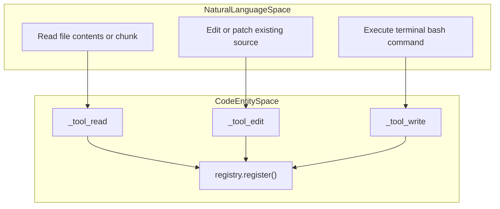
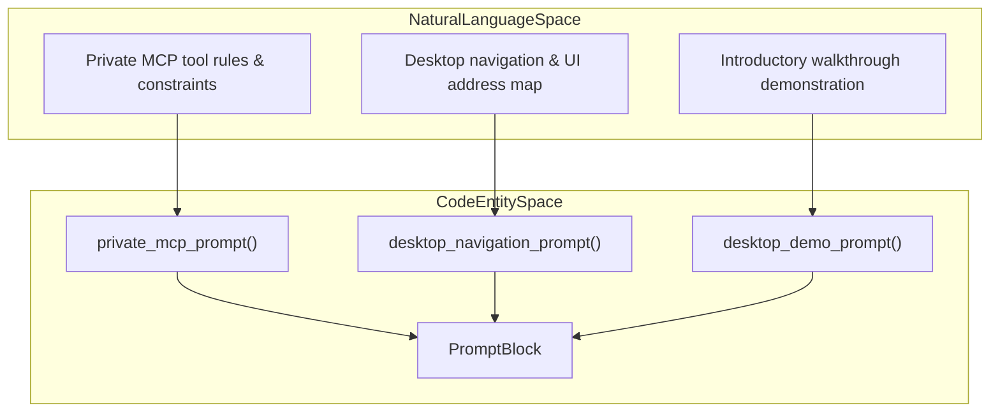
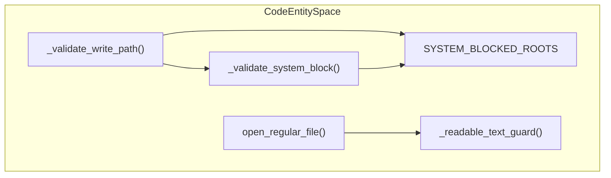

# Tools, Prompts and Policy

Relevant source files

The following files were used as context for generating this wiki page:

- [desktop/tests/session-summary.test.cjs](desktop/tests/session-summary.test.cjs)
- [docs/PROJECT_LAYOUT.md](docs/PROJECT_LAYOUT.md)
- [docs/architecture/ISOLATION.md](docs/architecture/ISOLATION.md)
- [docs/architecture/POLICY.md](docs/architecture/POLICY.md)
- [docs/architecture/RICH_CLI_RENDERING_EXPLAINED.md](docs/architecture/RICH_CLI_RENDERING_EXPLAINED.md)
- [docs/development/CROSS_PLATFORM_DESKTOP.md](docs/development/CROSS_PLATFORM_DESKTOP.md)
- [docs/development/FIRST_RUN_ACCEPTANCE.md](docs/development/FIRST_RUN_ACCEPTANCE.md)
- [docs/images/session-sources-flow.png](docs/images/session-sources-flow.png)
- [docs/images/session-sources-flow.svg](docs/images/session-sources-flow.svg)
- [factory/core/cc_backend_tools.py](factory/core/cc_backend_tools.py)
- [factory/core/mobile_bridge/server.py](factory/core/mobile_bridge/server.py)
- [factory/core/prompt_assembly.py](factory/core/prompt_assembly.py)
- [tests/test_cc_backend_read_tool.py](tests/test_cc_backend_read_tool.py)

## Purpose and Scope

This page documents the core subsystems responsible for executing agent actions, assembling system prompts, enforcing permission policies, and guarding file system operations within the Igorek-Harness Python core. Specifically, it covers the tool registry and implementations (`factory/core/cc_backend_tools.py`), prompt construction pipelines (`factory/core/prompt_assembly.py`), access levels and execution rules (`docs/architecture/POLICY.md`), and filesystem/command guard mechanisms.

---

## 1. Tool Registry & Implementations (`cc_backend_tools`)

The agent backend defines its available capabilities via `factory/core/cc_backend_tools.py`, which registers tools at the module level using a central registry (`registry.register()`) [factory/core/cc_backend_tools.py:1-10] [factory/core/cc_backend_tools.py:72-75]. Callers interact with these capabilities through `get_tool_schemas()` and `execute_tool()` wrappers [factory/core/cc_backend_tools.py:8-10]. Supported basic tools include `Write`, `Read`, `Bash`, `Edit`, `Glob`, `Grep`, `SessionSearch`, `web_search`, and `web_extract` [factory/core/cc_backend_tools.py:3-5].

### Natural Language Mapping to Tool Entity Space

*Sources: [factory/core/cc_backend_tools.py:1-75](), [tests/test_cc_backend_read_tool.py:6-20]()*

---

## 2. Prompt Assembly Engine (`prompt_assembly`)

System prompts, MCP integration instructions, navigation catalogs, and interactive demo scripts are assembled dynamically via `factory/core/prompt_assembly.py`. The module relies on `PromptBlock` data classes and helper methods like `_clean_text()` and `_append_block()` to construct bounded prompt structures [factory/core/prompt_assembly.py:104-123].

Key prompt generators include:
- `private_mcp_prompt()`: Configures safety rules and operational limits for provider integrations (such as OpenAI docs or Google Calendar) [factory/core/prompt_assembly.py:10-28].
- `desktop_navigation_prompt()`: Loads a static UI map from `web_ui/static/navigation.json` to provide exact `igorek://ui/...` markdown routing links to the agent [factory/core/prompt_assembly.py:49-61].
- `desktop_demo_prompt()`: Generates sequential, bounded multi-turn prompts for the built-in introductory walkthrough [factory/core/prompt_assembly.py:78-101].

### Natural Language Mapping to Prompt Entity Space

*Sources: [factory/core/prompt_assembly.py:10-62](), [factory/core/prompt_assembly.py:104-123]()*

---

## 3. Access Levels & Execution Policy

Execution security and permission modes are documented in `docs/architecture/POLICY.md` and enforced via `factory/config/inference-policy.yaml` [docs/architecture/POLICY.md:1-4]. The server resolves session-level overrides before falling back to global settings [docs/architecture/POLICY.md:31-32].

The security matrix maps access levels to specific security, guard, and filesystem modes:

| Level | `security_mode` | `guard_mode` | `filesystem_mode` |
| --- | --- | --- | --- |
| `strict` | `enforce` | `on` | `workspace` |
| `standard` | `observe` | `on` | `workspace` |
| `trusted` | `observe` | `warn` | `workspace` |
| `full` | `disabled` | `off` | `full-dangerous` |

*Sources: [docs/architecture/POLICY.md:22-30]*

---

## 4. File and Command Policy Guards

File tool operations implement rigorous path normalization and boundary checks to prevent unauthorized access outside the working directory or into restricted system paths.

### Path and Write Validation

Write and edit operations validate target paths through `_validate_write_path()` using `SYSTEM_BLOCKED_ROOTS` and filesystem resolution modes (`workspace`, `user-read`, `full-dangerous`) [factory/core/cc_backend_tools.py:76-90] [factory/core/cc_backend_tools.py:192-212]. 

*Sources: [factory/core/cc_backend_tools.py:76-90](), [factory/core/cc_backend_tools.py:192-217]()*

### Content and Read Guards

- **Binary & Image Files**: `_readable_text_guard()` inspects MIME types and block samples using `_looks_binary()` to prevent binary dumps or image consumption via text-based `Read` tools [factory/core/cc_backend_tools.py:148-174].
- **Unbounded Reads**: Read operations enforce character limits (`_DEFAULT_MAX_READ_CHARS` = 200,000; `_DEFAULT_MAX_UNBOUNDED_READ_CHARS` = 50,000) to protect the model context window, requiring explicit `offset` and `limit` parameters for large payloads [factory/core/cc_backend_tools.py:108-119] [tests/test_cc_backend_read_tool.py:45-72].

*Sources: [factory/core/cc_backend_tools.py:108-119](), [factory/core/cc_backend_tools.py:148-174](), [tests/test_cc_backend_read_tool.py:45-72]()*
