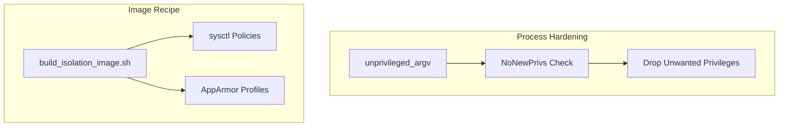
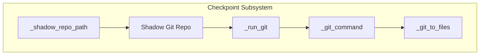
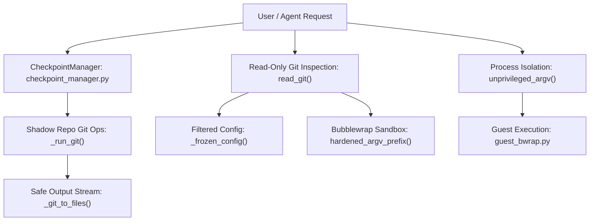

# Isolation Subsystem & Checkpoints

Relevant source files

The following files were used as context for generating this wiki page:

- [docs/PROJECT_LAYOUT.md](docs/PROJECT_LAYOUT.md)
- [docs/architecture/ISOLATION.md](docs/architecture/ISOLATION.md)
- [docs/architecture/POLICY.md](docs/architecture/POLICY.md)
- [docs/architecture/RICH_CLI_RENDERING_EXPLAINED.md](docs/architecture/RICH_CLI_RENDERING_EXPLAINED.md)
- [docs/development/CROSS_PLATFORM_DESKTOP.md](docs/development/CROSS_PLATFORM_DESKTOP.md)
- [docs/development/FIRST_RUN_ACCEPTANCE.md](docs/development/FIRST_RUN_ACCEPTANCE.md)
- [factory/core/checkpoint_manager.py](factory/core/checkpoint_manager.py)
- [factory/core/readonly_git.py](factory/core/readonly_git.py)
- [factory/scripts/build_isolation_image.sh](factory/scripts/build_isolation_image.sh)
- [tests/test_checkpoint_process.py](tests/test_checkpoint_process.py)
- [tests/test_guest_process_privileges.py](tests/test_guest_process_privileges.py)

The isolation subsystem (`factory/core/isolation/`) and checkpoint infrastructure (`factory/core/checkpoint_manager.py`, `factory/core/readonly_git.py`) enforce security boundaries between the host agent runtime and untrusted guest code executions. This layer handles bubblewrap (`bwrap`) guest sandboxing, egress control, host operations approval, workspace transfer limits, shadow git repositories, and read-only Git execution.

Sources: `factory/scripts/build_isolation_image.sh:1-33`, `docs/architecture/ISOLATION.md:1-28`

---

## Bubblewrap Guests & Process Hardening

Guest execution isolates arbitrary agent-driven commands by enforcing kernel capabilities, namespace restrictions, and process flags. The module `factory/core/isolation/guest_process.py` provides helpers such as `unprivileged_argv()` to ensure spawned children retain `NoNewPrivs` and operate securely even if their local environment variables are modified.

Base guest environments are defined via shell recipes like `factory/scripts/build_isolation_image.sh`, which configures unprivileged user namespaces (`kernel.unprivileged_userns_clone = 1`), AppArmor profiles (`bwrap-userns-restrict`), and readiness probes (`igorek-guest-bwrap-probe`).

*Figure 1: Guest process hardening and image building architecture.*

Sources: `tests/test_guest_process_privileges.py:9-48`, `factory/scripts/build_isolation_image.sh:70-91`

---

## Checkpoint Manager & Shadow Repositories

The checkpoint subsystem tracks workspace states by maintaining isolated shadow Git repositories under the data root (`<data_root>/checkpoints/<hash>`). 

Key functions in `factory/core/checkpoint_manager.py`:
- `_shadow_repo_path()`: Computes a 16-character SHA-256 hash of the absolute working directory path to isolate shadow refs [factory/core/checkpoint_manager.py:104-108]().
- `_run_git()`: Executes Git CLI commands against the shadow repository with disabled hooks (`core.hooksPath=/dev/null`) and filesystem monitors (`core.fsmonitor=false`) [factory/core/checkpoint_manager.py:134-167]().
- `_git_to_files()`: Streams subprocess outputs through temporary files to prevent deadlocks when subprocess timeouts trigger on Windows or Linux [factory/core/checkpoint_manager.py:30-44]().

*Figure 2: Checkpoint execution flow and process isolation code mapping.*

Sources: `factory/core/checkpoint_manager.py:21-78`, `tests/test_checkpoint_process.py:11-41`

---

## Read-Only Git Isolation

To inspect repository state without executing arbitrary repository hooks, clean filters, or configuration overrides, `factory/core/readonly_git.py` implements a locked-down execution routine via `read_git()` [factory/core/readonly_git.py:124-158]().

The read-only environment:
1. Filters configuration keys against an explicit whitelist via `SAFE_KEYS` regex (e.g., core repository format version, remote fetch rules) [factory/core/readonly_git.py:19-21]().
2. Sets strict environment variables via `git_environment()` disabling terminal prompts, optional locks, and lazy fetches [factory/core/readonly_git.py:30-47]().
3. Spawns Git inside a strict bubblewrap sandbox using `--unshare-net`, read-only system binds (`/usr`, `/lib`, `/bin`), and restricted resource limits [factory/core/readonly_git.py:141-158]().

Sources: `factory/core/readonly_git.py:1-48`, `factory/core/readonly_git.py:124-158`

---

## Isolation Subsystem & Checkpoint Data Flow

The following diagram illustrates how external code interactions flow through the isolation and checkpoint components, linking natural language operations directly to their corresponding Python code symbols and modules.

*Figure 3: Isolation subsystem and code entity mapping.*

Sources: `factory/core/isolation/guest_bwrap.py:1-25`, `factory/core/checkpoint_manager.py:30-54`, `factory/core/readonly_git.py:124-158`
