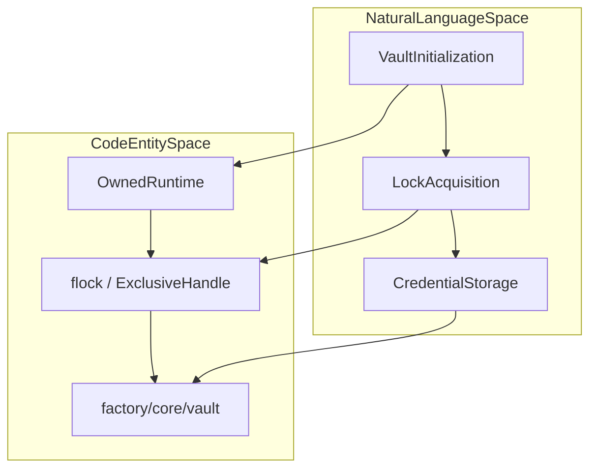
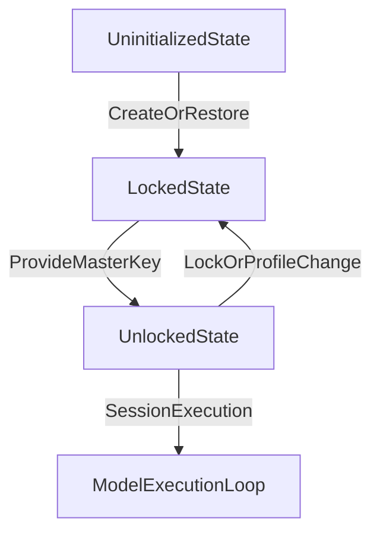
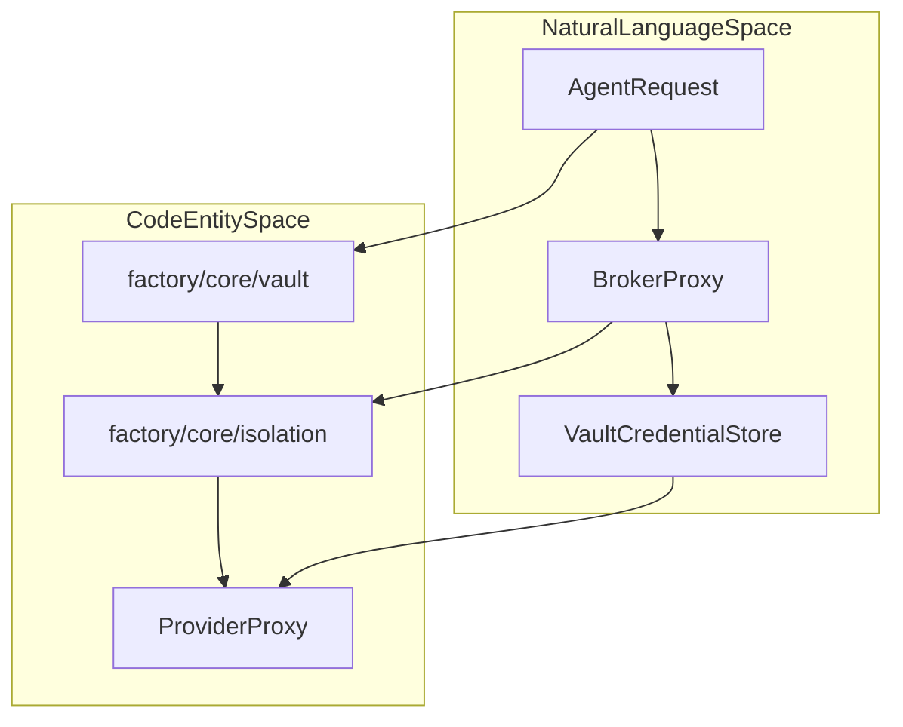

# Vault & Secrets

Relevant source files

The following files were used as context for generating this wiki page:

- [desktop/main.cjs](desktop/main.cjs)
- [desktop/tests/native/first-run.cjs](desktop/tests/native/first-run.cjs)
- [docs/PROJECT_LAYOUT.md](docs/PROJECT_LAYOUT.md)
- [docs/architecture/ISOLATION.md](docs/architecture/ISOLATION.md)
- [docs/architecture/POLICY.md](docs/architecture/POLICY.md)
- [docs/architecture/RICH_CLI_RENDERING_EXPLAINED.md](docs/architecture/RICH_CLI_RENDERING_EXPLAINED.md)
- [docs/development/CROSS_PLATFORM_DESKTOP.md](docs/development/CROSS_PLATFORM_DESKTOP.md)
- [docs/development/FIRST_RUN_ACCEPTANCE.md](docs/development/FIRST_RUN_ACCEPTANCE.md)
- [factory/core/mobile_bridge/files.py](factory/core/mobile_bridge/files.py)
- [factory/core/opencode_workspace.py](factory/core/opencode_workspace.py)

## Purpose & Scope

The `factory/core/vault` subsystem provides encrypted credential storage, cryptographic key management, scanner and detector logic, redaction mechanisms, broker permissions, and environment import capabilities (`[docs/PROJECT_LAYOUT.md:9]()`). It ensures that sensitive tokens, API keys, and private parameters remain secured against unauthorized reads across both host execution environments and isolated guests (`[docs/architecture/ISOLATION.md:24]()`). The subsystem integrates closely with the owner lifecycle, first-run application setup (`[docs/development/FIRST_RUN_ACCEPTANCE.md:8]()`), and cross-platform file locking guarantees (`[docs/development/CROSS_PLATFORM_DESKTOP.md:13-14]()`).

Sources: `[docs/PROJECT_LAYOUT.md:6-10]`, `[docs/architecture/ISOLATION.md:24-24]`, `[docs/development/FIRST_RUN_ACCEPTANCE.md:6-9]`, `[docs/development/CROSS_PLATFORM_DESKTOP.md:13-15]()`

---

## Storage Architecture & Cross-Platform Concurrency

Vault data persistence varies by operating system to enforce strict exclusivity and prevent concurrent corruption or unauthorized side-channel reads. 

- **Linux Targets**: Vault ownership and mutual exclusion are enforced via a kernel `flock` lease (`[docs/development/CROSS_PLATFORM_DESKTOP.md:13]()`), ensuring only a single authorized runtime instance can read or mutate stored credentials at any given time. Private data files default to restrictive POSIX file permissions (`[docs/development/CROSS_PLATFORM_DESKTOP.md:14]()`).
- **Windows Targets**: Vault access relies on an exclusive file handle that is automatically released upon process termination (`[docs/development/CROSS_PLATFORM_DESKTOP.md:13-14]()`). Access control lists utilize owner-and-SYSTEM inheritable DACLs (`[docs/development/CROSS_PLATFORM_DESKTOP.md:14]()`) to block unprivileged user inspection.

*Figure 1: Mapping Vault Ownership Contracts to Code Entities.*

Sources: `[docs/development/CROSS_PLATFORM_DESKTOP.md:13-15]`, `[docs/PROJECT_LAYOUT.md:8-10]()`

---

## Owner Lifecycle & State Transitions

The vault lifecycle governs access to downstream model providers and session settings through explicit states: uninitialized, locked, and unlocked (`[docs/development/FIRST_RUN_ACCEPTANCE.md:8]()`). 

During the first-run sequence, operators create, restore, or unlock the vault before storing or querying critical credentials (`[docs/development/FIRST_RUN_ACCEPTANCE.md:8-10]()`). Security policies dictate that profile changes, session locks, or timeouts immediately invalidate pending model replies and dependent bearer tokens (`[docs/development/FIRST_RUN_ACCEPTANCE.md:21-23]()`). When launched via Electron desktop bindings, the main controller interacts with vault operations through managed IPC handlers (`[desktop/main.cjs:69-79]()`).

*Figure 2: Vault State Transition Lifecycle.*

Sources: `[docs/development/FIRST_RUN_ACCEPTANCE.md:8-23]`, `[desktop/main.cjs:69-79]()`

---

## Scanners, Detectors, & Redaction

To prevent sensitive leakage, the vault and surrounding subsystems implement strict path and content screening. 

- **Workspace Filtering**: Snapshot and inventory scanners explicitly block private directories and credential files such as `.env`, `.aws`, `.ssh`, `.gnupg`, `.codex`, `.claude`, and private key extensions (`[factory/core/opencode_workspace.py:13-33]()`).
- **File Redaction**: The file collection and mobile bridge modules screen attachments and downloads to strip private certificates (`.pem`, `.key`, `.keystore`, `.jks`) prior to transmission or ingestion (`[factory/core/mobile_bridge/files.py:40-42]()`).
- **Policy Enforcement**: File policies (`[docs/architecture/POLICY.md:7-16]()`) coordinate with credential stores to ensure raw keys are never serialized into plaintext task logs or exported checkpoints.

Sources: `[factory/core/opencode_workspace.py:13-33]`, `[factory/core/mobile_bridge/files.py:40-42]`, `[docs/architecture/POLICY.md:7-16]()`

---

## Permissions & Broker Integration

Credentials stored in the vault are exposed to running agents exclusively through broker-mediated interfaces rather than generalized environment injection (`[docs/architecture/ISOLATION.md:24]()`).

- **Provider Proxying**: Upstream inference origins are pinned by the broker proxy (`[docs/architecture/ISOLATION.md:29]()`). Request paths cannot substitute credential recipients, and redirect chains do not forward bearer tokens to alternate origins (`[docs/architecture/ISOLATION.md:29-30]()`).
- **Guest Isolation**: Isolated guest environments do not inherit general secret-bearing environment blocks (`[docs/architecture/ISOLATION.md:24]()`). Instead, host-side services handle authorized requests on behalf of the task while keeping underlying keys isolated from guest-root escalation vectors (`[docs/architecture/ISOLATION.md:49-60]()`).

*Figure 3: Broker Integration and Credential Proxying.*

Sources: `[docs/architecture/ISOLATION.md:24-30]`, `[docs/architecture/ISOLATION.md:49-60]`, `[docs/PROJECT_LAYOUT.md:9-10]()`
