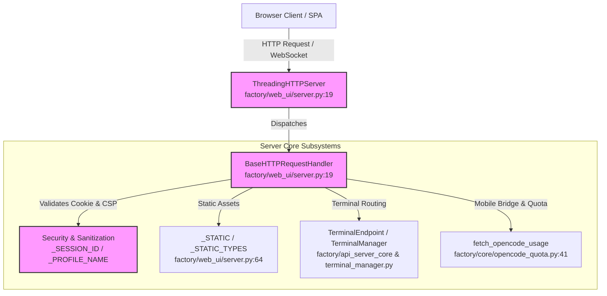
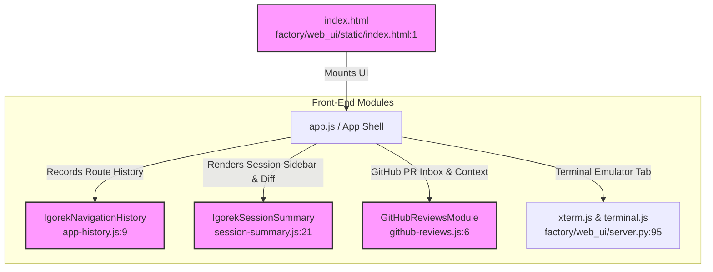

# API Server Core & Web UI

Relevant source files

The following files were used as context for generating this wiki page:

- [factory/web_ui/server.py](factory/web_ui/server.py)
- [factory/web_ui/static/app-history.js](factory/web_ui/static/app-history.js)
- [factory/web_ui/static/app.css](factory/web_ui/static/app.css)
- [factory/web_ui/static/github-reviews.js](factory/web_ui/static/github-reviews.js)
- [factory/web_ui/static/index.html](factory/web_ui/static/index.html)
- [factory/web_ui/static/session-summary.js](factory/web_ui/static/session-summary.js)

This page documents the architecture and implementation of the Python API server core (`factory/api_server_core`), provider runtimes (such as Anthropic and OpenRouter integration), workflow and policy engines, and the static front-end server (`factory/web_ui/server.py` and `factory/web_ui/static/`).

---

## 1. API Server Core Runtimes & Request Routing

The API server core manages incoming requests from various interfaces (Web UI, CLI daemon, Electron app bridge, and mobile bridge) and routes them to provider-specific execution adapters. It handles API format translation for external clients expecting standard wire formats (like Anthropic Messages API or OpenAI/OpenRouter chat completions) while running inside the secured agent harness.

The runtime layer coordinates multi-turn tool execution loops, context compaction, and strict security and approval policies before dispatching prompts to local or remote model backends.

Sources: `factory/web_ui/server.py:1-62`

---

## 2. Web UI HTTP Server Implementation

The backend for the web interface is built using standard Python HTTP server primitives wrapped in a multi-threaded request handler. It implements custom security headers, device cookie pairing (`__Host-igorek-device`), and strict Content Security Policy (CSP) enforcement.

### Key Server Classes and Routing Mechanics
* **`ThreadingHTTPServer`**: Manages concurrent HTTP request execution across worker threads [factory/web_ui/server.py:19]().
* **`BaseHTTPRequestHandler`**: Extended to process REST endpoints, static file serving, artifact previews with sandboxed CSP (`_PREVIEW_CSP`), and WebSocket handshakes [factory/web_ui/server.py:19](), [factory/web_ui/server.py:54](), [factory/web_ui/server.py:114]().
* **Security & Sandboxing**: Implements strict route sanitization using regular expressions for session IDs (`_SESSION_ID`), profile names (`_PROFILE_NAME`), and external sources (`_EXTERNAL_SOURCES`) to prevent path traversal and unauthorized system access [factory/web_ui/server.py:120](), [factory/web_ui/server.py:124](), [factory/web_ui/server.py:130]().

| MIME Map Key / Asset | Content-Type / Purpose |
| :--- | :--- |
| `index.html` | `text/html; charset=utf-8` (Main SPA Shell) [factory/web_ui/static/index.html:1](), [factory/web_ui/server.py:69]() |
| `app.js` / `app.css` | Application logic and UI styles [factory/web_ui/server.py:70](), [factory/web_ui/server.py:86]() |
| `vendor/xterm.js` / `vendor/xterm.css` | Terminal emulator dependency for the "Terminal" tab [factory/web_ui/server.py:95]() |
| `workers/xlsx-worker.js` | Client-side Excel parsing web worker (SheetJS) [factory/web_ui/server.py:102]() |

Sources: `factory/web_ui/server.py:1-155`

---

## 3. Static Front-End Architecture & Single Page Application (SPA)

The web user interface is structured as a single-page application hosted by `factory/web_ui/server.py` and rendered via modular JavaScript components inside `factory/web_ui/static/`.

### Application Shell and Navigation Rail
The layout (`index.html`) establishes a multi-column application grid comprising an application rail (`app.sub-rail`), a collapsible session sidebar (`sidebar`), and a main workspace panel (`main-panel`) [factory/web_ui/static/index.html:16](). 

* **Application Rail (`.app-rail`)**: Houses top-level views such as Home/Chat, Code Reviews (`github-reviews.js`), Scheduled Tasks, and Plugins [factory/web_ui/static/index.html:17]().
* **Navigation History (`IgorekNavigationHistory`)**: Managed in `app-history.js`, recording route transitions (`view`, `session`, `panel`, `tab`, `pull`) and handling asynchronous state restoration with concurrency epochs [factory/web_ui/static/app-history.js:1]().
* **Session Summary (`IgorekSessionSummary`)**: Rendered via `session-summary.js`, this component tracks background running processes, file sources, pull requests, uploads, and active diff changes [factory/web_ui/static/session-summary.js:1]().
* **GitHub Code Reviews (`github-reviews.js`)**: Provides an integrated inbox for filtering, searching, and inspecting GitHub Pull Requests, checking account state validity, and generating secure prompt contexts for AI code review or merge conflict resolution [factory/web_ui/static/github-reviews.js:1]().

Sources: `factory/web_ui/static/index.html:1-78`, `factory/web_ui/static/app-history.js:1-33`, `factory/web_ui/static/github-reviews.js:1-28`, `factory/web_ui/static/session-summary.js:1-62`

---

## 4. Architecture Diagrams

### Diagram 1: Web UI Server & Request Dispatch Flow (Code Entity Space)
This diagram maps the natural language concept of web client requests to concrete classes and modules in `factory/web_ui/server.py`.

Sources: `factory/web_ui/server.py:1-62`, `factory/web_ui/server.py:120-155`

### Diagram 2: Front-End SPA Component & State Management (Code Entity Space)
This diagram associates front-end user actions with JavaScript modules inside `factory/web_ui/static/`.

Sources: `factory/web_ui/static/index.html:1-78`, `factory/web_ui/static/app-history.js:1-33`, `factory/web_ui/static/github-reviews.js:1-28`, `factory/web_ui/static/session-summary.js:1-62`

## Offline 3D artifact previews

HTML artifact previews resolve the pinned Three.js r128 global build locally for its matching cdnjs, jsDelivr and unpkg URLs. Preview HTML up to 4 MiB is processed in memory, with at most four library replacements; original downloads and oversized documents remain unchanged. The bundled library SHA-256 and MIT notice are in the vendor directory. Script data URLs are allowed only within the opaque sandbox; external requests, parent access, forms and Node integration remain unavailable. Other library versions, relative files, network-loaded models and remote textures are not automatically substituted or granted network access. This fixes matching CDN-based Three.js animations without changing the Electron GPU configuration. Native CI exercises actual changing 3D frames with isolated SwiftShader; this does not claim physical GPU acceptance.
