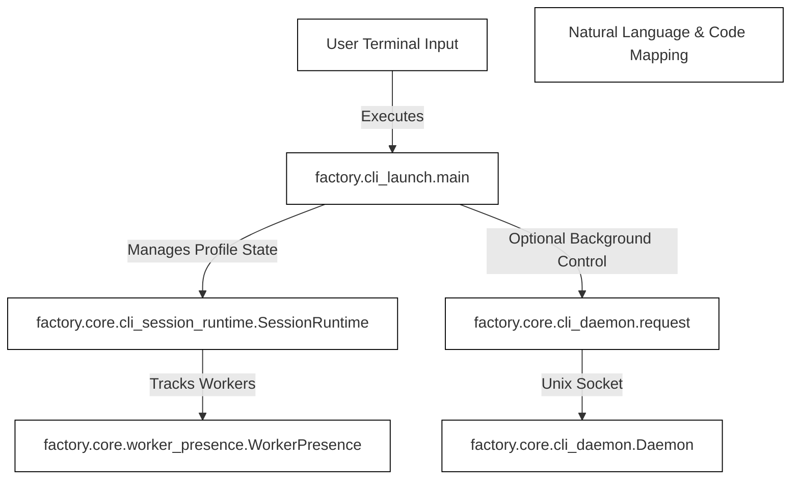
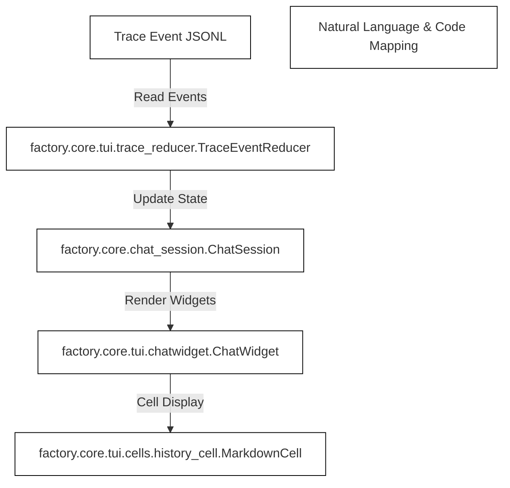

# Terminal CLI & TUI

Relevant source files

The following files were used as context for generating this wiki page:

- [docs/development/CLI_LAUNCH.md](docs/development/CLI_LAUNCH.md)
- [factory/cli_launch.py](factory/cli_launch.py)
- [factory/core/chat_session.py](factory/core/chat_session.py)
- [factory/core/cli_daemon.py](factory/core/cli_daemon.py)
- [tests/test_cli_launch.py](tests/test_cli_launch.py)

## Purpose and Scope

This page provides a high-level overview of the `igorek` command-line interface (CLI) [factory/cli_launch.py:1](), owner-local shared CLI runtimes [factory/core/cli_daemon.py:1](), and the Rich-based terminal user interface (TUI) [factory/core/chat_session.py:1]() in Igorek-Harness. It outlines how foreground launchers interact with workers, manage profile sessions, and render rich chat elements in POSIX terminals. 

As a parent page, this document summarizes core concepts and links to detailed child pages:
- For deep dives into launchers, daemon lifecycle, and runtimes, see [CLI Launch, Daemon and Chat Session](#3.1).
- For details on widget rendering, streaming, and mouse protocols, see [TUI Rendering and Mouse Support](#3.2).

Sources: `factory/cli_launch.py:1-12`, `factory/core/cli_daemon.py:1-15`, `factory/core/chat_session.py:1-15`, `docs/development/CLI_LAUNCH.md:1-15`

---

## 3.1. CLI Launch, Daemon and Chat Session Overview

The CLI subsystem initializes interactive chat sessions via the real console entrypoint `igorek` [docs/development/CLI_LAUNCH.md:3](). It supports profile selection [docs/development/CLI_LAUNCH.md:16](), session resumption, and fullscreen alt-screen rendering or persistent inline terminal scrollback [docs/development/CLI_LAUNCH.md:83](). 

Client instances coordinate via `SessionRuntime` [tests/test_cli_launch.py:14]() and `worker_presence` to share queue workers safely across multiple terminals mapped to the same data directory [docs/development/CLI_LAUNCH.md:25](). For unattended or shared background execution, the opt-in owner-local `Daemon` [factory/core/cli_daemon.py:69]() manages background queues over a private Unix socket with peer UID validation [factory/core/cli_daemon.py:45]().

For comprehensive technical documentation on launcher execution, session management, and daemon commands, see [CLI Launch, Daemon and Chat Session](#3.1).

Sources: `factory/cli_launch.py:12-87`, `factory/core/cli_daemon.py:45-75`, `tests/test_cli_launch.py:14-65`, `docs/development/CLI_LAUNCH.md:1-45`

---

## 3.2. TUI Rendering and Mouse Support Overview

The terminal UI is driven by Rich and custom widget components located under `factory/core/tui/` [factory/core/chat_session.py:71](). `ChatSession` coordinates user keystrokes, slash commands [factory/core/chat_session.py:81](), background task dispatch, and real-time trace event streaming [factory/core/chat_session.py:121]().

Rendering relies on modular cell types such as `MarkdownCell`, `ReasoningCell`, and `ToolCallGroupCell` [factory/core/chat_session.py:72]() coupled with `TraceEventReducer` [factory/core/chat_session.py:77]() to translate raw backend trace JSONL streams into structured terminal frames. Mouse protocols, selection handling, and clipboard integrations operate asynchronously to maintain prompt responsiveness.

For detailed documentation on widget trees, markdown and diff rendering, mouse protocols, and clipboard flows, see [TUI Rendering and Mouse Support](#3.2).

Sources: `factory/core/chat_session.py:71-79`, `factory/core/chat_session.py:121-137`, `docs/development/CLI_LAUNCH.md:83-110`
