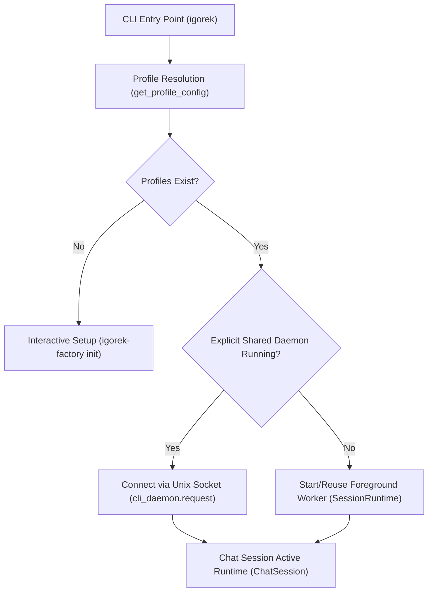
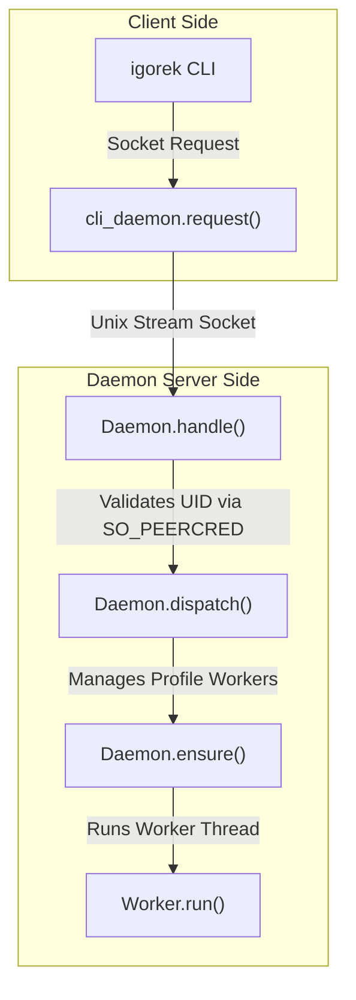

# CLI Launch, Daemon and Chat Session

<details>
<summary>Relevant source files</summary>

The following files were used as context for generating this wiki page:

- [docs/development/CLI_LAUNCH.md](docs/development/CLI_LAUNCH.md)
- [factory/core/chat_session.py](factory/core/chat_session.py)
- [factory/core/cli_chat_active.py](factory/core/cli_chat_active.py)
- [factory/core/cli_classic.py](factory/core/cli_classic.py)
- [factory/core/cli_daemon.py](factory/core/cli_daemon.py)
- [factory/core/cli_session_runtime.py](factory/core/cli_session_runtime.py)
- [tests/test_cli_launch.py](tests/test_cli_launch.py)

</details>


## Purpose and Scope
This page details the terminal-owned CLI startup lifecycle (`igorek`), the reference-counted foreground session runtime (`SessionRuntime`), the explicit owner-local background daemon (`Daemon`), and the chat session execution modes (classic vs active chat runtimes, slash commands, profile queues, and cancellation handling).

---

## 1. CLI Launch and Startup Sequence
The host-tool installer sets up an independent `igorek` console entry point `[docs/development/CLI_LAUNCH.md:1-7]()`. The CLI frontend supports standard fullscreen mode with mouse capture or an inline prompt mode via `--no-alt-screen` `[docs/development/CLI_LAUNCH.md:83-86]()`.

- **Profile Resolution:** On first launch, if no user profiles exist, an interactive setup is presented `[docs/development/CLI_LAUNCH.md:16-18]`. Single configured profiles are selected automatically; otherwise, the user chooses from available profiles, remembering the last successful choice `[docs/development/CLI_LAUNCH.md:17-18]`.
- **Command-line Flags:** Accepts `--profile NAME`, `--resume SESSION_ID`, `--no-alt-screen`, and `--data-dir PATH` `[docs/development/CLI_LAUNCH.md:8-14]`, `[docs/development/CLI_LAUNCH.md:55-57]`.


*Sources: `docs/development/CLI_LAUNCH.md:1-127`, `factory/core/cli_session_runtime.py:19-64`*

---

## 2. Interactive Ownership and Foreground Session Runtimes
Foreground clients manage workers using reference counting and OS-held file locks under the profile data directory `[factory/core/cli_session_runtime.py:1-112]`.

### Key Components
- `SessionRuntime`: Located in `[factory/core/cli_session_runtime.py:19-112]`, manages client lifecycle, profile selection, and process spawning.
- **Client Locks:** Each active client holds an exclusive file lock inside `profile_directory(profile) / "clients"` `[factory/core/cli_session_runtime.py:33-37]()`.
- **Startup Serialization:** An exclusive lock on `startup.lock` prevents race conditions during worker initialization or shutdown `[factory/core/cli_session_runtime.py:39-40]()`.
- **Worker Termination:** When the last client releases its lock, the managed background worker process is signaled to stop `[factory/core/cli_session_runtime.py:92-105]()`.

```mermaid
graph TD
    subcol["Natural Language & Code Entity Space"]
    CLI["CLI Client Launch"] -->|Calls select()| SR["SessionRuntime (factory/core/cli_session_runtime.py)"]
    SR -->|Checks Shared Daemon| DAEMON{"Daemon Running?"}
    DAEMON -->|Yes| REQ["cli_daemon.request()"]
    DAEMON -->|No| LOCK["Acquire startup.lock & client lock"]
    LOCK -->|Spawns if needed| W["Worker Process (factory/core/worker.py)"]
    W -->|Monitors presence| WP["worker_presence.py"]
```
*Sources: `factory/core/cli_session_runtime.py:19-156`, `factory/core/worker_presence.py`*

---

## 3. Explicit Shared Background Daemon
For unattended or long-running profile workflows, an explicit daemon can be started `[docs/development/CLI_LAUNCH.md:46-82]`.

### Lifecycle Commands
- `igorek app-server daemon start`: Idempotently starts the background daemon `[docs/development/CLI_LAUNCH.md:51-59]`.
- `igorek app-server daemon stop`: Refuses to stop if active tasks or execution locks are busy (`Daemon.dispatch()`) `[factory/core/cli_daemon.py:145-161]()`.
- `igorek app-server daemon version`: Returns running status, version, served profiles, and scheduler state `[factory/core/cli_daemon.py:133-135]()`.

### Security and IPC
- **Unix Domain Socket:** Communication occurs strictly via an owner-local Unix socket with bounded JSON frames (`LIMIT = 8 * 1024 * 1024`) `[factory/core/cli_daemon.py:25-42]()`.
- **Peer Credential Validation:** `SO_PEERCRED` checks verify that the connecting process UID matches `os.getuid()` `[factory/core/cli_daemon.py:54-57]()`.


*Sources: `factory/core/cli_daemon.py:1-277`*

---

## 4. Chat Session Execution: Classic vs Active Runtimes
Chat sessions handle user inputs, tool execution display, and slash commands.

### Slash Commands and Profile Switching
- Commands like `/profile NAME` update the active profile route, clear previous model overrides, reset session approval rules, and update history metadata `[docs/development/CLI_LAUNCH.md:19-21]`, `[tests/test_cli_launch.py:131-156]`.
- Other commands include `/help`, `/exit`, `/clear`, `/history`, `/resume`, `/model`, and `/theme` `[factory/core/chat_session.py:81-101]()`.

### Runtime Modes
- **Active Chat Runtime (`cli_chat_active.py`):** Uses `prompt_toolkit` custom layouts, a dynamic textarea height matching wrapped text, and a live rich display for active model turns `[factory/core/cli_chat_active.py:1-177]`.
- **Classic Header Mode (`cli_classic.py`):** Provides a compact terminal header showing profile, model, version, and working directory when `IGOREK_TUI_CLASSIC_STYLE=legacy` is set `[docs/development/CLI_LAUNCH.md:83-97]`, `[factory/core/cli_classic.py:1-17]`.
- **Cancellation (`Ctrl+C`):** Cancels only the current task belonging to the invoking client without affecting other concurrent profile clients or daemon execution threads `[docs/development/CLI_LAUNCH.md:35-37]`, `[docs/development/CLI_LAUNCH.md:74-75]`.

| Feature | Classic / Inline Mode (`--no-alt-screen`) | Fullscreen TUI Mode (Default) |
| :--- | :--- | :--- |
| **Terminal Scrollback** | Preserves ordinary normal scrollback | Uses alternate screen buffer |
| **Mouse Capture** | Disabled | Enabled for selection and clicking |
| **Header Style** | Compact header or legacy style (`cli_classic.py`) | Integrated status line and widgets |
| **Event Loop** | Single thread prompt loop with rich output | `prompt_toolkit` layout with `ChatWidget` |

*Sources: `docs/development/CLI_LAUNCH.md:83-97`, `factory/core/chat_session.py:1-214`, `factory/core/cli_classic.py:1-17`, `factory/core/cli_chat_active.py:1-177`*
