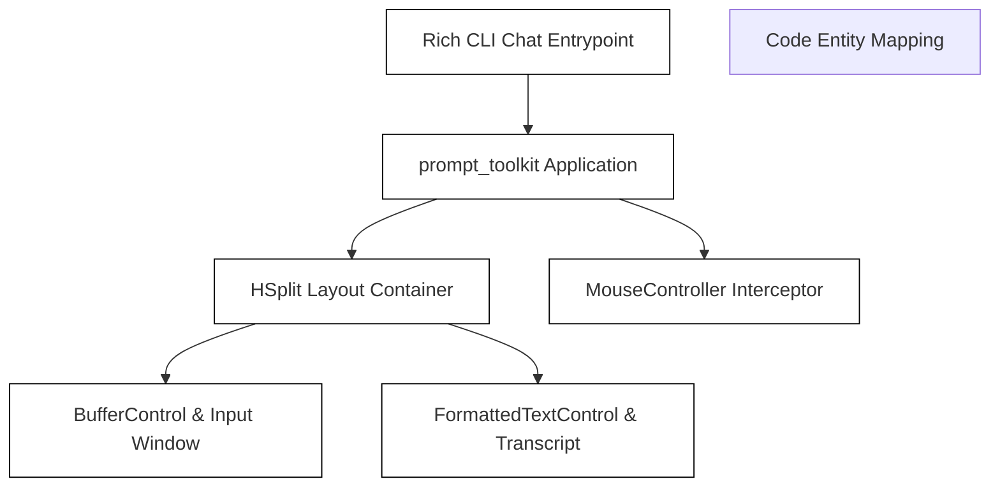
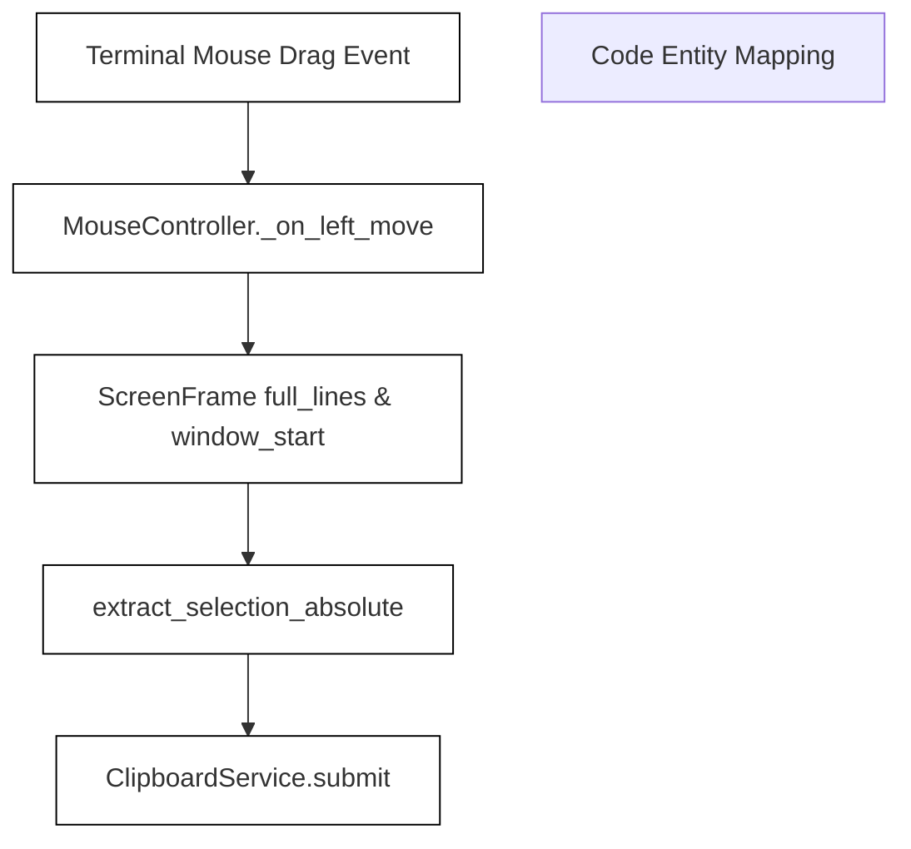

# TUI Rendering and Mouse Support

Relevant source files

The following files were used as context for generating this wiki page:

- [factory/core/cli_chat_rich.py](factory/core/cli_chat_rich.py)
- [factory/core/tui/mouse_clipboard.py](factory/core/tui/mouse_clipboard.py)
- [factory/core/tui/mouse_controller.py](factory/core/tui/mouse_controller.py)
- [tests/test_mouse_selection_absolute.py](tests/test_mouse_selection_absolute.py)
- [tests/test_tui_mouse.py](tests/test_tui_mouse.py)

## Purpose and Scope
This section covers the terminal user interface (TUI) rendering architecture and advanced mouse support within the Igorek-Harness Python core. Built as a Python port of the Codex Rust TUI architecture, it bridges `prompt_toolkit` applications and `rich`-based rendering with an advanced mouse protocol parser, absolute off-screen selections, auto-scrolling gesture handling, and a serialized thread-safe clipboard service.

Sources: `[factory/core/cli_chat_rich.py:1-46]`, `[factory/core/tui/mouse_clipboard.py:1-15]`, `[factory/core/tui/mouse_controller.py:1-16]()`

---

## 1. TUI Architecture & Prompt Toolkit Integration
The TUI subsystem coordinates interactive chat sessions through `prompt_toolkit` layout components (such as `Layout`, `HSplit`, `Window`, `BufferControl`, and `FormattedTextControl`) managed inside `factory/core/cli_chat_rich.py`. It integrates idle prompts, active execution screens, reasoning trace cells, and approval dialogs by dynamically binding symbols and application layouts.

*Diagram 1: TUI Layout and Application Integration Bridge*

Sources: `[factory/core/cli_chat_rich.py:22-123]()`

---

## 2. Mouse Protocol and SGR Parsing
Mouse input parsing is implemented via the SGR (1006) mouse tracking extension. The parser converts raw escape sequences into structured mouse events, distinguishing between clicks, releases, movements, and scroll wheels while extracting coordinate modifiers (`shift`, `ctrl`).

- **Key Function**: `parse_sgr_mouse_sequence()` parses sequences matching SGR formats like `\x1b[<button;x;yM` (press) or `\x1b[<button;x;ym` (release).
- **Coordinate Conversion**: Maps 1-based terminal coordinates to 0-based application indices.

Sources: `[tests/test_tui_mouse.py:49-92]()`

---

## 3. Mouse Capture & Output Proxies
Terminal output streams are wrapped to inject escape sequences that enable and disable mouse reporting without disrupting standard VT100 operations.

- **Classes**: `MouseCaptureOutput` and `wrap_output_for_mouse()` in `factory/core/tui/mouse_output.py` proxy standard `prompt_toolkit` output streams.
- **Escape Sequences**: Dynamically emits `ENABLE_SEQUENCES` on startup and `DISABLE_SEQUENCES` on shutdown.

Sources: `[tests/test_tui_mouse.py:94-134]()`

---

## 4. Frame Representation and Selection Mechanics
Selection mechanics are driven by frame geometry captured during layout rendering.

- **Classes & Structures**: 
  - `ScreenFrame`: Stores visible rows (`FrameRow`), window scroll offsets (`window_start`), and full transcript history (`full_lines`).
  - `Selection`: Defines anchor and focus coordinates `(x1, y1, x2, y2)`.
- **Functions**:
  - `extract_selection()`: Extracts and strips ANSI formatting from a visible region, handling wide character boundaries and combining marks correctly.
  - `extract_selection_absolute()`: Enables absolute transcript-coordinate selection across rows that have scrolled out of the visible window.

*Diagram 2: Absolute Selection and Copy Data Flow*

Sources: `[factory/core/tui/mouse_controller.py:134-144]`, `[tests/test_mouse_selection_absolute.py:20-56]`, `[tests/test_tui_mouse.py:135-183]()`

---

## 5. Mouse Controller & Gesture Coordination
The `MouseController` class acts as the single integration point for TUI mouse support. It tracks user intent (`user_enabled` and environment variables like `IGOREK_TUI_MOUSE`), gesture states (`GestureState`), and coordinates drag-and-drop auto-scrolling when a selection hits the top or bottom edge of the viewport.

- **Gesture Tracking**: Manages press, move, and release states (`_on_left_press`, `_on_left_move`, `_on_left_release`).
- **Wheel Handling**: Maps scroll wheel notches to configurable line jumps via `IGOREK_TUI_WHEEL_LINES`.

Sources: `[factory/core/tui/mouse_controller.py:52-160]`, `[tests/test_mouse_selection_absolute.py:80-130]()`

---

## 6. Clipboard Integration and Serialization
Copying selections to the system clipboard may involve blocking subprocess calls (e.g., `arboard`, `wl-copy`, `xclip`, `xsel`, or WSL PowerShell utilities). To prevent race conditions from slow or overlapping copy actions, `ClipboardService` serializes requests using monotonic tickets.

- **Class**: `ClipboardService` in `factory/core/tui/mouse_clipboard.py`.
- **Concurrency Control**: Issues a monotonically increasing ticket via `next_ticket()`. Background worker threads compare their start ticket against `_latest_ticket`, discarding stale copy operations.
- **Backend Categorization**:
  - `_LOCAL_BACKENDS`: Confirmed local clipboard tools (`arboard`, `wl-copy`, `xclip`, `xsel`, `wsl`).
  - `_TERMINAL_BACKENDS`: Terminal-driven escape sequences (`osc52`, `tmux`) where delivery cannot be locally verified.

Sources: `[factory/core/tui/mouse_clipboard.py:1-116]()`
