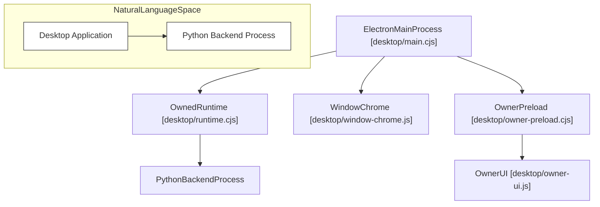

# Electron Desktop Application

Relevant source files

The following files were used as context for generating this wiki page:

- [desktop/main.cjs](desktop/main.cjs)
- [desktop/owner-preload.cjs](desktop/owner-preload.cjs)
- [desktop/owner-ui.js](desktop/owner-ui.js)
- [desktop/runtime.cjs](desktop/runtime.cjs)
- [desktop/tests/native/first-run.cjs](desktop/tests/native/first-run.cjs)
- [desktop/tests/owner-busy.test.cjs](desktop/tests/owner-busy.test.cjs)
- [desktop/tests/runtime.test.cjs](desktop/tests/runtime.test.cjs)
- [factory/core/mobile_bridge/files.py](factory/core/mobile_bridge/files.py)
- [factory/core/opencode_workspace.py](factory/core/opencode_workspace.py)

This page provides a high-level overview of the `desktop/` subsystem in Igorek-Harness, which implements the Electron desktop application. The desktop client manages window chrome, native integrations, secure inter-process communication (IPC) surfaces, the administrative owner UI, and the lifecycle hosting of the Python agent backend runtime.

For detailed technical breakdowns, refer to the child pages:
- [Main Process & IPC Handlers](#4.1)
- [Owned Runtime & Owner UI](#4.2)
- [Release Updates & What's New](#4.3)

---

## Desktop Architecture & Component Overview

The desktop architecture separates privileged main-process orchestrations from sandboxed renderer frames. The main entrypoint `desktop/main.cjs` coordinates Electron app lifecycles, creates windows, registers IPC handlers, and spawns the managed Python backend using `OwnedRuntime` defined in `desktop/runtime.cjs`.

Sources: `[desktop/main.cjs:1-58]`, `[desktop/runtime.cjs:68-85]`, `[desktop/owner-preload.cjs:1-10]()`

---

## 4.1 Main Process & IPC Handlers

The main process manages window frames, application menus, OS notifications, custom keyboard shortcuts, and diagnostic windows. It establishes secure IPC bridges using `ipcMain.handle` to restrict renderer capabilities and validate frame origins.

For detailed documentation on the IPC channel catalogue, window chrome injection, menus, notifications, shortcuts, and diagnostics, see [Main Process & IPC Handlers](#4.1).

Sources: `[desktop/main.cjs:73-129]()`

---

## 4.2 Owned Runtime & Owner UI

The desktop application hosts the underlying Python agent core as a managed child process. `OwnedRuntime` (`[desktop/runtime.cjs:68-109]()`) spawns the Python backend, handles its stdout/stderr streams, sets up isolated environment variables (`[desktop/runtime.cjs:15-54]()`), and routes owner requests. The owner UI (`desktop/owner-ui.js`) and its secure preload bridge (`desktop/owner-preload.cjs`) provide settings panels for vault secrets, plugin statuses, execution modes, and recovery flows.

For detailed information on managed backend spawning, owner UI panels, busy states, vault settings, and recovery files, see [Owned Runtime & Owner UI](#4.2).

Sources: `[desktop/runtime.cjs:68-109]`, `[desktop/owner-preload.cjs:29-86]()`

---

## 4.3 Release Updates & What's New

The desktop application features a built-in release verification, download, and installation pipeline. It exposes update dialogs (`desktop/release-updates-ui.cjs`) and progress presentation windows (`desktop/release-progress.cjs`) to guide users through safe updates and application history assets.

For full details on the update flow, release installation helpers, progress windows, and release notes assets, see [Release Updates & What's New](#4.3).

Sources: `[desktop/main.cjs:5-8]()`
