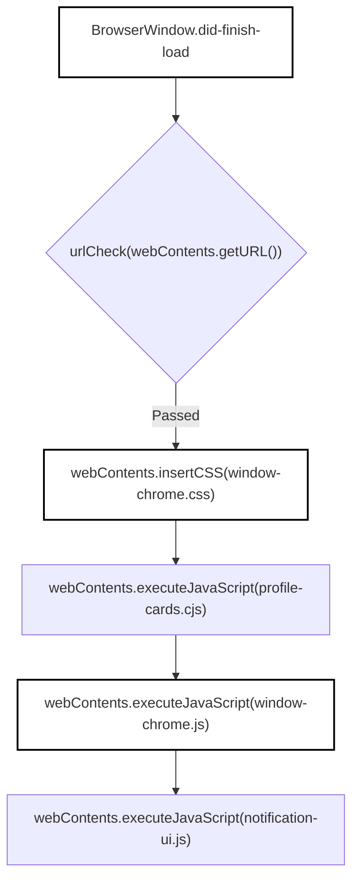

# Main Process & IPC Handlers

<details>
<summary>Relevant source files</summary>

The following files were used as context for generating this wiki page:

- [desktop/main.cjs](desktop/main.cjs)
- [desktop/packaging/bundle_sources.py](desktop/packaging/bundle_sources.py)
- [desktop/tests/completion-sound.test.cjs](desktop/tests/completion-sound.test.cjs)
- [desktop/tests/github-reviews.test.cjs](desktop/tests/github-reviews.test.cjs)
- [desktop/tests/native/first-run.cjs](desktop/tests/native/first-run.cjs)
- [desktop/tests/notifications.test.cjs](desktop/tests/notifications.test.cjs)
- [desktop/window-chrome.css](desktop/window-chrome.css)
- [desktop/window-chrome.js](desktop/window-chrome.js)
- [desktop/window-menu.cjs](desktop/window-menu.cjs)
- [docs/THIRD_PARTY_NOTICES.md](docs/THIRD_PARTY_NOTICES.md)
- [docs/licenses/OPENCODE-ICON-LICENSE.txt](docs/licenses/OPENCODE-ICON-LICENSE.txt)
- [factory/core/mobile_bridge/files.py](factory/core/mobile_bridge/files.py)
- [factory/core/opencode_workspace.py](factory/core/opencode_workspace.py)
- [factory/web_ui/static/app.js](factory/web_ui/static/app.js)

</details>


## Purpose and Scope

The Electron desktop application's main process, anchored by `desktop/main.cjs`, acts as the privileged orchestrator for Igorek's desktop runtime [desktop/main.cjs:1-41](). It manages Electron `BrowserWindow` instances, enforces security boundaries through strict frame checking, routes Inter-Process Communication (IPC) channels between renderer views and host services, injects dynamic window chrome [desktop/main.cjs:94-108](), and coordinates system integrations such as native application menus [desktop/window-menu.cjs:1-48](), desktop notifications [desktop/main.cjs:80-92](), global keyboard shortcuts [desktop/main.cjs:70](), and performance diagnostics [desktop/main.cjs:48-49]().

Sources: [desktop/main.cjs:1-49](), [desktop/main.cjs:70-108](), [desktop/window-menu.cjs:1-48]()

---

## IPC Channel Catalogue & Security Architecture

The main process registers several protected IPC handlers via Electron's `ipcMain.handle` [desktop/main.cjs:73](). To prevent renderer views from issuing unauthorized host commands, each channel invocation passes through a validation guard such as `trustedChromeWindow(event)` [desktop/main.cjs:110-115]() or session trust checks [desktop/main.cjs:76]().

| IPC Channel | Direction | Function / Handler | Security Guard / Validation |
| :--- | :--- | :--- | :--- |
| `igorek:completion-sound` | Renderer ⇄ Main | `completionSound.state()`, `claim()`, `set()` [desktop/main.cjs:73-79]() | `trustedChromeWindow(event)` for reads/claims; `isOwnerFrame()` for settings mutations [desktop/main.cjs:76-77]() |
| `igorek:notifications` | Renderer ⇄ Main | `notificationStore` (`snapshot`, `add`, `read`, `clear`) [desktop/main.cjs:80-92]() | `trustedChromeWindow(event)` ensuring valid frame URL and sender [desktop/main.cjs:110-115]() |
| `igorek:window-control` | Renderer → Main | `target.minimize()`, `maximize()`, `close()` [desktop/main.cjs:116-122]() | `trustedChromeWindow(event)` [desktop/main.cjs:110-115]() |
| `igorek:window-menu` | Renderer → Main | `menu.popup({ window: target, x, y })` [desktop/main.cjs:123-129]() | Validates menu label, integer coordinates within content bounds [desktop/main.cjs:126-127]() |

### IPC Security & Routing Data Flow

```mermaid
graph TD
    subcode["Code Entity Space"]
        IPC["ipcMain.handle"] --> Guard["trustedChromeWindow(event)"]
        Guard --> Check{"chromeWindows.get(event.sender)"}
        Check -->|Valid| Handler["CompletionSound / NotificationStore"]
        Check -->|Invalid| Deny["Throw Error('Доступ запрещен.')"]
    end

    style IPC fill:none,stroke:#000,stroke-width:2px
    style Guard fill:none,stroke:#000,stroke-width:2px
    style Handler fill:none,stroke:#000,stroke-width:2px
```

Sources: [desktop/main.cjs:73-129](), [desktop/tests/completion-sound.test.cjs:65-81]()

---

## Window Chrome & DOM Injection

Desktop windows do not rely on standard OS frame decorations. Instead, `desktop/main.cjs` applies custom window control styling [desktop/main.cjs:98]() and injects client-side UI behaviors upon completion of a page load (`did-finish-load`) [desktop/main.cjs:100-108]().

The function `installWindowChrome(target, urlCheck)` binds audio notification listeners [desktop/main.cjs:96](), tracks active browser contents in the `chromeWindows` map [desktop/main.cjs:97](), and programmatically injects style sheets and scripts [desktop/main.cjs:102-106]():
* `window-chrome.css`: Establishes the custom title bar layout (`#igorek-window-bar`), drag regions, sidebar toggling styles, and notification popup panels [desktop/window-chrome.css:1-40]().
* `profile-cards.cjs`: Renders active profile cards and runtime environment indicators [desktop/main.cjs:104]().
* `window-chrome.js`: Implements DOM elements for window control buttons (minimize, maximize, close), navigation history buttons, and menu popup triggers [desktop/window-chrome.js:1-33]().
* `notification-ui.js`: Wires notification badges and dropdown trays [desktop/main.cjs:106]().

### Window Chrome Injection Pipeline



Sources: [desktop/main.cjs:94-109](), [desktop/window-chrome.js:1-43](), [desktop/window-chrome.css:1-40]()

---

## Application Menus & Shortcuts

Application menus are defined in `desktop/window-menu.cjs` via `windowMenu(actions, tracing, bindings)` [desktop/window-menu.cjs:2](). The menu structure is categorized into four primary submenus:
1. **Файл (File)**: New window, new session, open folder, browser, ChatGPT tab, settings, close window, and quit [desktop/window-menu.cjs:10-18]().
2. **Правка (Edit)**: Standard text editing operations (undo, redo, cut, copy, paste, delete, select all) [desktop/window-menu.cjs:19-23]().
3. **Вид (View)**: Toggle sidebar, panel checks, terminal, composer focus, message sending, chat navigation (previous/next/pin/recent chats), zoom controls, and fullscreen [desktop/window-menu.cjs:24-38]().
4. **Справка (Help)**: Keyboard shortcuts, system status, task manager, performance tracing, "What's New", and "About" [desktop/window-menu.cjs:39-45]().

Global and local shortcut mappings are managed by `ShortcutStore` [desktop/main.cjs:70]() and evaluated against user-configurable keybindings [desktop/main.cjs:17]().

Sources: [desktop/window-menu.cjs:1-48](), [desktop/main.cjs:17](), [desktop/main.cjs:70]()

---

## Notifications, Audio & Diagnostics

The desktop harness integrates persistent background stores and diagnostics facilities within the main process:
* **`NotificationStore`**: Persists system notifications to `notifications.json` under `userData` [desktop/main.cjs:71](). Supports adding, reading, clearing, and broadcasting change events across all active `chromeWindows` [desktop/main.cjs:80-92]().
* **`CompletionSound`**: Manages synthesized task-completion chime preferences stored in `completion-sound.json` [desktop/main.cjs:72](). Tracks window focus and blur states to determine whether to play completion chimes when background tasks finish [desktop/tests/completion-sound.test.cjs:35-47]().
* **Performance Diagnostics**: The main process coordinates Electron's `contentTracing` API [desktop/main.cjs:1](). Through the Help menu [desktop/window-menu.cjs:43](), operators can start, stop, and dump performance traces for diagnostic reviews.

Sources: [desktop/main.cjs:48-49](), [desktop/main.cjs:71-72](), [desktop/main.cjs:80-92](), [desktop/tests/completion-sound.test.cjs:35-47]()
