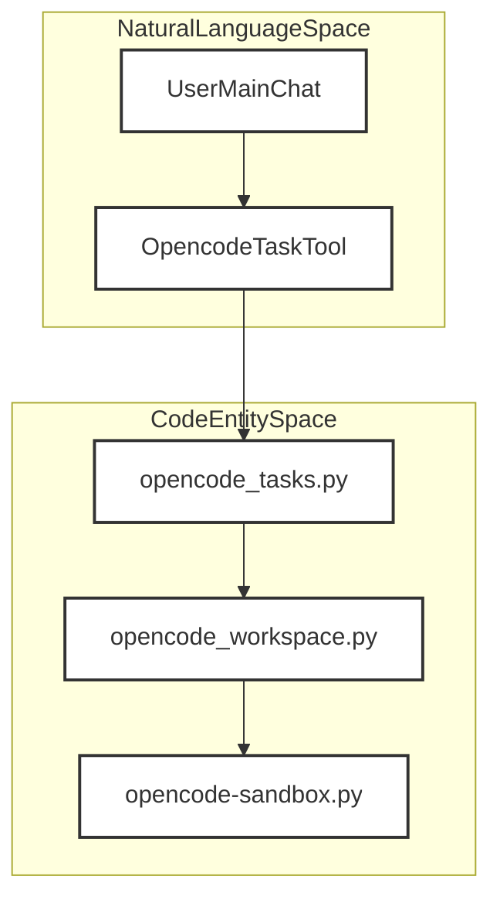
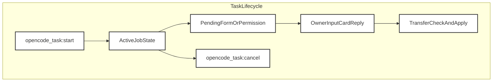
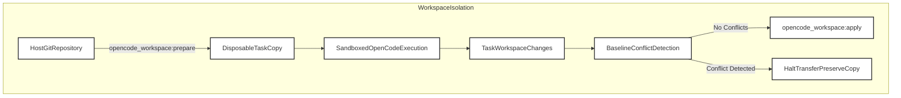
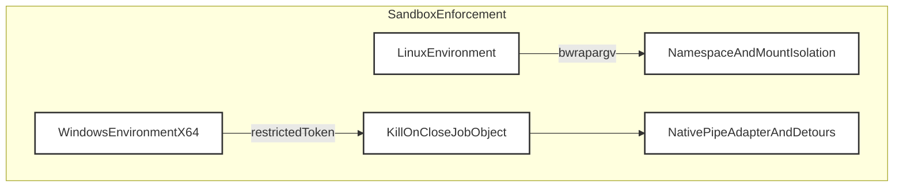

# OpenCode Delegation Subsystem

Relevant source files

The following files were used as context for generating this wiki page:

- [docs/architecture/OPENCODE_DELEGATION.md](docs/architecture/OPENCODE_DELEGATION.md)
- [docs/images/opencode-delegation-en.png](docs/images/opencode-delegation-en.png)
- [docs/images/opencode-delegation-en.svg](docs/images/opencode-delegation-en.svg)
- [docs/images/opencode-delegation-ru.png](docs/images/opencode-delegation-ru.png)
- [docs/images/opencode-delegation-ru.svg](docs/images/opencode-delegation-ru.svg)

## Purpose and Scope

The OpenCode Delegation Subsystem enables Linux and Windows x64 desktop platforms to delegate background coding assignments to an installed OpenCode service while preserving the continuity of the main conversation [docs/architecture/OPENCODE_DELEGATION.md:1-7](). The core orchestrator exposes an `opencode_task` tool supporting start, status, and cancellation primitives [docs/architecture/OPENCODE_DELEGATION.md:5-7](). 

This parent page provides a high-level overview of how background sessions are sandboxed, how code workspaces are isolated and snapshotted, and how task lifecycles are managed across processes. For comprehensive technical details, consult the dedicated child pages.

*Figure 1: Bridging natural language task requests to python orchestration entities.*

Sources: `docs/architecture/OPENCODE_DELEGATION.md:1-14`

---

## 5.1 OpenCodeService and Task Lifecycle

Background coding assignments operate as durable records rather than active turns in the primary conversation queue [docs/architecture/OPENCODE_DELEGATION.md:38-42](). A background runtime monitor polls session outcomes, timelines, pending form requests, and permission prompts, surfacing them securely through the main chat input-card interface [docs/architecture/OPENCODE_DELEGATION.md:38-45](). 

The system guarantees that model prose never accidentally answers permission prompts or user questions [docs/architecture/OPENCODE_DELEGATION.md:41-44](). Replying directly in OpenCode or via the host UI resolves the specific request ID, ensuring strict transactional isolation between agent loops [docs/architecture/OPENCODE_DELEGATION.md:41-45](). For deep architectural documentation on service installation, gateway management, KVM versus sandbox modes, and task job states, see [OpenCodeService and Task Lifecycle](#5.1).

*Figure 2: OpenCode task state transitions and user feedback loops.*

Sources: `docs/architecture/OPENCODE_DELEGATION.md:38-60`

---

## 5.2 Workspace Snapshots & Transfer Check

To prevent unintended modifications to host projects, the subsystem captures the active Git workspace—including tracked dirty files and non-ignored untracked files—into an independent repository clone without remotes or shared Git metadata [docs/architecture/OPENCODE_DELEGATION.md:8-13](). Private control paths, environment secrets, symlinks, and submodules are explicitly excluded or refused to guarantee source isolation [docs/architecture/OPENCODE_DELEGATION.md:8-13]().

Upon successful task execution, modified files in the temporary clone are compared against the original source baseline before final application [docs/architecture/OPENCODE_DELEGATION.md:48-52](). Any file conflicts abort the entire transfer while keeping the task clone intact for manual inspection [docs/architecture/OPENCODE_DELEGATION.md:48-52](). For details on workspace preparation, conflict detection algorithms, and strict isolation guarantees, see [Workspace Snapshots & Transfer Check](#5.2).

*Figure 3: Workspace preparation, execution, and transfer validation workflow.*

Sources: `docs/architecture/OPENCODE_DELEGATION.md:8-13`, `docs/architecture/OPENCODE_DELEGATION.md:48-52`

---

## 5.3 Sandbox Profiles and Host Services

The host environment runs OpenCode processes inside heavily fortified platform-specific sandboxes [docs/architecture/OPENCODE_DELEGATION.md:15-24](). Linux environments enforce restrictions using bubblewrap (`bwrap`) mount namespaces and private network contexts [docs/architecture/OPENCODE_DELEGATION.md:17-18](). Windows environments utilize restricted tokens, low mandatory integrity levels, private desktop handles, and kill-on-close process Job Objects [docs/architecture/OPENCODE_DELEGATION.md:18-20]().

Temporary access grants (such as ancestor directory traversal) are strictly scoped and automatically revoked when the process sandbox terminates [docs/architecture/OPENCODE_DELEGATION.md:20-24](). Windows x64 environments also leverage a native pipe adapter to safely capture command output without exposing private host files [docs/architecture/OPENCODE_DELEGATION.md:29-34](). For detailed parameters on bubblewrap argument vectors, bridge sockets, egress servers, and host-services tokens, see [Sandbox Profiles and Host Services](#5.3).

*Figure 4: Cross-platform sandbox isolation architecture.*

Sources: `docs/architecture/OPENCODE_DELEGATION.md:15-37`, `docs/architecture/OPENCODE_DELEGATION.md:63-68`
