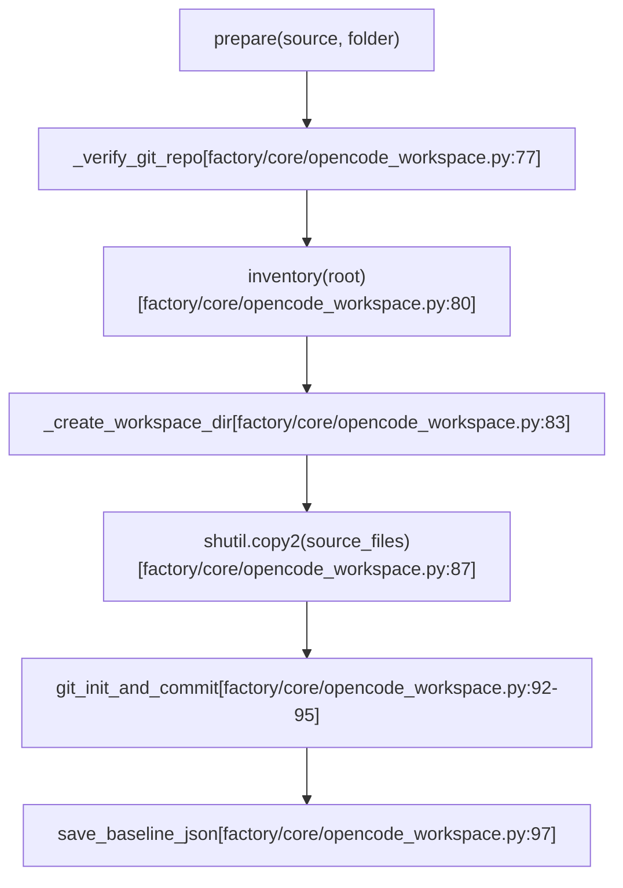
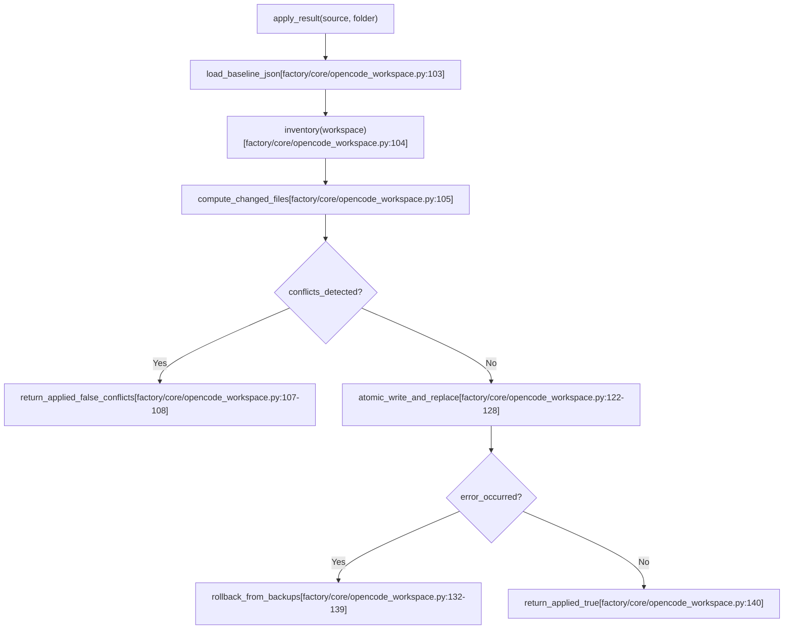
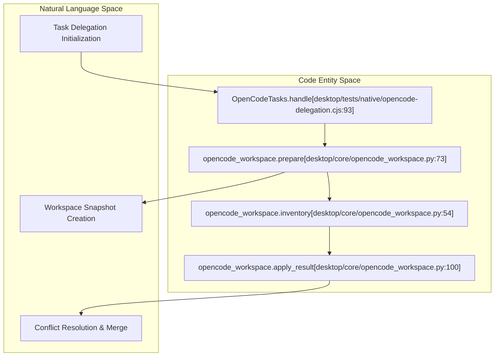

# Workspace Snapshots & Transfer Check

Relevant source files

The following files were used as context for generating this wiki page:

- [desktop/backend.py](desktop/backend.py)
- [desktop/main.cjs](desktop/main.cjs)
- [desktop/opencode-sandbox.py](desktop/opencode-sandbox.py)
- [desktop/opencode-workspace.cjs](desktop/opencode-workspace.cjs)
- [desktop/opencode_profiles.py](desktop/opencode_profiles.py)
- [desktop/tests/native/first-run.cjs](desktop/tests/native/first-run.cjs)
- [desktop/tests/native/opencode-delegation.cjs](desktop/tests/native/opencode-delegation.cjs)
- [factory/core/mobile_bridge/files.py](factory/core/mobile_bridge/files.py)
- [factory/core/opencode_workspace.py](factory/core/opencode_workspace.py)
- [tests/test_opencode_profiles.py](tests/test_opencode_profiles.py)

## Purpose and Scope
The workspace snapshot and transfer check subsystem (`factory/core/opencode_workspace.py`) is responsible for establishing clean, isolated file system baselines for background coding assignments delegated to sandboxed OpenCode sessions [factory/core/opencode_workspace.py:1](). It provides strict safety guarantees by isolating target source repositories, recording file inventories via Git and hash digests, preventing symlink traversal attacks, filtering sensitive files, detecting source modifications during task execution, and safely applying or rejecting modifications via conflict detection.

---

## 1. Snapshot Preparation (`prepare`)

When a delegated OpenCode task is initiated, the system calls `prepare(source, folder)` to generate an independent workspace copy [factory/core/opencode_workspace.py:73-98](). 

### Preparation Workflow
1. **Validation**: Resolves the source path, verifies it is an absolute directory, ensures it is not the home directory or root, and checks for an underlying Git repository (`rev-parse --show-toplevel`) [factory/core/opencode_workspace.py:74-77](). Submodules are explicitly rejected (`ls-files --stage` matching `160000`) [factory/core/opencode_workspace.py:78-79]().
2. **Inventory Indexing**: Scans all cached and untracked files using `inventory(root)` while omitting ignored files and sensitive paths [factory/core/opencode_workspace.py:54-70, 80]().
3. **Workspace Isolation**: Creates a secure working subdirectory (`folder/workspace`) with `0o700` permissions [factory/core/opencode_workspace.py:81-83]() and copies non-ignored regular files using `shutil.copy2` with `follow_symlinks=False` [factory/core/opencode_workspace.py:84-87]().
4. **Baseline Git History**: Initializes a clean Git repository inside the workspace, commits all staged files with a fixed author (`Igorek`), and archives the `.git` metadata to `folder/baseline.git` alongside a JSON inventory map (`folder/baseline.json`) [factory/core/opencode_workspace.py:92-97]().

*Sources: [factory/core/opencode_workspace.py:73-98]()*

---

## 2. Inventory Tracking and Source Isolation Guarantees

Source isolation relies on rigorous file validation functions defined in `opencode_workspace.py` to prevent unauthorized file access or directory traversal:

- **`private(name)`**: Blocks sensitive paths and credentials such as `.git`, `.aws`, `.ssh`, `.gnupg`, `.codex`, `.claude`, `.igorek-agent-factory`, `Archive`, `docs/local`, and environment files (`.env`, `.env.*` excluding `.example`) [factory/core/opencode_workspace.py:29-33]().
- **`entry(root, name)`**: Validates that target paths contain no parent directory traversals (`..`), are not symlinks escaping `root`, are regular files (`stat.S_ISREG`), and do not exceed size bounds (`MAX_BYTES = 512MB`) [factory/core/opencode_workspace.py:36-51](). It returns an object containing SHA-256 hash digests, file permissions (`mode`), and size [factory/core/opencode_workspace.py:51]().
- **`inventory(root, control)`**: Compiles a comprehensive mapping of relative paths to file hashes and metadata for cached and untracked files while enforcing total limits (`MAX_FILES = 20000`, `MAX_BYTES = 512MB`) [factory/core/opencode_workspace.py:54-70]().

---

## 3. Conflict Detection & Result Application (`apply_result`)

When an OpenCode session completes, `apply_result(source, folder)` evaluates whether the modifications made inside the isolated workspace can be safely merged back into the live project source [factory/core/opencode_workspace.py:100-140]().

### Conflict Check and Application Flow
1. **Baseline Comparison**: Reads the archived `baseline.json` and inventories the current workspace state against `baseline.git` to determine the set of changed files (`changed`) [factory/core/opencode_workspace.py:103-104]().
2. **Conflict Analysis**: Identifies conflicts by checking if any changed file in the live source (`root`) has been modified since the snapshot baseline was established (`entry(root, name) != baseline.get(name)`) [factory/core/opencode_workspace.py:106](). If conflicts exist, application is aborted and returns `{'applied': False, 'conflicts': conflicts, 'files': changed}` [factory/core/opencode_workspace.py:107-108]().
3. **Atomic Write & Rollback**: If conflict-free, backs up existing file contents, writes new file contents atomically via temporary files (`.igorek-...`), updates file modes, and replaces live targets [factory/core/opencode_workspace.py:110-130](). If any error occurs during application, changes are fully rolled back using the backup dictionary [factory/core/opencode_workspace.py:131-139]().

*Sources: [factory/core/opencode_workspace.py:100-140]()*

---

## 4. Integration with Delegation Subsystem and Tests

Workspace snapshot and transfer mechanics are invoked by the task controller (`OpenCodeTasks`) and validated through native integration test fixtures (`desktop/tests/native/opencode-delegation.cjs`) [desktop/tests/native/opencode-delegation.cjs:7-28](). 

The test harness spawns Python subprocesses to execute `prepare` and `apply_result`, ensuring that file modifications within sandboxed runner environments respect safety constraints and accurately catch concurrent source edits [desktop/tests/native/opencode-delegation.cjs:24-28]().

*Sources: [desktop/tests/native/opencode-delegation.cjs:7-28](), [factory/core/opencode_workspace.py:54-100]()*
