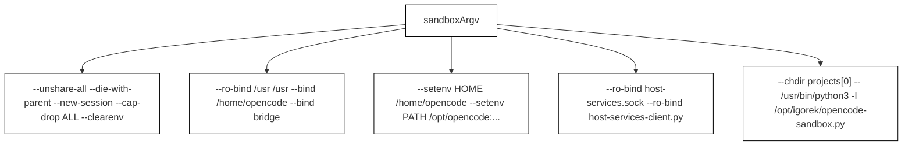
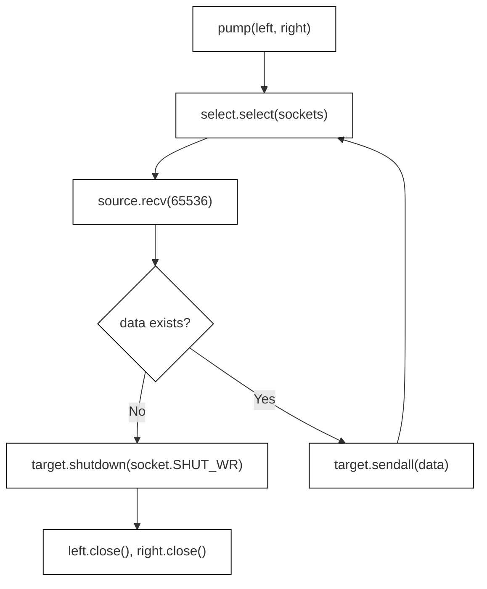
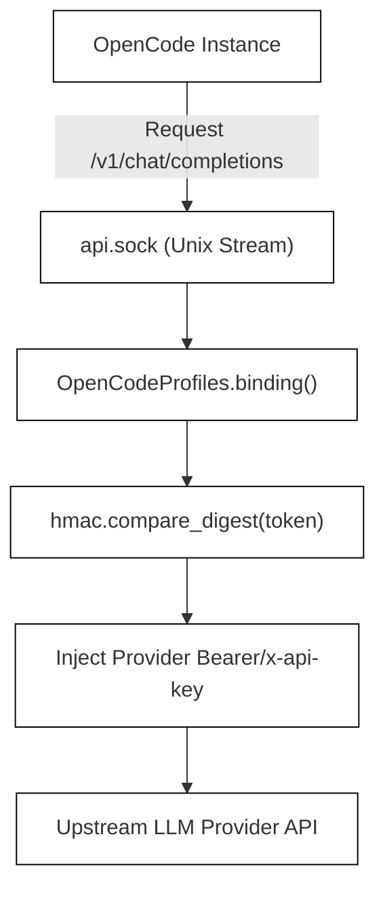

# Sandbox Profiles and Host Services

Relevant source files

The following files were used as context for generating this wiki page:

- [desktop/backend.py](desktop/backend.py)
- [desktop/opencode-sandbox.py](desktop/opencode-sandbox.py)
- [desktop/opencode-service.cjs](desktop/opencode-service.cjs)
- [desktop/opencode-tasks.cjs](desktop/opencode-tasks.cjs)
- [desktop/opencode-workspace.cjs](desktop/opencode-workspace.cjs)
- [desktop/opencode_profiles.py](desktop/opencode_profiles.py)
- [tests/test_opencode_profiles.py](tests/test_opencode_profiles.py)

## Purpose and Scope

This page documents the isolation subsystem, containerization parameters, profile proxying, and host-services architecture utilized when delegating background coding tasks to sandboxed OpenCode sessions. It details the Bubblewrap (`bwrap`) command-line argument construction, the container-side entrypoint script (`opencode-sandbox.py`), credential isolation via `opencode_profiles.py`, stream proxying bridges, and the Model Context Protocol (MCP) host-services integration.

---

## 1. Bubblewrap Sandbox Configuration (`sandboxArgv`)

The host-side orchestration layer prepares an isolated Linux container using Bubblewrap. The function `sandboxArgv` constructs the strict isolation argument vector (`argv`) that strips host capabilities, mounts selective filesystems, drops environment variables, and configures sandbox-internal paths [desktop/opencode-service.cjs:26-46]().

*Figure 5.3.1: Code-entity association for `sandboxArgv` argument vector generation.*

Sources: `desktop/opencode-service.cjs`

---

## 2. Guest Execution and Stream Pumping (`opencode-sandbox.py`)

Inside the Bubblewrap container, `opencode-sandbox.py` acts as the low-level supervisor and stream bridge [desktop/opencode-sandbox.py:1-49](). It runs stream redirection routines (`pump`) across Unix sockets and manages client requests [desktop/opencode-sandbox.py:13-30]().

*Figure 5.3.2: Stream pump loop logic inside `opencode-sandbox.py`.*

Sources: `desktop/opencode-sandbox.py`

---

## 3. Profile Security and Token Proxying (`opencode_profiles.py`)

To prevent sandboxed coding agents from leaking real API keys or altering model endpoints, `OpenCodeProfiles` intercepts provider configuration requests [desktop/opencode_profiles.py:25-113](). It exposes verified profiles via a Unix domain socket and proxies requests, injecting authentication headers on the host side [desktop/opencode_profiles.py:128-141]().

*Figure 5.3.3: Profile proxy token validation and credential isolation flow.*

Sources: `desktop/opencode_profiles.py`, `tests/test_opencode_profiles.py`

---

## 4. Bridge Sockets and Inter-Process Communication

Communication between the host environment, the desktop harness, and the sandboxed guest operates over isolated UNIX domain sockets mapped into `/run/igorek` inside the container [desktop/opencode-service.cjs:26-34](). 

- **`api.sock`**: Primary gateway for OpenCode server management API requests [desktop/opencode-tasks.cjs:10-28]().
- **`host-services.sock`**: Socket providing controlled execution of host operations via the MCP client [desktop/opencode-service.cjs:37-41]().
- **`profiles.sock`**: Socket exposing restricted LLM profiles to the sandbox environment [desktop/opencode-service.cjs:43]().

Sources: `desktop/opencode-service.cjs`, `desktop/opencode-tasks.cjs`

---

## 5. Host Services Tokens and MCP Integration

When host services are enabled in `sandboxArgv`, a local token file is mounted at `/run/igorek-host-services-token` alongside `host-services-client.py` [desktop/opencode-service.cjs:37-41](). The environment variable `OPENCODE_CONFIG_CONTENT` configures the Model Context Protocol (MCP) server inside OpenCode to route tools through the host bridge [desktop/opencode-service.cjs:41]().

Sources: `desktop/opencode-service.cjs`, `desktop/backend.py`
