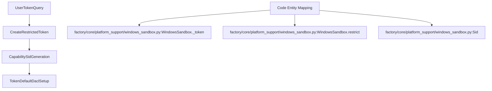
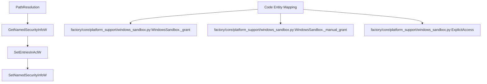
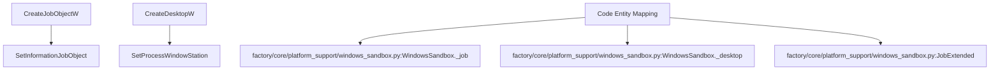
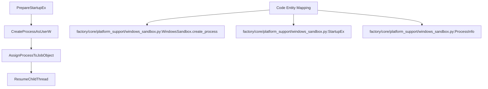

# WindowsSandbox Internals

Relevant source files

The following files were used as context for generating this wiki page:

- [desktop/native/windows-pipes.cpp](desktop/native/windows-pipes.cpp)
- [factory/core/platform_support/windows_sandbox.py](factory/core/platform_support/windows_sandbox.py)
- [tests/test_platform_support.py](tests/test_platform_support.py)

## Purpose and Scope

The Windows sandbox subsystem provides strict process isolation for child processes running on Windows hosts within the Igorek-Harness architecture. It enforces least privilege by combining Windows NT security primitives: restricted user tokens, unique capability SIDs, customized Discretionary Access Control Lists (DACLs), integrity labels, isolated window stations/desktops, and job objects with strict resource limits. 

This page details the implementation of `WindowsSandbox` and its security lifecycle as defined in `factory/core/platform_support/windows_sandbox.py` and tested in `tests/test_platform_support.py`.

Sources: `factory/core/platform_support/windows_sandbox.py`, `tests/test_platform_support.py`

---

## Restricted Tokens and Capability SIDs

To prevent a sandboxed agent task from elevating privileges or interacting with sensitive system components, `WindowsSandbox` constructs a restricted token using `CreateRestrictedToken`. 

During initialization (`factory/core/platform_support/windows_sandbox.py`), a unique capability SID is generated in the form of `S-1-5-21-...` [factory/core/platform_support/windows_sandbox.py:83](). This SID is assigned to the token to scope resource access exclusively to explicitly granted workspace directories and disposable roots.

*Diagram: Natural Language to Code Entity Space for Token Restriction.*

Sources: `factory/core/platform_support/windows_sandbox.py`, `tests/test_platform_support.py`

---

## DACL Grants and Integrity Labels

File and directory access is controlled via explicit DACL modifications. The sandbox manages permissions by translating paths into security descriptors using Windows API functions such as `SetNamedSecurityInfoW` and `SetEntriesInAclW` [factory/core/platform_support/windows_sandbox.py:120]().

- **Readable / Writable Roots**: Workspace paths and designated inputs are granted read or write access relative to the sandbox instance root [factory/core/platform_support/windows_sandbox.py:87]().
- **Manual Projects**: Explicit manual project grants can be provisioned and subsequently revoked to ensure temporary cross-workspace access does not leak [factory/core/platform_support/windows_sandbox.py:92]().
- **Integrity Labels**: Integrity levels restrict write access from lower-integrity processes to higher-integrity targets, preventing tampering.

*Diagram: DACL Modification Workflow and Code Mapping.*

Sources: `factory/core/platform_support/windows_sandbox.py`

---

## Isolated Desktops and Job Objects

Sandboxed processes are isolated from the primary user desktop and bound to resource-controlling job objects to restrict CPU time, memory consumption, and process tree expansion.

- **Isolated Desktops**: A private desktop is created via desktop APIs to isolate clipboard operations and window messages from the active user session [factory/core/platform_support/windows_sandbox.py:95]().
- **Job Objects**: Job objects use structures like `JobBasic` and `JobExtended` to cap working sets and enforce process termination policies when the sandbox handle is closed [factory/core/platform_support/windows_sandbox.py:36]().

*Diagram: Job Object and Desktop Isolation Lifecycle.*

Sources: `factory/core/platform_support/windows_sandbox.py`

---

## Process Spawn Lifecycle

The final phase of sandbox instantiation is launching the target executable under the configured security context. `WindowsSandbox` utilizes `CreateProcessAsUserW` combined with extended startup information (`StartupEx`) to apply the restricted token, assign the new process to the job object, and route it through the isolated desktop [factory/core/platform_support/windows_sandbox.py:131]().

*Diagram: Process Spawn Lifecycle and API Mapping.*

Sources: `factory/core/platform_support/windows_sandbox.py`, `tests/test_platform_support.py`
