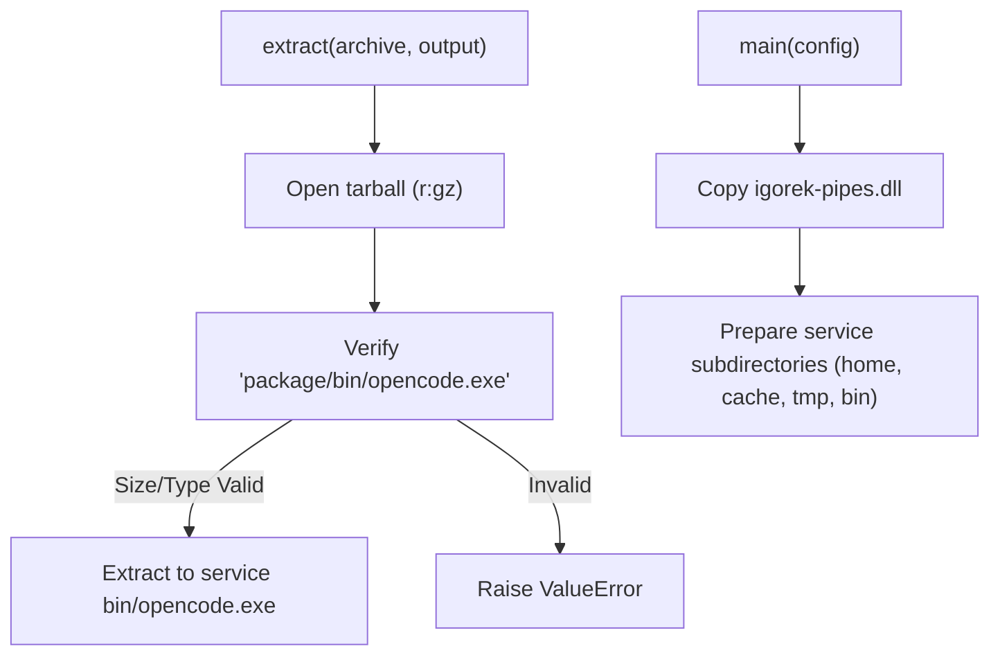
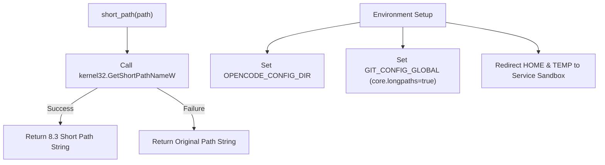
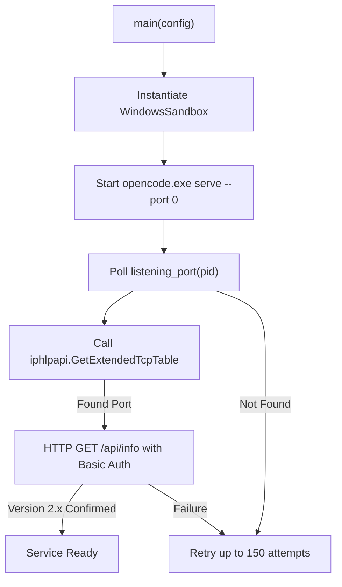

# Windows OpenCode Host Runner

Relevant source files

The following files were used as context for generating this wiki page:

- [desktop/opencode-windows.py](desktop/opencode-windows.py)
- [desktop/packaging/build-windows-runtime.py](desktop/packaging/build-windows-runtime.py)

## Purpose and Scope

The `desktop/opencode-windows.py` module acts as the host runner for launching and managing the native Windows OpenCode service inside a sandboxed environment on Windows platforms. It handles safe archive extraction of backend binaries, path shorteners for legacy-compatible environment variables, custom environment isolation, sandbox process instantiation via restricted tokens/job objects, and TCP port discovery using low-level IP helper APIs.

Sources: `[desktop/opencode-windows.py:1-19]()`

---

## Archive Extraction and Binary Preparation

The runner begins by unpacking required packages and binaries. The `extract(archive, output)` function handles gzipped tarball extraction specifically targeting `package/bin/opencode.exe` [desktop/opencode-windows.py:20-29].

Key safety checks during extraction include:
- Restricting output directory creation modes (`0o700`) [desktop/opencode-windows.py:22].
- Validating that the archive member is a regular file and bounded between 1 byte and 300 MB [desktop/opencode-windows.py:25].
- Copying the service binary and the native pipe adapter (`igorek-pipes.dll`) into the service `bin/` directory [desktop/opencode-windows.py:75-80].

Sources: `[desktop/opencode-windows.py:20-29]`, `[desktop/opencode-windows.py:73-80]()`

---

## Environment Isolation and Short Path Handling

Windows environments often encounter path length or special character limitations in legacy toolchains. To mitigate this, `desktop/opencode-windows.py` implements two core environment management strategies:

1. **Short Path Resolution (`short_path`)**: Uses `kernel32.GetShortPathNameW` to query 8.3-compatible short paths for directories such as `XDG_DATA_HOME` [desktop/opencode-windows.py:49-57, 97].
2. **Environment Isolation**: Constructs an isolated dictionary containing minimal necessary Windows root keys (`SystemRoot`, `WINDIR`, `COMSPEC`), redirects user profile and application data variables (`HOME`, `USERPROFILE`, `APPDATA`, `LOCALAPPDATA`, `TEMP`, `TMP`) to the service home/tmp directories, and configures global Git options [desktop/opencode-windows.py:90-102].

Sources: `[desktop/opencode-windows.py:49-58]`, `[desktop/opencode-windows.py:88-102]()`

---

## Sandbox Launch and TCP Port Discovery

Once the environment and directories are set up, the runner instantiates a `WindowsSandbox` instance [desktop/opencode-windows.py:119] and initiates the OpenCode service binary with dynamic loopback port assignment (`--port 0`) [desktop/opencode-windows.py:122].

Because the child process binds to an ephemeral port, `desktop/opencode-windows.py` uses `listening_port(pid)` [desktop/opencode-windows.py:31-46] to query active TCP listeners via `iphlpapi.GetExtendedTcpTable`, matching the process ID and loopback address (`127.0.0.1`) [desktop/opencode-windows.py:44].

Sources: `[desktop/opencode-windows.py:31-46]`, `[desktop/opencode-windows.py:119-141]()`
