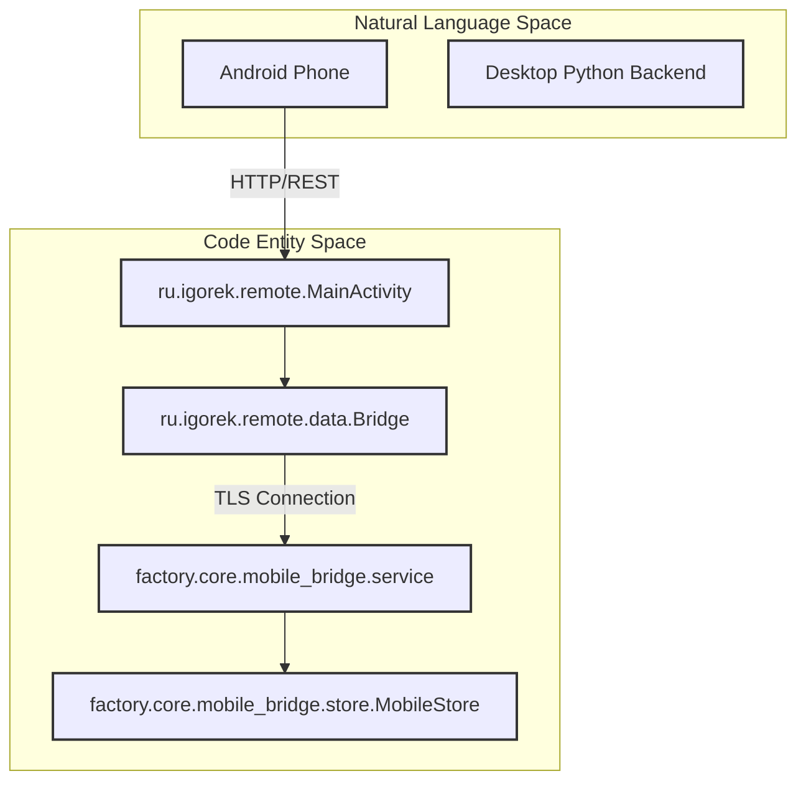
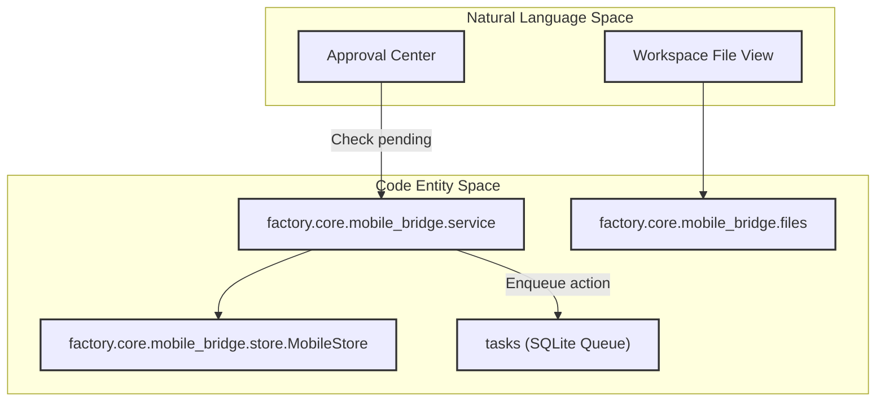

# Mobile: Android Client & Bridge

Relevant source files

The following files were used as context for generating this wiki page:

- [android/app/build.gradle.kts](android/app/build.gradle.kts)
- [android/app/src/main/assets/release-notes.json](android/app/src/main/assets/release-notes.json)
- [android/app/src/main/java/ru/igorek/remote/ui/SessionBrowserPanel.kt](android/app/src/main/java/ru/igorek/remote/ui/SessionBrowserPanel.kt)
- [android/build.gradle.kts](android/build.gradle.kts)
- [android/gradle/libs.versions.toml](android/gradle/libs.versions.toml)
- [factory/core/mobile_bridge/service.py](factory/core/mobile_bridge/service.py)

This page provides an architectural overview of the mobile remote client ecosystem for Igorek-Harness, consisting of the native Android application (`android/`) and the companion Python `mobile_bridge` subsystem (`factory/core/mobile_bridge/`) [factory/core/mobile_bridge/service.py:1-7](). Together, these components allow users to securely interact with desktop agent sessions, approve high-risk actions, inspect remote file trees, and control browser previews from an Android device.

As a parent page, this document outlines the core responsibilities of both the client and the bridge backend. For granular implementation details, see [Android App Structure & Build](#7.1) and [Mobile Bridge Backend](#7.2).

*Figure 7.1: High-level mapping from user-facing mobile operations to underlying Android and Python bridge code entities.*

Sources: `android/app/build.gradle.kts:40-50`, `factory/core/mobile_bridge/service.py:1-105`

---

## 7.1. Android App Structure & Build

The Android client is a native Jetpack Compose application built with Kotlin, targeting modern Android runtimes (`minSdk 26`, `compileSdk 37`) [android/app/build.gradle.kts:43-46]. The codebase is organized around modular UI panels (such as `SessionBrowserPanel.kt`), background bridge services, and voice call integration. Network communication relies on OkHttp with certificate pinning and custom TLS handling, while secure credential storage utilizes EncryptedSharedPreferences.

The build system utilizes Gradle with Kotlin DSL (`build.gradle.kts`), managing AndroidX dependencies, Compose Material 3 components, and Kotlin serialization via version catalogs (`gradle/libs.versions.toml`) [android/gradle/libs.versions.toml:1-34]. Release builds enforce strict validation of release notes (`verifyReleaseNotes`) and cryptographic signing configurations (`verifyReleaseSigning`) to ensure secure distribution artifacts [android/app/build.gradle.kts:87-127].

For detailed information on activities, Compose panels, Gradle configurations, and release signing, see [Android App Structure & Build](#7.1).

Sources: `android/build.gradle.kts:1-6`, `android/app/build.gradle.kts:37-146`, `android/app/src/main/java/ru/igorek/remote/ui/SessionBrowserPanel.kt:72-120`, `android/gradle/libs.versions.toml:1-34`

---

## 7.2. Mobile Bridge Backend

The mobile bridge backend (`factory/core/mobile_bridge/`) integrates directly into the existing Igorek runtime rather than running as a standalone executor [factory/core/mobile_bridge/service.py:1-7]. It routes messages through the shared `tasks` queue, appends history to the same `chat_sessions/*.jsonl` journals used by the TUI and Telegram clients, and shares storage for approvals and user input [factory/core/mobile_bridge/service.py:1-7].

Key modules within the bridge backend handle safe file operations (`files.py`), session uploads (`uploads.py`), persistent credential and pairing data stores (`store.py`), and high-risk tool filtering (`HIGH_RISK_TOOLS`) [factory/core/mobile_bridge/service.py:105-122]. The bridge exposes endpoints for pairing verification, workspace file inspection, and remote approval workflows while maintaining isolation guarantees with the desktop core.

*Figure 7.2: Bridge backend components processing mobile requests and interfacing with shared storage.*

Sources: `factory/core/mobile_bridge/service.py:1-140`

For detailed information on the bridge server, SQLite stores, source routers, safe file access protocols, and test coverage, see [Mobile Bridge Backend](#7.2).
