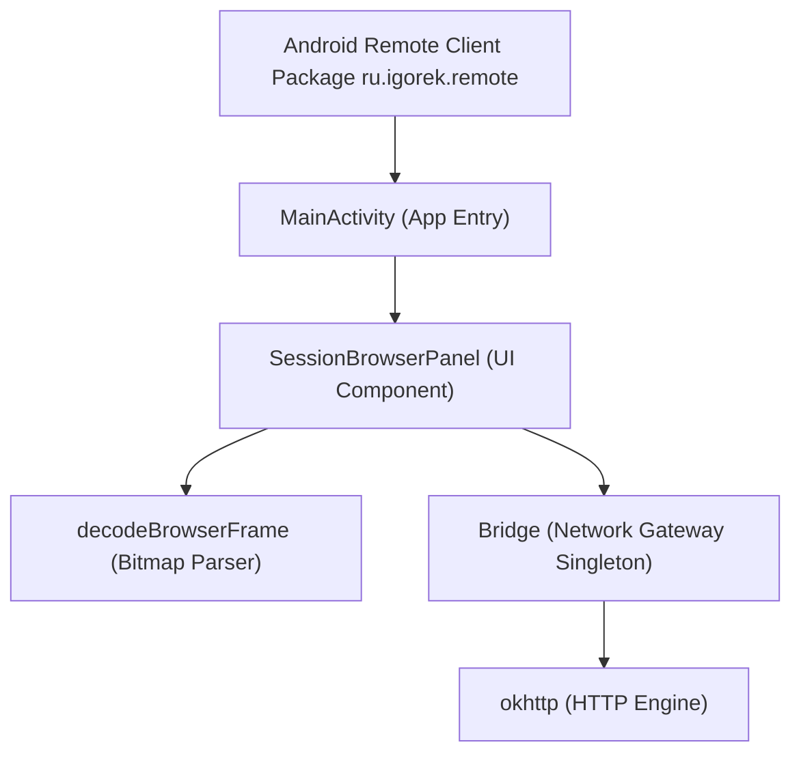
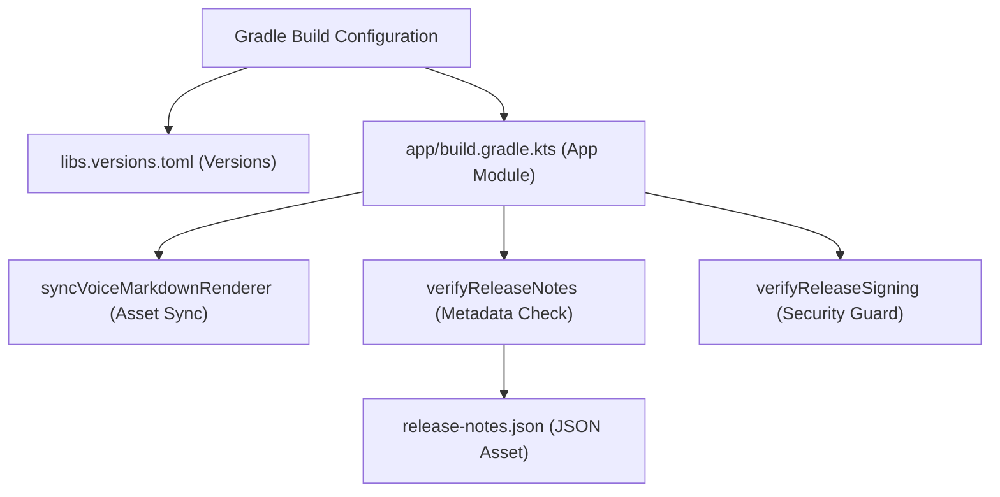

# Android App Structure & Build

Relevant source files

The following files were used as context for generating this wiki page:

- [android/app/build.gradle.kts](android/app/build.gradle.kts)
- [android/app/src/main/assets/release-notes.json](android/app/src/main/assets/release-notes.json)
- [android/app/src/main/java/ru/igorek/remote/ui/SessionBrowserPanel.kt](android/app/src/main/java/ru/igorek/remote/ui/SessionBrowserPanel.kt)
- [android/build.gradle.kts](android/build.gradle.kts)
- [android/gradle/libs.versions.toml](android/gradle/libs.versions.toml)
- [android/gradle/wrapper/gradle-wrapper.jar](android/gradle/wrapper/gradle-wrapper.jar)
- [android/gradle/wrapper/gradle-wrapper.properties](android/gradle/wrapper/gradle-wrapper.properties)
- [android/gradlew](android/gradlew)
- [android/gradlew.bat](android/gradlew.bat)
- [desktop/about.html](desktop/about.html)

## Purpose and Scope

The Android client module (`ru.igorek.remote`) provides a remote Kotlin and Jetpack Compose interface to the desktop and core Igorek harness. It handles network communication through `Bridge`, manages secure local storage via `androidx.security:security-crypto`, renders reactive UI panels such as `SessionBrowserPanel`, and enforces strict Gradle-based build workflows, asset synchronization, and cryptographic signing policies.

Sources: `[android/app/build.gradle.kts:40-50](), [android/app/src/main/java/ru/igorek/remote/ui/SessionBrowserPanel.kt:60-75]()`

---

## Kotlin App Structure & UI Panels

The Android app resides within the `ru.igorek.remote` package namespace, targeting an Android `compileSdk` of 37 and a `minSdk` of 26 (`[android/app/build.gradle.kts:40-45]()`). The user interface is built entirely with Jetpack Compose and Material 3 components.

### Session Browser Panel

The `SessionBrowserPanel` component (`[android/app/src/main/java/ru/igorek/remote/ui/SessionBrowserPanel.kt:72-120]()`) manages browser preview interactions, decoding base64-encoded JPEG frames (`[android/app/src/main/java/ru/igorek/remote/ui/SessionBrowserPanel.kt:50-58]()`) and executing lifecycle-aware background polling via `repeatOnLifecycle` (`[android/app/src/main/java/ru/igorek/remote/ui/SessionBrowserPanel.kt:92-118]()`).

Sources: `[android/app/src/main/java/ru/igorek/remote/ui/SessionBrowserPanel.kt:50-123]()`

---

## Gradle Configuration & Dependency Version Catalogs

The build configuration uses Gradle version catalogs (`libs.versions.toml`) to centrally manage dependency versions across the Android project (`[android/gradle/libs.versions.toml:1-33]()`). 

### Core Dependencies Table

| Dependency Group & Artifact | Version Reference | Role in App Module |
| :--- | :--- | :--- |
| `androidx.compose:compose-bom` | `2026.09.00` | Jetpack Compose Bill of Materials |
| `com.squareup.okhttp3:okhttp` | `5.5.0` | HTTP transport and SSE client for Bridge |
| `org.jetbrains.kotlinx:kotlinx-serialization-json` | `1.11.0` | JSON serialization for bridge payloads |
| `androidx.security:security-crypto` | `1.1.0` | Encrypted SharedPrefs and vault keys |
| `com.journeyapps:zxing-android-embedded` | `4.3.0` | QR code scanning for pairing |

Sources: `[android/gradle/libs.versions.toml:1-33](), [android/app/build.gradle.kts:129-146]()`

Sources: `[android/gradle/libs.versions.toml:1-33](), [android/app/build.gradle.kts:1-146]()`

---

## Build Tasks, Asset Sync & Release Verification

The app module build script (`[android/app/build.gradle.kts:1-146]()`) defines automated tasks to prepare test environments, sync static assets from the Python backend, and validate release metadata.

### Custom Gradle Tasks

* **`generateTestTlsKey`**: Generates a self-signed PKCS12 keystore (`loopback-test.p12`) for TLS unit and instrumentation test fixtures (`[android/app/build.gradle.kts:12-25]()`).
* **`syncVoiceMarkdownRenderer`**: Copies `factory/web_ui/static/render.js` and octopus drawable resources into the generated voice markdown assets directory before pre-build (`[android/app/build.gradle.kts:28-35]()`).
* **`verifyReleaseNotes`**: Parses `src/main/assets/release-notes.json` (`[android/app/src/main/assets/release-notes.json:1-16]()`) to ensure `versionName` and `versionCode` match `defaultConfig`, and checks that bilingual (`ru`/`en`) translation notes are present (`[android/app/build.gradle.kts:101-127]()`).

Sources: `[android/gradle/libs.versions.toml:1-33](), [android/app/build.gradle.kts:28-127](), [android/app/src/main/assets/release-notes.json:1-16]()`

---

## Gradle Wrapper & Signing Pipeline

The project includes standard POSIX (`[android/gradlew:1-50]()`) and Windows (`[android/gradlew.bat:1-30]()`) wrapper scripts backed by Gradle version `9.8.1` (`[android/gradle/wrapper/gradle-wrapper.properties:1-7]()`).

### Release Signing and Security Guards

Release builds (`[android/app/build.gradle.kts:53-70]`) require specific environment variables (`IGOREK_ANDROID_KEYSTORE`, `IGOREK_ANDROID_STORE_PASSWORD_FILE`, and `IGOREK_ANDROID_KEY_ALIAS`). The custom validation task `verifyReleaseSigning` enforces strict security constraints prior to packaging release binaries:
1. Verifies all required environment variables are set.
2. Asserts that signing input paths point to regular files rather than symbolic links (`[android/app/build.gradle.kts:92-94]()`).
3. Guarantees that keystore credentials reside *outside* the repository directory tree (`[android/app/build.gradle.kts:95]()`).

Sources: `[android/gradle/wrapper/gradle-wrapper.properties:1-7](), [android/gradlew:1-50](), [android/gradlew.bat:1-30](), [android/app/build.gradle.kts:53-99]()`

### Reasoning formatting and completed-task time

Expanded reasoning cards use the existing native Markdown renderer, including syntax-highlighted fenced code, per-block copying and horizontal scrolling. Collapsed cards retain a three-line preview; the header copy action still copies the original complete reasoning. Code is displayed as text and is not executed, including unfinished fences received while streaming.

A completed-task card shows elapsed wall-clock time between execution start and completion when both are known. Queue creation time and individual tool durations are not substituted. Pauses within the same task interval are included. Persisted events restore the value on reopening a chat; optional task metadata `started_at`/`completed_at` can backfill missing events. Missing or reversed timestamps leave the duration absent rather than showing zero.
