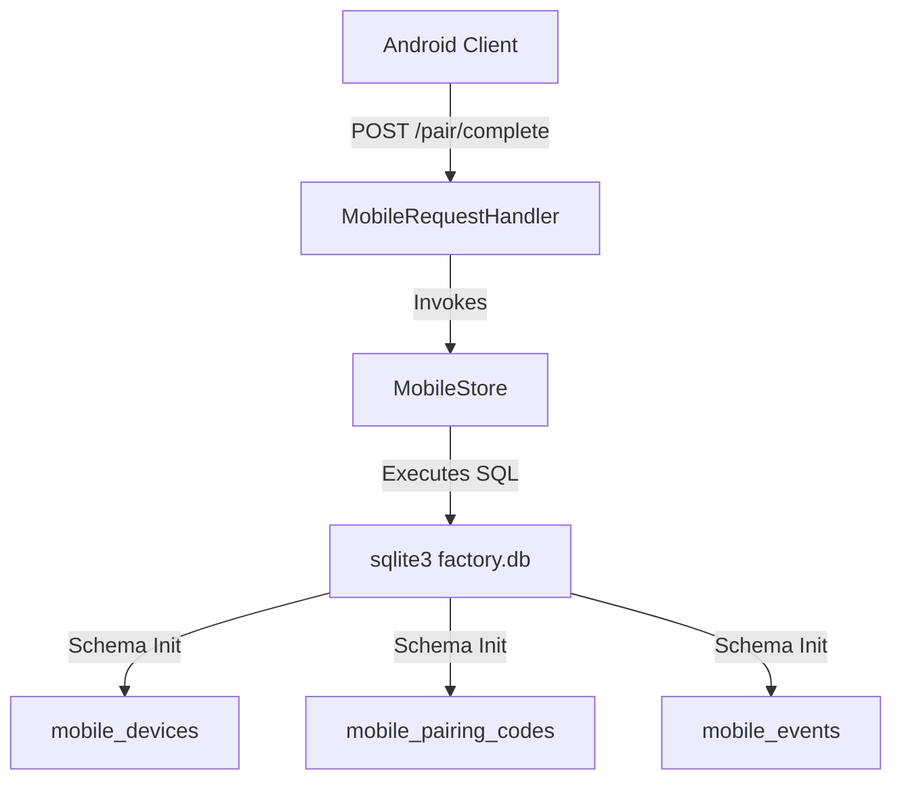
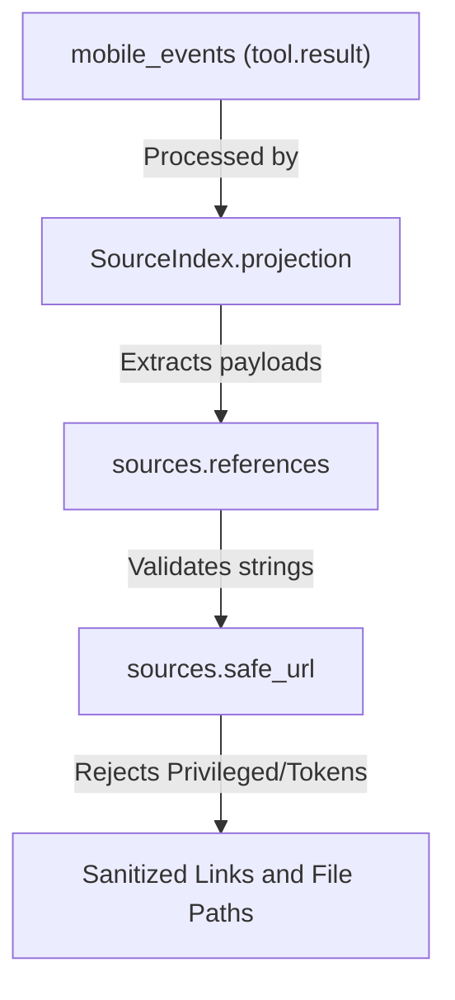

# Mobile Bridge Backend

Relevant source files

The following files were used as context for generating this wiki page:

- [factory/core/mobile_bridge/service.py](factory/core/mobile_bridge/service.py)
- [factory/core/mobile_bridge/sources.py](factory/core/mobile_bridge/sources.py)
- [factory/core/mobile_bridge/store.py](factory/core/mobile_bridge/store.py)
- [tests/test_mobile_bridge_server.py](tests/test_mobile_bridge_server.py)
- [tests/test_session_sources.py](tests/test_session_sources.py)

The mobile bridge backend (`mobile_bridge`) enables remote clients (such as the Android companion app) to interact directly with the local Igorek runtime without instantiating a separate agent executor. It queues tasks into the shared task registry, continues sessions within durable JSONL journals (`chat_sessions/*.jsonl`), and unifies approval flows and user inputs with the TUI and Telegram channels.

Sources: `[factory/core/mobile_bridge/service.py:1-7]()`

---

## 1. State Store and Pairing Architecture (`MobileStore`)

Device persistence, single-use enrollment codes, and monotonic event streaming are managed by `MobileStore` inside the shared SQLite database (`factory.db`). 

The persistence layer defines four primary tables:
- `mobile_devices`: Stores metadata, platform info, and hashed device tokens (`token_hash`) secured with a application-level pepper (`_DEVICE_TOKEN_PEPPER`).
- `mobile_pairing_codes`: Short-lived, single-use codes (`code_hash`) protected by `_PAIRING_CODE_PEPPER` with default time-to-live (`_DEFAULT_PAIRING_TTL_S`).
- `mobile_events`: A durable monotonic event stream indexed by `seq` for efficient delta-sync over reconnecting clients.
- `mobile_requests`: Tracks idempotency keys and active execution scopes.

Sources: `[factory/core/mobile_bridge/store.py:1-88]`, `[factory/core/mobile_bridge/store.py:145-193]()`

---

## 2. Bridge Service and Message Queueing (`MobileService`)

`MobileService` coordinates operations over active agent sessions. Rather than running isolated execution threads, it deposits tasks into the global `tasks` queue inspected by local workers.

Key runtime attributes and policies defined in `service.py`:
- `ACTIVE_STATUSES`: Encompasses states such as `queued`, `processing`, `waiting_approval`, `cancelling`, and `retry`.
- `FINAL_STATUSES`: Terminal states like `ok`, `fail`, `dead_letter`, `cancelled`, and `timeout`.
- `HIGH_RISK_TOOLS`: Designates tools (`write`, `edit`, `bash`) requiring explicit elevated permissions or mobile approval prompts.
- Foreign approval filtering (`_FOREIGN_APPROVAL_FILTER_SQL`): Excludes external platform approvals (such as Telegram or chat-specific bindings) from surfacing in the mobile approval center to avoid decision duplication.

Sources: `[factory/core/mobile_bridge/service.py:1-133]()`

---

## 3. Sources Indexing and Safe File Access (`SourceIndex`)

The `SourceIndex` class caches and projects references and changed file paths derived from durable tool-result event journals.

The reference extraction process parses tool output payloads, identifies valid external URLs via `safe_url()`, and strips out private query parameters or credential-bearing links (`_PRIVATE_QUERY`).

Sources: `[factory/core/mobile_bridge/sources.py:16-139]()`

---

## 4. Test Suites and Server Integration

The mobile bridge functionality is verified by comprehensive server and unit test suites located in `tests/test_mobile_bridge_server.py` and `tests/test_session_sources.py`.

- `ServerTestCase`: Spins up a temporary runtime environment and instantiates a background `MobileBridge` instance running on an ephemeral port.
- `AuthFlowTest`: Exercises pairing flows, device revocation, sudo request restrictions over plain HTTP, token validation, and session pinning state persistence.
- Session source tests ensure that privileged URIs (`file://`, `javascript:`, credentials in query strings) are strictly rejected by `safe_url()` and unrecorded paths or environment files are excluded from session file listings.

Sources: `[tests/test_mobile_bridge_server.py:1-163]`, `[tests/test_session_sources.py:1-121]()`
