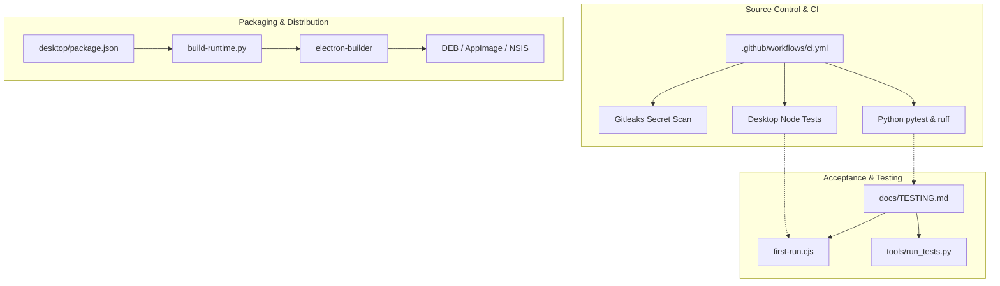
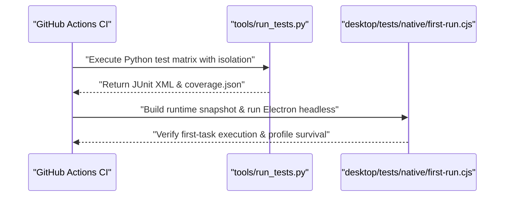

# Build, Packaging, CI and Testing

Relevant source files

The following files were used as context for generating this wiki page:

- [.github/workflows/ci.yml](.github/workflows/ci.yml)
- [.gitignore](.gitignore)
- [.gitleaks.toml](.gitleaks.toml)
- [desktop/package-lock.json](desktop/package-lock.json)
- [desktop/package.json](desktop/package.json)
- [desktop/tests/helpers/private-permissions.cjs](desktop/tests/helpers/private-permissions.cjs)
- [docs/TESTING.md](docs/TESTING.md)

This page provides a high-level overview of how the Igorek-Harness project is built, packaged into deployable desktop and mobile artifacts, verified through automated continuous integration workflows, and tested across its multi-language layers. 

As a parent page, this section introduces the primary components of the build and validation pipeline. For deep technical details on specific scripts, configuration files, and execution mechanics, refer to the child pages:
- [Desktop Packaging & Distribution](#8.1)
- [CI Workflows & Publication Checks](#8.2)
- [Test Suites and Native Acceptance Runs](#8.3)

*Sources: [desktop/package.json:1-28](), [.github/workflows/ci.yml:1-38](), [docs/TESTING.md:1-38]()*

---

## 8.1 Desktop Packaging & Distribution

The desktop application packages the Electron shell (`desktop/`) alongside a compiled Python runtime bundle. Build scripts handle dependency isolation, source bundling, and artifact generation across Linux and Windows platforms.

The packaging flow uses scripts defined in `desktop/package.json` [desktop/package.json:5-14]() to invoke Python bundling utilities such as `packaging/build-runtime.py` and `packaging/build-windows-runtime.py`. These scripts construct self-contained Python environments, inject required application code, and configure `electron-builder` to produce installers and portable binaries (such as DEB, AppImage, and NSIS packages). Sandbox policy installers (`install-sandbox-policy.sh`) ensure unprivileged user namespaces and AppArmor profiles are correctly set up on target Linux hosts.

For comprehensive details on configuration parameters, bundle preparation, and target-specific artifacts, see [Desktop Packaging & Distribution](#8.1).

*Sources: [desktop/package.json:1-28](), [docs/TESTING.md:108-118]()*

---

## 8.2 CI Workflows & Publication Checks

Continuous integration and quality gates are orchestrated via GitHub Actions workflows in `.github/workflows/ci.yml` [.github/workflows/ci.yml:1-38](). The CI pipeline enforces rigorous security, code style, and test coverage standards before any code is merged or released.

Key validation jobs include:
- **Secret Detection**: Scanning the current tree and full git history using `gitleaks` against `.gitleaks.toml` [.github/workflows/ci.yml:17-38]().
- **Python Multi-Version Matrix**: Running `ruff` checks and executing comprehensive test suites across supported Python versions (`3.13`, `3.14`) with locked dependencies (`uv sync --locked --dev`) [.github/workflows/ci.yml:38-86]().
- **Desktop Contracts**: Validating Node.js test suites across Linux and Windows runner environments [.github/workflows/ci.yml:87-106]().
- **Native Acceptance**: Building actual offline snapshots and executing windowed Electron workflows under `xvfb-run` [.github/workflows/ci.yml:107-157]().

For deep dives into action definitions, dependabot rules, and publication contract verification tools, see [CI Workflows & Publication Checks](#8.2).

*Sources: [.github/workflows/ci.yml:1-162](), [.gitleaks.toml:1-25]()*

---

## 8.3 Test Suites and Native Acceptance Runs

Verification in Igorek-Harness spans multiple distinct test runners and verification layers, documenting results through structured coverage reports and release journals as outlined in `docs/TESTING.md` [docs/TESTING.md:1-38]().

The test ecosystem includes:
- **Python Unit & Integration Tests**: Discovered and run via `tools/run_tests.py`, enforcing per-test deadlines, isolated temporary Vault data, and branch coverage tracking [docs/TESTING.md:17-27]().
- **Desktop Node Tests**: Component and transport contract validations executed via `npm test` within `desktop/tests/` [docs/TESTING.md:28-32]().
- **Native Acceptance Scripts**: Automated Electron scenarios (`desktop/tests/native/first-run.cjs`) verifying actual window rendering, first-task delegation, and state persistence after backend restarts [docs/TESTING.md:29-32]().
- **Helper Utilities**: Specialized assertion scripts like `desktop/tests/helpers/private-permissions.cjs` ensuring strict file and access control list (ACL) permissions on sensitive Vault fixtures [desktop/tests/helpers/private-permissions.cjs:1-26]().

*Sources: [docs/TESTING.md:1-123](), [desktop/tests/helpers/private-permissions.cjs:1-26]()*, [.github/workflows/ci.yml:70-157]()

For detailed documentation on coverage scopes, execution commands, acceptance matrices, and the TestLOG release journal, see [Test Suites and Native Acceptance Runs](#8.3).

*Sources: [docs/TESTING.md:1-123]()*
