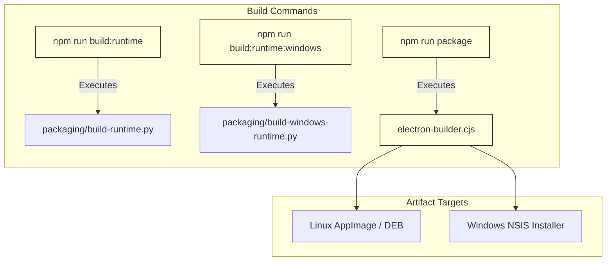
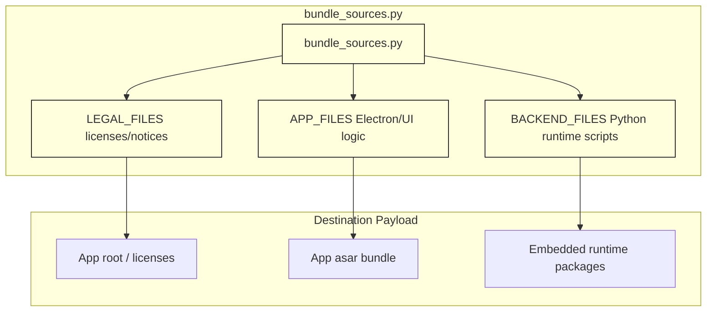

# Desktop Packaging & Distribution

Relevant source files

The following files were used as context for generating this wiki page:

- [desktop/package-lock.json](desktop/package-lock.json)
- [desktop/package.json](desktop/package.json)
- [desktop/packaging/build-windows-runtime.py](desktop/packaging/build-windows-runtime.py)
- [desktop/packaging/bundle_sources.py](desktop/packaging/bundle_sources.py)
- [desktop/window-chrome.css](desktop/window-chrome.css)
- [desktop/window-chrome.js](desktop/window-chrome.js)
- [docs/THIRD_PARTY_NOTICES.md](docs/THIRD_PARTY_NOTICES.md)
- [docs/licenses/OPENCODE-ICON-LICENSE.txt](docs/licenses/OPENCODE-ICON-LICENSE.txt)
- [factory/web_ui/static/app.js](factory/web_ui/static/app.js)

The desktop packaging and distribution subsystem is responsible for bundling the Electron-based main process, web UI assets, native code components, and an embedded isolated Python runtime into production-ready packages (`.deb`, `.AppImage`, and `.nsis` installers). This page details the configuration scripts, allowlists, runtime builders, and artifact generation pipelines.

---

## Purpose and Scope

The scope of desktop packaging covers transforming source repositories into self-contained desktop binaries for Linux and Windows. It integrates Node.js dependency compilation (`electron-builder`), Python environment cloning (`uv`), native binary embedding (such as `ripgrep` and Windows process pipe adapters), and manifest generation to ensure secure, deterministic builds.

Sources: `desktop/package.json:1-14()`, `desktop/packaging/bundle_sources.py:1-26()`

---

## 1. Electron-Builder Configuration & Build Scripts

The desktop workspace is governed by `desktop/package.json`, which defines scripts for development, native runtime building, and final packaging via `electron-builder` [desktop/package.json:1-14()].

*Figure 1: Desktop Build Script Flow to Artifact Generation.*

Sources: `desktop/package.json:1-14()`

---

## 2. Application Source Allowlists (`bundle_sources.py`)

To prevent extraneous build files, tests, or sensitive local configuration from leaking into production distributions, all packaged sources are strictly controlled via `desktop/packaging/bundle_sources.py`. The file defines tuple constants for legal notices (`LEGAL_FILES`), front-end and Electron core scripts (`APP_FILES`), and Python backend execution scripts (`BACKEND_FILES`) [desktop/packaging/bundle_sources.py:1-26()].

*Figure 2: Mapping Source Allowlists to Distribution Layouts.*

Sources: `desktop/packaging/bundle_sources.py:1-26()`

---

## 3. Platform Runtimes and Dependency Compilation

The Python runtime payload is assembled dynamically depending on the target platform. For Windows targets, `desktop/packaging/build-windows-runtime.py` downloads a pinned CPython embed distribution (`3.14.4`), exports locked requirements using `uv`, compiles the project wheel, and bundles auxiliary tools like `ripgrep` and Windows pipe adapters [desktop/packaging/build-windows-runtime.py:1-92()].

### Key Pipeline Steps in `build-windows-runtime.py`:
1. **Validation**: Confirms `.python-version` matches the hardcoded `PYTHON_VERSION` and verifies SHA256 checksums [desktop/packaging/build-windows-runtime.py:26-40()].
2. **Dependency Export**: Runs `uv export --frozen --no-dev --no-emit-project` to generate a strict requirements list [desktop/packaging/build-windows-runtime.py:47-49()].
3. **Wheel Compilation**: Invokes `tools/build_wheel.py` to build the `igorek_agent_factory` wheel and capture its provenance JSON [desktop/packaging/build-windows-runtime.py:54-65()].
4. **Tool Bundling**: Downloads `ripgrep`, compiles Windows named pipe adapters via `build-windows-pipes.py`, and writes a comprehensive `manifest.json` recording all component hashes [desktop/packaging/build-windows-runtime.py:69-91()].

Sources: `desktop/packaging/build-windows-runtime.py:24-92()`

---

## 4. Distribution Artifacts: DEB, AppImage, and NSIS

Electron-builder packages the assembled application tree into native installers based on the host environment:
* **Linux**: Produces `.deb` packages for Debian/Ubuntu environments and self-contained `.AppImage` bundles containing sandbox policies and runtime wrappers.
* **Windows**: Produces `.nsis` installer executables that unpack the Electron binaries, set up start menu shortcuts, and provision the isolated Python environment alongside required DLLs and native hooks.

Sources: `desktop/package.json:12-12()`, `docs/THIRD_PARTY_NOTICES.md:41-43()`

---

## 5. Sandbox Policy Installation and Third-Party Compliance

Packages must incorporate comprehensive third-party legal notices and license inventories. Components such as `xterm.js`, `highlight.js`, `SheetJS`, Microsoft Detours, and bundled Python modules are recorded in `docs/THIRD_PARTY_NOTICES.md` [docs/THIRD_PARTY_NOTICES.md:1-88()]. 

During packaging, these legal files are bundled into the target distribution directory to preserve compliance with upstream MIT, Apache-2.0, and BSD licenses.

Sources: `docs/THIRD_PARTY_NOTICES.md:1-44()`
