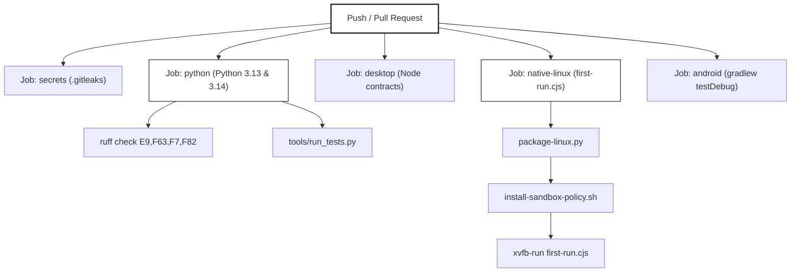
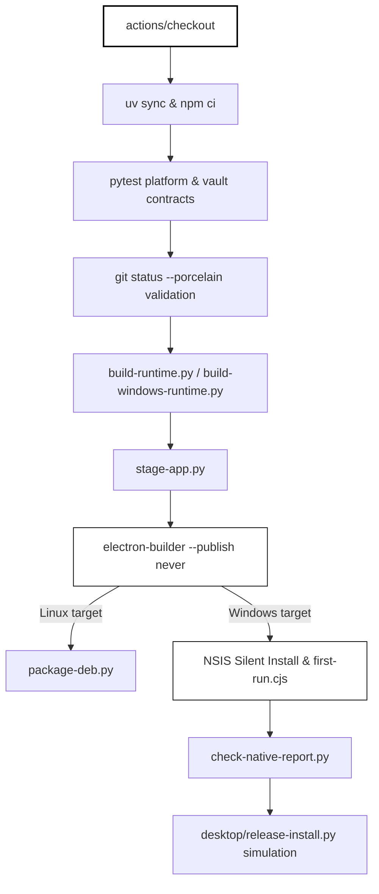

# CI Workflows & Publication Checks

Relevant source files

The following files were used as context for generating this wiki page:

- [.gitattributes](.gitattributes)
- [.github/dependabot.yml](.github/dependabot.yml)
- [.github/workflows/ci.yml](.github/workflows/ci.yml)
- [.github/workflows/desktop-build.yml](.github/workflows/desktop-build.yml)
- [.gitignore](.gitignore)
- [.gitleaks.toml](.gitleaks.toml)
- [desktop/agent_runtime.py](desktop/agent_runtime.py)
- [desktop/tests/helpers/private-permissions.cjs](desktop/tests/helpers/private-permissions.cjs)
- [docs/TESTING.md](docs/TESTING.md)
- [tests/test_publication_contracts.py](tests/test_publication_contracts.py)
- [tests/test_publication_git_config.py](tests/test_publication_git_config.py)
- [tools/check_publication.py](tools/check_publication.py)

## Purpose and Scope
This page details the continuous integration (CI) workflows, automated publication checks, secret detection systems, and dependency maintenance policies implemented in the Igorek-Harness codebase. It covers the primary GitHub Actions workflows (`.github/workflows/ci.yml` and `.github/workflows/desktop-build.yml`), the publication and documentation validation harness (`tools/check_publication.py`), secret scanning (`.gitleaks.toml`), and automated dependency management (`.github/dependabot.yml`).

Sources: [`.github/workflows/ci.yml:1-162](), [`.github/workflows/desktop-build.yml:1-134](), [`tools/check_publication.py:1-113](), [`.github/dependabot.yml:1-44](), [`.gitleaks.toml:1-26]()

---

## 1. Main CI Pipeline (`ci.yml`)

The primary integration pipeline is defined in `.github/workflows/ci.yml`. It runs on every pull request and push to `main` with minimal repository permissions (`contents: read`) and concurrent cancellation configured [.github/workflows/ci.yml:1-15]().

The pipeline executes five core jobs:
1. **`secrets`**: Clones the repository with full history (`fetch-depth: 0`) and runs `gitleaks` against the current tree and all historical commits [.github/workflows/ci.yml:17-37]().
2. **`python`**: Runs across Python `3.13` and `3.14` matrix legs on `ubuntu-24.04`. It provisions system dependencies (`apparmor`, `bubblewrap`, `qemu-utils`, `ripgrep`, `openssl`, `xvfb`, `python3-gi`, `gir1.2-gtk-4.0`), configures AppArmor profiles for unprivileged user namespaces in `bwrap`, syncs locked dev dependencies via `uv`, runs `ruff` syntax checks, and executes `tools/run_tests.py` inside an `xvfb` session [.github/workflows/ci.yml:38-85]().
3. **`desktop`**: Runs Node-based desktop test contracts on `ubuntu-24.04` and `windows-2025` using `npm --prefix desktop test` [.github/workflows/ci.yml:87-106]().
4. **`native-linux`**: Builds an offline Linux desktop snapshot, configures sandbox policies via `install-sandbox-policy.sh`, and executes `desktop/tests/native/first-run.cjs` under `xvfb-run` to verify real backend communication and UI initialization [.github/workflows/ci.yml:107-156]().
5. **`android`**: Executes Gradle unit tests, lint checks, and a debug build for the Android client module [.github/workflows/ci.yml:158-204]().

*Figure 1: Architecture map of GitHub Actions CI pipeline execution paths.*

Sources: [`.github/workflows/ci.yml:1-205]()

---

## 2. Desktop Packaging & Native Acceptance (`desktop-build.yml`)

The desktop packaging workflow `.github/workflows/desktop-build.yml` handles cross-platform distribution builds for `linux-x64` (`ubuntu-24.04`) and `windows-x64` (`windows-2025`) [.github/workflows/ci.yml:18-31]().

### Packaging Lifecycle Steps
1. **Locked Dependency Sync**: Installs dependencies using `uv sync --locked --dev` and `npm --prefix desktop ci` [.github/workflows/desktop-build.yml:50-53]().
2. **Platform Contracts**: Runs targeted Python contract suites (`tests/test_platform_support.py`, `tests/test_vault_lifecycle.py`, `tests/test_checkpoint_process.py`, `tests/test_release_install.py`) with branch coverage reporting [.github/workflows/desktop-build.yml:54-58]().
3. **Clean Source Verification**: Uses `tools/build_wheel.py` helper `git_output('status', '--porcelain')` to guarantee the release checkout contains no uncommitted modifications [.github/workflows/desktop-build.yml:59-69]().
4. **Runtime Payload Generation**:
   - On Windows: Executes `desktop/packaging/build-windows-runtime.py` [.github/workflows/desktop-build.yml:72-73]().
   - On Linux: Executes `desktop/packaging/build-runtime.py` [.github/workflows/desktop-build.yml:74-76]().
5. **App Staging**: Runs `desktop/packaging/stage-app.py` to organize the Python runtime and source bundles into the target distribution structure [.github/workflows/desktop-build.yml:77-80]().
6. **Electron Builder**: Invokes `npx electron-builder --config electron-builder.cjs` with `--publish never` [.github/workflows/desktop-build.yml:81-86]().
7. **Platform-Specific Acceptance**:
   - **Linux**: Packages a custom DEB candidate via `package-linux.py` and `package-deb.py` [.github/workflows/desktop-build.yml:87-94]().
   - **Windows**: Performs a silent installation (`/S`) of the generated NSIS installer, executes native Windows acceptance scripts (`desktop/tests/native/first-run.cjs`), validates the test report using `check-native-report.py`, and simulates a self-update installation flow via `desktop/release-install.py` [.github/workflows/desktop-build.yml:95-134]().

*Figure 2: Desktop packaging, native validation, and update simulation pipeline.*

Sources: [`.github/workflows/desktop-build.yml:1-134]()

---

## 3. Publication Contracts & Safety Checks (`tools/check_publication.py`)

Publication contract checks are enforced by `tools/check_publication.py` and tested via `tests/test_publication_contracts.py` and `tests/test_publication_git_config.py`. 

### Key Publication Rules
- **Public Inventory Validation**: Ensures that local build artifacts, database files (`.db`, `.sqlite`, `.sqlite3`), keystores (`.jks`, `.keystore`, `.p12`, `.pfx`), and private folders (`Archive/`, `docs/local/`) are never leaked into the public wheel or distribution [tools/check_publication.py:70-77]().
- **Documentation Link Integrity**: Parses all Markdown files (`.md`) for relative links `\]\(([^\s)]+)\)`, verifying that targets resolve correctly inside the repository root without broken or non-portable paths [tools/check_publication.py:85-96]().
- **Comment Language Enforcement**: Scans source files across Python, JavaScript, TypeScript, Kotlin, Bash, HTML, XML, and TOML for Cyrillic characters in comments or docstrings [tools/check_publication.py:15-101]().
  - Python comments are parsed via `tokenize.generate_tokens` and AST docstring extraction [tools/check_publication.py:28-36]().
  - Other languages utilize `tree_sitter_language_pack` parsers to locate comment nodes while ignoring third-party vendor directories such as `factory/web_ui/static/vendor/` and `android/.../terminal/xterm.js` [tools/check_publication.py:37-61]().
- **Private Workstation Markers**: Flags unmasked absolute recipient or workstation paths matching `PRIVATE_MARKERS` (e.g., specific `/home/` directories) [tools/check_publication.py:16-84]().

Sources: [`tools/check_publication.py:1-113](), [`tests/test_publication_contracts.py:1-83](), [`tests/test_publication_git_config.py:1-137]()

---

## 4. Dependency Maintenance & Secret Scanning

### Dependabot Configuration
Automated dependency updates are configured in `.github/dependabot.yml` [.github/dependabot.yml:1-43](). It monitors four ecosystems on a weekly schedule with a limit of 3 open pull requests per ecosystem:
1. `github-actions` (`directory: /`) [.github/dependabot.yml:3-7]()
2. `uv` (`directory: /`), grouping routine minor/patch updates while excluding `tree-sitter` and `tree-sitter-language-pack` [.github/dependabot.yml:13-23]()
3. `npm` (`directory: /desktop`) [.github/dependabot.yml:24-33]()
4. `gradle` (`directory: /android`) [.github/dependabot.yml:34-43]()

### Secret Detection (`.gitleaks.toml`)
Secret scanning is configured via `.gitleaks.toml`, extending default Gitleaks detectors [.gitleaks.toml:1-4]() and specifying strict allowlists for:
- Historical synthetic Tavily smoke fixtures (`factory/core/smoke_vault.py`) [.gitleaks.toml:6-12]()
- Boolean UI state assignments (`desktop/owner-ui.js`) [.gitleaks.toml:13-19]()
- Bundled third-party `xterm.js` libraries [.gitleaks.toml:20-25]()

Sources: [`.github/dependabot.yml:1-44](), [`.gitleaks.toml:1-26]()
