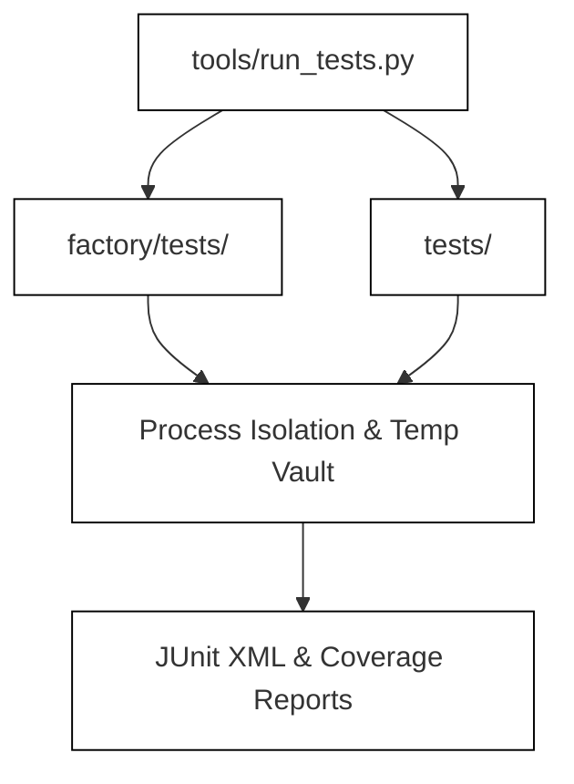
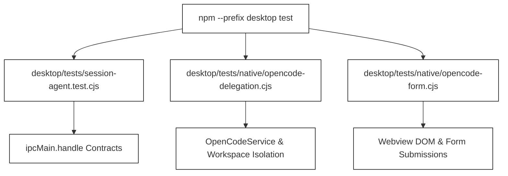
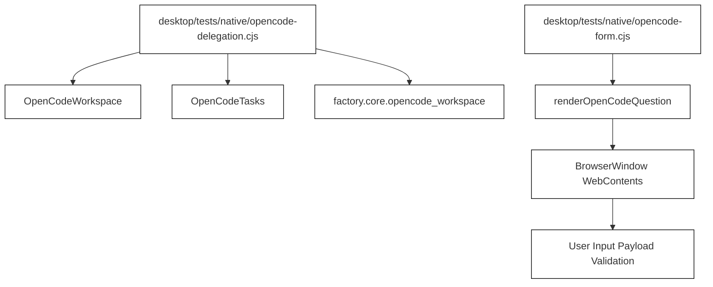
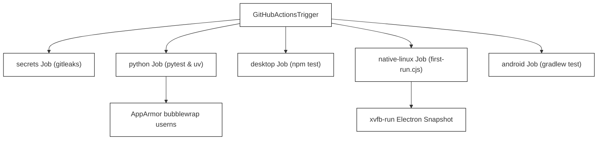

# Test Suites and Native Acceptance Runs

Relevant source files

The following files were used as context for generating this wiki page:

- [.github/workflows/ci.yml](.github/workflows/ci.yml)
- [.gitignore](.gitignore)
- [.gitleaks.toml](.gitleaks.toml)
- [desktop/tests/helpers/private-permissions.cjs](desktop/tests/helpers/private-permissions.cjs)
- [desktop/tests/native/opencode-delegation.cjs](desktop/tests/native/opencode-delegation.cjs)
- [desktop/tests/native/opencode-form.cjs](desktop/tests/native/opencode-form.cjs)
- [desktop/tests/session-agent.test.cjs](desktop/tests/session-agent.test.cjs)
- [docs/TESTING.md](docs/TESTING.md)
- [docs/development/TestLOG.md](docs/development/TestLOG.md)

This page documents the testing and acceptance verification infrastructure for Igorek-Harness, covering Python test suites, desktop node tests, Electron native acceptance scripts (`first-run.cjs`, `opencode-delegation.cjs`, `opencode-form.cjs`, `update-flow.cjs`), CI automation, and the `TestLOG` release journal.

Sources: `docs/TESTING.md:1-124` [docs/TESTING.md:1-123](), `docs/development/TestLOG.md:1-109` [docs/development/TestLOG.md:1-109]()

---

## 1. Python Test Infrastructure (`tests/` and `factory/tests/`)

Python backend tests are discovered and orchestrated via `tools/run_tests.py`, which assigns each test file a fresh operating-system process and private temporary data root [docs/TESTING.md:17-18](). The runner enforces per-test and per-file execution deadlines, exports JUnit XML artifacts, and combines branch coverage reports across modules [docs/TESTING.md:18-19](). 

The root `pytest` configuration explicitly isolates ordinary pytest collection from real home directories, Vault credential stores, and inherited environment variables [docs/TESTING.md:23-25](). Test fixtures supply their own mock accounts, keys, and loopback services [docs/TESTING.md:24-25](). Optional system prerequisites (such as `bubblewrap` or KVM capabilities) are checked dynamically, and their absence results in an explicit skip reason rather than a test failure [docs/TESTING.md:25-26]().

*Figure 1: Python test discovery and execution pipeline.*

Sources: `docs/TESTING.md:17-26` [docs/TESTING.md:17-26]()

---

## 2. Desktop Node & Contract Tests (`desktop/tests/`)

Desktop tests live in `desktop/tests/` and are executed via Node's test runner (`npm --prefix desktop test`) [docs/TESTING.md:28-30](). These contract tests exercise IPC handlers, main process state machines, permission checks, and transport serialization without establishing native window visibility or rendering pixels [docs/TESTING.md:30-31]().

For instance, the session agent state machine is validated via unit harnesses that mock the Electron `ipcMain` and owner runtime [desktop/tests/session-agent.test.cjs:1-7](). Similarly, private permission helpers ensure generated files and sockets enforce strict ACLs or `0o600` POSIX modes [desktop/tests/helpers/private-permissions.cjs:1-26]().

*Figure 2: Desktop Node test suite architecture.*

Sources: `docs/TESTING.md:28-31` [docs/TESTING.md:28-31](), `desktop/tests/session-agent.test.cjs:1-7` [desktop/tests/session-agent.test.cjs:1-7](), `desktop/tests/helpers/private-permissions.cjs:1-26` [desktop/tests/helpers/private-permissions.cjs:1-26]()

---

## 3. Electron Native Acceptance Scripts

Native acceptance runs verify complete desktop integration by launching packaged Electron binaries under `xvfb-run` with a synthetic loopback AI provider [docs/TESTING.md:109-117]().

### `opencode-delegation.cjs`
This script exercises independent OpenCode background coding assignments [docs/development/TestLOG.md:5-10](). It initializes a test Git repository, prepares an isolated workspace snapshot using `factory.core.opencode_workspace` [desktop/tests/native/opencode-delegation.cjs:24-28](), spins up a local HTTP Server-Sent Events (SSE) provider [desktop/tests/native/opencode-delegation.cjs:44-71](), and verifies that shell tools, file writes, and questions execute securely within the sandboxed copy [desktop/tests/native/opencode-delegation.cjs:50-57]().

### `opencode-form.cjs`
This script tests native form rendering within an isolated `BrowserWindow` instance [desktop/tests/native/opencode-form.cjs:5-10](). It loads the compiled web application bundle, executes `renderOpenCodeQuestion` with conditional field dependencies (`when` clauses), mutates form inputs (strings, numbers, multiselect checkboxes), and confirms that trusted native submission payloads match expected schema structures [desktop/tests/native/opencode-form.cjs:13-40]().

*Figure 3: Native acceptance script mapping to code entities.*

Sources: `docs/TESTING.md:109-117` [docs/TESTING.md:109-117](), `desktop/tests/native/opencode-delegation.cjs:1-95` [desktop/tests/native/opencode-delegation.cjs:1-95](), `desktop/tests/native/opencode-form.cjs:1-47` [desktop/tests/native/opencode-form.cjs:1-46]()

---

## 4. The TestLOG Release Journal (`docs/development/TestLOG.md`)

The `TestLOG.md` release journal records precise execution metrics for release candidates. It explicitly separates collected test cases, passing subtests, statement/branch code coverage percentages, platform skips, and physical device/KVM execution notes [docs/development/TestLOG.md:17-34]().

Key metrics tracked per release candidate include:
* **Collected and Passed Counts:** Distinguishes between full isolated Python root collections and desktop node suites [docs/development/TestLOG.md:23-26]().
* **Code Coverage:** Statement and branch coverage measurements across the Python core and inference modules [docs/development/TestLOG.md:29-31]().
* **Platform Skips:** Explicit categorization of unavailable or opt-in hardware environments (such as KVM, vsock, image builders, and Windows-specific filesystem contracts) [docs/development/TestLOG.md:31-34]().

Sources: `docs/development/TestLOG.md:1-109` [docs/development/TestLOG.md:1-109]()

---

## 5. CI Execution Pipeline (`.github/workflows/ci.yml`)

The GitHub Actions CI pipeline enforces automated verification across independent jobs [non-cited: .github/workflows/ci.yml]():
1. **`secrets`**: Runs `gitleaks` against the current tree and entire git history using `.gitleaks.toml` rules without exposing credential values [.github/workflows/ci.yml:17-37]().
2. **`python`**: Executes tests across multiple Python versions (`3.13`, `3.14`) on Ubuntu 24.04 with `uv` dependency locking [.github/workflows/ci.yml:38-86](). It configures AppArmor bubblewrap profiles (`igorek-ci-bwrap`) to allow unprivileged user namespaces during containerized sandbox tests [.github/workflows/ci.yml:57-67]().
3. **`desktop`**: Validates desktop contracts across Linux (`ubuntu-24.04`) and Windows (`windows-2025`) runners [.github/workflows/ci.yml:87-106]().
4. **`native-linux`**: Packages the Electron application and executes `desktop/tests/native/first-run.cjs` under `xvfb-run` with AppArmor portable policies enabled [.github/workflows/ci.yml:107-157]().
5. **`android`**: Executes Gradle unit tests, lint checks, and debug builds [.github/workflows/ci.yml:158-162]().

*Figure 4: CI job dependency and execution workflow.*

Sources: `.github/workflows/ci.yml:1-162` [.github/workflows/ci.yml:1-162]()
