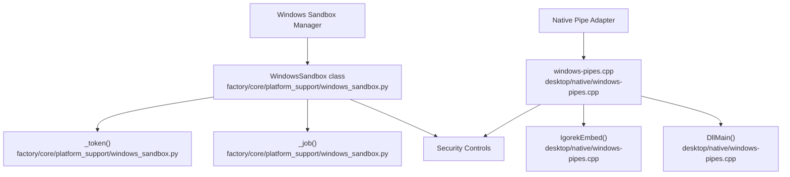
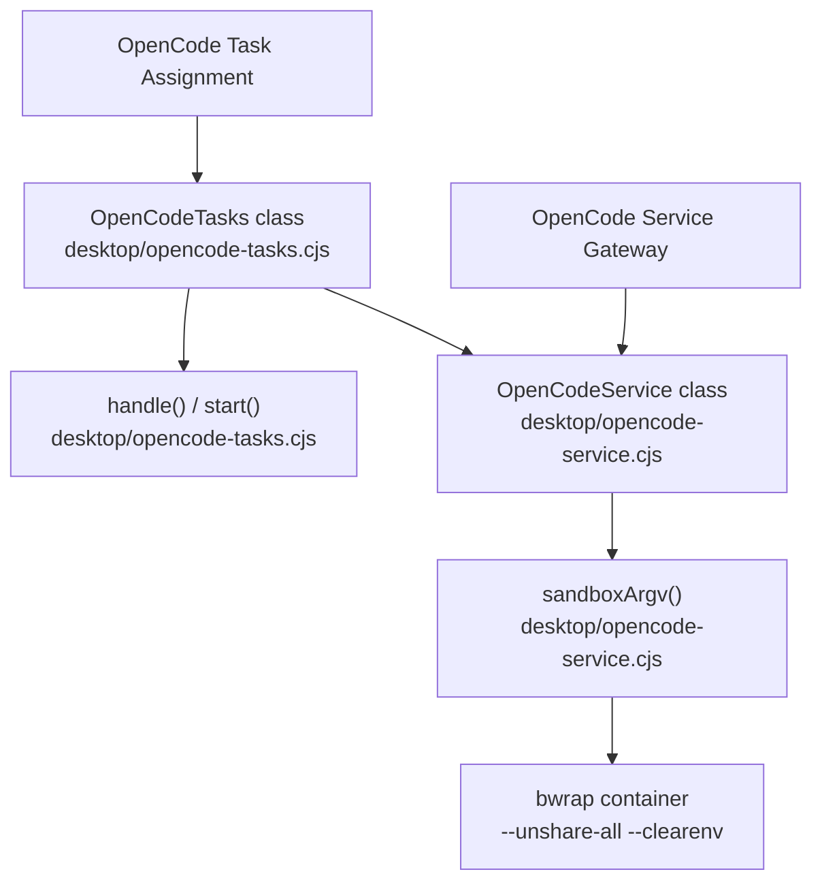

# Glossary

Relevant source files

The following files were used as context for generating this wiki page:

- [desktop/native/windows-pipes.cpp](desktop/native/windows-pipes.cpp)
- [desktop/opencode-service.cjs](desktop/opencode-service.cjs)
- [desktop/opencode-tasks.cjs](desktop/opencode-tasks.cjs)
- [docs/PROJECT_LAYOUT.md](docs/PROJECT_LAYOUT.md)
- [docs/architecture/ISOLATION.md](docs/architecture/ISOLATION.md)
- [docs/architecture/POLICY.md](docs/architecture/POLICY.md)
- [docs/architecture/RICH_CLI_RENDERING_EXPLAINED.md](docs/architecture/RICH_CLI_RENDERING_EXPLAINED.md)
- [docs/development/CROSS_PLATFORM_DESKTOP.md](docs/development/CROSS_PLATFORM_DESKTOP.md)
- [docs/development/FIRST_RUN_ACCEPTANCE.md](docs/development/FIRST_RUN_ACCEPTANCE.md)
- [docs/development/TestLOG.md](docs/development/TestLOG.md)
- [factory/core/cc_backend_executor.py](factory/core/cc_backend_executor.py)
- [factory/core/cc_backend_trace.py](factory/core/cc_backend_trace.py)
- [factory/core/openai_responses.py](factory/core/openai_responses.py)
- [factory/core/platform_support/windows_sandbox.py](factory/core/platform_support/windows_sandbox.py)
- [pyproject.toml](pyproject.toml)
- [tests/test_openai_responses.py](tests/test_openai_responses.py)

## Purpose and Scope

This page defines codebase-specific terms, architectural abstractions, security primitives, and subsystem components used across the `Endorpheen/Igorek-Harness` repository. Each entry provides technical implementation details, data flow characteristics, key functions and classes, and precise file pointers.

---

## Core Definitions & Technical Reference

### AgentRuntime
* **Definition**: The core execution state and background worker engine that drives multi-turn agent execution loops, tool dispatch, and state persistence [docs/PROJECT_LAYOUT.md:8-10]().
* **Implementation & Data Flow**: The runtime resolves task parameters, initializes the model execution loop in `factory/core/cc_backend_executor.py`, handles tool approvals via `factory/core/cc_backend_tools.py`, and records event logs and session state to the local database [factory/core/cc_backend_executor.py:1-7]().

Sources: [docs/PROJECT_LAYOUT.md:6-10](), [factory/core/cc_backend_executor.py:1-7]()

### bwrap (Bubblewrap)
* **Definition**: The unprivileged sandboxing utility used on Linux hosts to isolate background OpenCode service instances and execution sessions [desktop/opencode-service.cjs:26-46]().
* **Implementation & Data Flow**: The desktop OpenCode service constructor compiles a strict argument vector via `sandboxArgv()` in `desktop/opencode-service.cjs`, passing flags such as `--unshare-all`, `--die-with-parent`, `--clearenv`, and capability drops to restrict filesystem and network exposure before spawning `/opt/igorek/opencode-sandbox.py` [desktop/opencode-service.cjs:26-46]().

Sources: [desktop/opencode-service.cjs:26-46]()

### Capability SID
* **Definition**: A unique security identifier (SID) generated dynamically to restrict access tokens for Windows child processes [factory/core/platform_support/windows_sandbox.py:83-83]().
* **Implementation & Data Flow**: `WindowsSandbox` generates a capability string prefixed with `S-1-5-21-` using secure random bits, applying explicit DACL grants to ensure that assignment workspace writes remain isolated and disposable [factory/core/platform_support/windows_sandbox.py:57-95]().

Sources: [factory/core/platform_support/windows_sandbox.py:57-95]()

### Compaction
* **Definition**: The mechanism for reducing context window pressure by summarizing older message history and archiving session states [factory/core/cc_backend_executor.py:43-52]().
* **Implementation & Data Flow**: Evaluates token pressure (`evaluate_compaction_pressure`), constructs compacted message arrays (`build_compacted_messages`), summarizes history via `summarize_history()`, and writes manual or reactive compaction artifacts [factory/core/cc_backend_executor.py:43-52]().

Sources: [factory/core/cc_backend_executor.py:43-52]()

### Egress Server
* **Definition**: A network proxy component regulating and filtering outbound requests from sandboxed worker environments [desktop/opencode-service.cjs:10-10]().
* **Implementation & Data Flow**: Implemented in `desktop/opencode-egress.cjs`, it intercepts HTTP/HTTPS traffic from sandboxed child processes to enforce strict domain allowlists and prevent unauthorized data exfiltration.

Sources: [desktop/opencode-service.cjs:1-11]()

### Host Services
* **Definition**: Local Model Context Protocol (MCP) or API bridge services exposed to sandboxed OpenCode worker instances through secure Unix or named pipes [desktop/opencode-service.cjs:37-42]().
* **Implementation & Data Flow**: `sandboxArgv()` mounts the host services socket (`/run/igorek-host-services.sock`), a verification token, and `host-services-client.py` inside the container namespace, configuring an MCP server profile mapping local tools safely [desktop/opencode-service.cjs:37-42]().

Sources: [desktop/opencode-service.cjs:26-46]()

### Job Object
* **Definition**: A Windows kernel containment primitive used to manage and limit the lifetime, memory consumption, and process tree of spawned child processes [factory/core/platform_support/windows_sandbox.py:36-46]() [factory/core/platform_support/windows_sandbox.py:94-94]().
* **Implementation & Data Flow**: `WindowsSandbox._job()` instantiates and assigns process limits (`JobBasic`, `JobExtended`) to ensure that all descendant processes terminate simultaneously when the sandbox handle closes [factory/core/platform_support/windows_sandbox.py:36-46]() [factory/core/platform_support/windows_sandbox.py:94-94]().

Sources: [factory/core/platform_support/windows_sandbox.py:36-46](), [factory/core/platform_support/windows_sandbox.py:94-94]()

### Managed Mode / Owned Runtime
* **Definition**: The operational state where the Electron desktop container process spawns, supervises, and controls the underlying Python backend lifecycle [docs/PROJECT_LAYOUT.md:21-22]() [docs/PROJECT_LAYOUT.md:33-35]().
* **Implementation & Data Flow**: `desktop/main.cjs` and `desktop/runtime.cjs` manage the backend spawn sequence, IPC communication channels, readiness polling, and automatic recovery or restart flows.

Sources: [docs/PROJECT_LAYOUT.md:21-22](), [docs/PROJECT_LAYOUT.md:33-35]()

### Mobile Bridge
* **Definition**: An authenticated HTTP and WebSocket gateway facilitating communication between the Android/mobile UI clients and the Python core backend [docs/PROJECT_LAYOUT.md:11-11]() [docs/PROJECT_LAYOUT.md:34-34]().
* **Implementation & Data Flow**: `factory/core/mobile_bridge/service.py` exposes session APIs, device pairing endpoints, and safe file access handlers supporting remote agent interaction from mobile devices.

Sources: [docs/PROJECT_LAYOUT.md:11-11](), [docs/PROJECT_LAYOUT.md:34-34]()

### OpenCode Assignment & Run ID
* **Definition**: An independent, sandboxed background coding task delegated to an OpenCode service instance, uniquely tracked by a 32-character hexadecimal run identifier (`run_id` matching `oc_[a-f0-9]{32}`) [docs/development/TestLOG.md:3-8]() [desktop/opencode-tasks.cjs:35-41]().
* **Implementation & Data Flow**: Managed by `OpenCodeTasks` in `desktop/opencode-tasks.cjs`, assignments receive isolated workspace directories, process questions and form submissions from the user, and schedule single-turn result delivery back to the main chat session upon completion [docs/development/TestLOG.md:3-15]() [desktop/opencode-tasks.cjs:30-86]().

Sources: [docs/development/TestLOG.md:3-15](), [desktop/opencode-tasks.cjs:30-86]()

### Pipe Adapter
* **Definition**: A native Windows DLL injection mechanism using Microsoft Detours to intercept named pipe creation and process spawning, ensuring proper default DACL inheritance [desktop/native/windows-pipes.cpp:1-64]().
* **Implementation & Data Flow**: `windows-pipes.cpp` hooks `CreateNamedPipeA/W` and `CreateProcessA/W`, applying `PipeSecurity` structures derived from the current thread token default DACL before child initialization via `IgorekEmbed` [desktop/native/windows-pipes.cpp:1-120]().

Sources: [desktop/native/windows-pipes.cpp:1-120]()

### Transit Grant
* **Definition**: Temporary file system or permission leases established during sandbox initialization to permit safe workspace copying and result verification [factory/core/platform_support/windows_sandbox.py:77-86]().
* **Implementation & Data Flow**: Managed inside `WindowsSandbox.__init__`, transit lists track temporary descriptors that are cleaned up upon successful transfer or sandbox termination [factory/core/platform_support/windows_sandbox.py:77-86]().

Sources: [factory/core/platform_support/windows_sandbox.py:57-98]()

### Trace JSONL
* **Definition**: Structured newline-delimited JSON tracing logs capturing model execution events, tool calls, error taxonomy, and diagnostics [factory/core/cc_backend_trace.py:1-49]().
* **Implementation & Data Flow**: `append_cc_backend_trace` records events to trace files, while `model_failure_diagnostics` and `browser_tool_diagnostics` sanitize and filter diagnostic keys for telemetry and debugging [factory/core/cc_backend_trace.py:1-83]().

Sources: [factory/core/cc_backend_trace.py:1-83]()

### Vault
* **Definition**: The encrypted credential storage, owner lifecycle, and broker permission subsystem [docs/PROJECT_LAYOUT.md:9-9]().
* **Implementation & Data Flow**: Located in `factory/core/vault/`, it handles cryptographic secrets encryption, secret scanning, environment import, and permission verification for agent tools.

Sources: [docs/PROJECT_LAYOUT.md:9-9]()

---

## Architectural Mapping: Sandbox & Pipe Subsystem

The following diagram bridges the natural language concepts of Windows sandboxing and pipe security to their concrete code entities and functions.

Sources: [factory/core/platform_support/windows_sandbox.py:57-95](), [desktop/native/windows-pipes.cpp:1-120]()

---

## Architectural Mapping: OpenCode Delegation Subsystem

The following diagram bridges the natural language concepts of OpenCode task delegation and Bubblewrap containerization to their respective Node.js modules and functions.

Sources: [desktop/opencode-tasks.cjs:30-94](), [desktop/opencode-service.cjs:26-54]()
