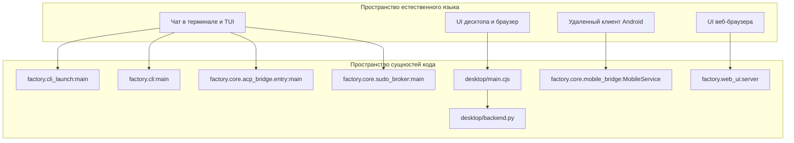
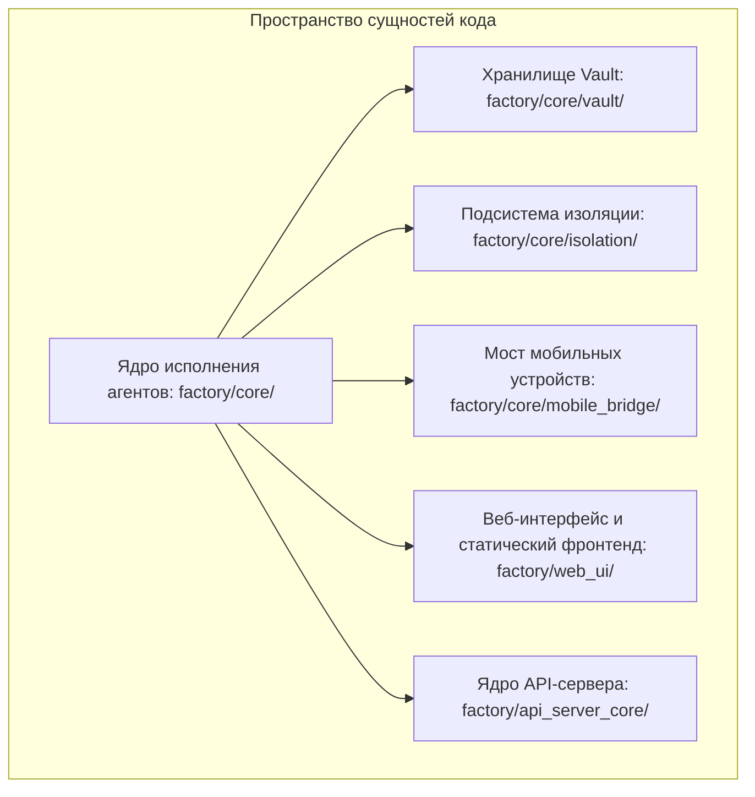

# Обзор

Релевантные исходные файлы

При генерации этой страницы вики в качестве контекста использовались следующие файлы:

- [AGENTS.md](AGENTS.md)
- [README.md](README.md)
- [README.ru.md](README.ru.md)
- [desktop/release-updates.cjs](desktop/release-updates.cjs)
- [docs/PROJECT_LAYOUT.md](docs/PROJECT_LAYOUT.md)
- [docs/architecture/ISOLATION.md](docs/architecture/ISOLATION.md)
- [docs/architecture/POLICY.md](docs/architecture/POLICY.md)
- [docs/architecture/RICH_CLI_RENDERING_EXPLAINED.md](docs/architecture/RICH_CLI_RENDERING_EXPLAINED.md)
- [docs/architecture/cli-after.png](docs/architecture/cli-after.png)
- [docs/architecture/cli-after.svg](docs/architecture/cli-after.svg)
- [docs/architecture/cli-before-after.png](docs/architecture/cli-before-after.png)
- [docs/architecture/cli-before.png](docs/architecture/cli-before.png)
- [docs/architecture/cli-before.svg](docs/architecture/cli-before.svg)
- [docs/development/CROSS_PLATFORM_DESKTOP.md](docs/development/CROSS_PLATFORM_DESKTOP.md)
- [docs/development/FIRST_RUN_ACCEPTANCE.md](docs/development/FIRST_RUN_ACCEPTANCE.md)
- [factory/core/cc_backend_executor.py](factory/core/cc_backend_executor.py)
- [factory/core/cc_backend_trace.py](factory/core/cc_backend_trace.py)
- [factory/core/openai_responses.py](factory/core/openai_responses.py)
- [pyproject.toml](pyproject.toml)
- [tests/test_openai_responses.py](tests/test_openai_responses.py)

Igorek-Harness — платформа персонального ИИ-агента с несколькими пользовательскими интерфейсами: настольным приложением на Electron (`desktop/`), клиентом для Android (`android/`), терминальными режимами CLI/TUI (`factory/core/`) и веб-интерфейсом по HTTPS (`factory/web_ui/`); все они опираются на единое ядро на Python (`factory/`) [README.md:16-20](), [docs/PROJECT_LAYOUT.md:6-28](). 

Система обеспечивает надежные циклы исполнения агентов, планирование задач, шифрованное управление учетными данными через Vault [factory/core/vault/]() и подсистемы изоляции песочницы [factory/core/isolation/]().

### Системная архитектура и точки входа

Приведенная ниже диаграмма сопоставляет пространства взаимодействия пользователя верхнего уровня с конкретными точками входа в код и точками входа исполнения в кодовой базе:

Источники: [pyproject.toml:47-52](), [docs/PROJECT_LAYOUT.md:30-35]()

### Основные подсистемы Python и слои UI

Источники: [docs/PROJECT_LAYOUT.md:6-18]()

---

## 1.1. Начало работы и структура проекта

Проект Igorek-Harness управляется с помощью `uv` для зависимостей Python (`pyproject.toml`, `uv.lock`) и `npm` для настольного приложения на Electron. Точки входа проекта зарегистрированы в секции `[project.scripts]` файла `pyproject.toml` и предоставляют `igorek`, `igorek-factory`, `factory-acp` и `igorek-sudo` [pyproject.toml:25-52](). 

Репозиторий разделяет код времени выполнения по отдельным каталогам: `factory/core/` содержит логику исполнения агентов, `desktop/` отвечает за основные процессы Electron и рендеринг, `android/` содержит мобильное приложение на Kotlin/Compose, а `docs/` хранит подробные материалы по архитектуре [docs/PROJECT_LAYOUT.md:6-28]().

Подробные руководства по установке, спецификации зависимостей и полную карту компоновки репозитория см. в разделе [Начало работы и структура проекта](#1.1).

Источники: [pyproject.toml:1-61](), [docs/PROJECT_LAYOUT.md:1-30]()

---

## 1.2. Соглашения репозитория и правила внесения изменений

Разработка в репозитории следует строгим правилам, изложенным в `AGENTS.md`. Ключевые политики включают английский как основной язык комментариев в коде, документации и сообщений коммитов, а также жесткие границы приватности (никогда не добавлять в индекс приватные ключи, данные Vault или логи) [AGENTS.md:1-24](). Проверка требует синхронизации зафиксированных зависимостей (`uv sync --locked --dev`) и запуска наборов тестов с отслеживанием результатов в `docs/development/TestLOG.md` [AGENTS.md:64-74]().

Полные правила внесения изменений, чек-листы релизов, структуру документации и уведомления о сторонних лицензиях см. в разделе [Соглашения репозитория и правила внесения изменений](#1.2).

Источники: [AGENTS.md:1-120]()
