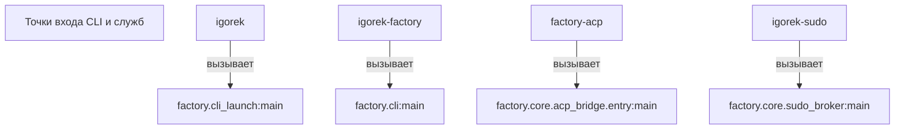
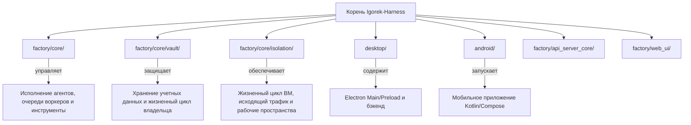

# Начало работы и структура проекта

Релевантные исходные файлы

При генерации этой страницы вики в качестве контекста использовались следующие файлы:

- [docs/PROJECT_LAYOUT.md](docs/PROJECT_LAYOUT.md)
- [docs/architecture/ISOLATION.md](docs/architecture/ISOLATION.md)
- [docs/architecture/POLICY.md](docs/architecture/POLICY.md)
- [docs/architecture/RICH_CLI_RENDERING_EXPLAINED.md](docs/architecture/RICH_CLI_RENDERING_EXPLAINED.md)
- [docs/development/CROSS_PLATFORM_DESKTOP.md](docs/development/CROSS_PLATFORM_DESKTOP.md)
- [docs/development/FIRST_RUN_ACCEPTANCE.md](docs/development/FIRST_RUN_ACCEPTANCE.md)
- [factory/cli_launch.py](factory/cli_launch.py)
- [factory/core/cc_backend_executor.py](factory/core/cc_backend_executor.py)
- [factory/core/cc_backend_trace.py](factory/core/cc_backend_trace.py)
- [factory/core/openai_responses.py](factory/core/openai_responses.py)
- [pyproject.toml](pyproject.toml)
- [tests/test_openai_responses.py](tests/test_openai_responses.py)
- [uv.lock](uv.lock)

## Назначение и область охвата

Эта страница охватывает процедуры установки, управление зависимостями через `pyproject.toml` [pyproject.toml:1-61]() и `uv.lock` [uv.lock:1-733](), точки входа приложения (`igorek`, `igorek-factory`, `factory-acp`, `igorek-sudo`), компоновку каталогов репозитория и карту основной документации. Она дает базовую техническую ориентировку, необходимую для сборки, запуска и навигации по кодовой базе Igorek-Harness.

---

## 1. Установка и зависимости

Igorek-Harness требует **Python >=3.13** [pyproject.toml:32-32]() и использует [uv](https://github.com/astral-sh/uv) для детерминированного и быстрого создания виртуальных окружений и фиксации зависимостей через `uv.lock` [uv.lock:1-733]().

### Конфигурация зависимостей (`pyproject.toml`)

Система сборки опирается на `setuptools` [pyproject.toml:1-3]() с настроенной упаковкой для пространства имен пакета `factory` [pyproject.toml:8-10](). Включаемые в пакет ресурсы (профили, YAML-конфигурации, статические файлы веб-интерфейса и скрипты MCP-серверов) явно объявлены в данных пакета [pyproject.toml:13-23]().

Ключевые зависимости времени выполнения, управляемые в `pyproject.toml`:
* `agent-client-protocol` (>=0.9.0,<1.0) [pyproject.toml:41-41]() для интеграции с ACP.
* `cryptography` (>=42.0.0) [pyproject.toml:39-39]() для шифрования в Vault и безопасного хранения.
* `pydantic` (>=2.7.0) [pyproject.toml:40-40]() для структурированной конфигурации и валидации полезных нагрузок.
* `rich` [pyproject.toml:36-36]() и `prompt-toolkit` [pyproject.toml:37-37]() для отрисовки терминального пользовательского интерфейса.
* `pywinpty` (==3.0.5) подключается условно для Windows (`sys_platform == 'win32'`) [pyproject.toml:44-44]() для поддержки хостинга терминалов ConPTY.

Зависимости для разработки (группа зависимостей `dev`) включают фреймворки тестирования и инструменты качества кода (`pytest`, `pytest-cov`, `ruff`, `tree-sitter`) [pyproject.toml:53-61]().

Источники: [pyproject.toml:1-61](), [uv.lock:1-733]()

---

## 2. Точки входа CLI и служб

Проект предоставляет четыре основных консольных скрипта, объявленных в `pyproject.toml` [pyproject.toml:47-52](). Каждый скрипт напрямую указывает на конкретную цель исполнения Python, отвечающую за жизненный цикл CLI, чат TUI, мост ACP или задачи привилегированной изоляции.

*Рисунок 1: Сопоставление пространства естественного языка с сущностями кода для консольных точек входа*

### Каталог точек входа
1. **`igorek`**: соответствует `factory.cli_launch:main` [pyproject.toml:48-48](). Служит основным пользовательским вызовом из терминала для запуска интерактивных сессий CLI-чата и контроллеров демона.
2. **`igorek-factory`**: соответствует `factory.cli:main` [pyproject.toml:49-49](). Вызывает полный интерфейс управления агентами и конфигурации профилей.
3. **`factory-acp`**: соответствует `factory.core.acp_bridge.entry:main` [pyproject.toml:50-50](). Реализует мост Agent Client Protocol для интеграции с редакторами.
4. **`igorek-sudo`**: соответствует `factory.core.sudo_broker:main` [pyproject.toml:51-51](). Обслуживает брокер привилегированной изоляции и операций на хосте, необходимый для выполнения в ограниченной песочнице.

Источники: [pyproject.toml:47-52]()

---

## 3. Компоновка репозитория и структура каталогов

Репозиторий разделяет основные компоненты времени выполнения, настольные приложения, мобильные клиенты и тестовые харнессы по отдельным каталогам [docs/PROJECT_LAYOUT.md:1-29]().

*Рисунок 2: Сопоставление каталогов проекта с доменами кода*

### Сводка ответственности каталогов

| Каталог | Ответственность |
| --- | --- |
| `factory/core/` | Циклы исполнения агентов, очереди воркеров, промпты, сессии и основные политики [docs/PROJECT_LAYOUT.md:8-15] |
| `factory/core/vault/` | Хранение учетных данных, криптографические ключи, жизненный цикл владельца и разрешения брокера [docs/PROJECT_LAYOUT.md:9-9] |
| `factory/core/isolation/` | Жизненный цикл ВМ песочницы, протокол хост/гость, правила исходящего трафика и границы рабочих пространств [docs/PROJECT_LAYOUT.md:10-10] |
| `factory/core/mobile_bridge/` | Аутентифицированный REST/WS API мобильных сессий [docs/PROJECT_LAYOUT.md:11-11] |
| `factory/core/realtime_voice/` | Обработчики голосовых сессий и транспортные уровни [docs/PROJECT_LAYOUT.md:12-12] |
| `factory/core/acp_bridge/` | Интеграция с редакторами через Agent Client Protocol [docs/PROJECT_LAYOUT.md:14-14] |
| `factory/core/tui/` | Виджеты терминальной отрисовки, ячейки, буферы кадров и контроллеры мыши [docs/PROJECT_LAYOUT.md:15-15] |
| `factory/web_ui/` | HTTPS-сервер и общие рендереры чата для десктопа и веба [docs/PROJECT_LAYOUT.md:16-16] |
| `factory/api_server_core/` | Отдельные реализации инференс-API и оркестрации рабочих процессов [docs/PROJECT_LAYOUT.md:17-17] |
| `desktop/` | Главный процесс Electron, preload-скрипты, контроллеры UI и управляемый бэкенд на Python [docs/PROJECT_LAYOUT.md:21-21] |
| `android/` | Клиент на Kotlin/Compose, JVM-юнит-тесты и инструментальные тесты на устройстве [docs/PROJECT_LAYOUT.md:25-25] |
| `tools/` | Проверки соответствия репозитория, изолированные запуски тестов и помощники сборки из чистых исходников [docs/PROJECT_LAYOUT.md:27-27] |
| `docs/` | Руководства по архитектуре, runbook'и разработчиков, спецификации интеграций и эксплуатационные руководства [docs/PROJECT_LAYOUT.md:28-28] |

Источники: [docs/PROJECT_LAYOUT.md:1-29]()

---

## 4. Карта документации и основные архитектурные спецификации

Дерево `docs/` определяет эксплуатационные и архитектурные контракты системы:
* **`docs/architecture/POLICY.md`**: определяет политики инференс-API, охранные режимы исполнения (`strict`, `standard`, `trusted`, `full`) и управление файлами и командами [docs/architecture/POLICY.md:1-46]().
* **`docs/architecture/ISOLATION.md`**: описывает границы изоляции хост/гость, монтирование рабочих пространств через virtiofs, правила исходящего трафика и процедуры проверки песочницы [docs/architecture/ISOLATION.md:1-100]().
* **`docs/development/FIRST_RUN_ACCEPTANCE.md`**: подробно описывает правила приемки первичного запуска: разблокировку Vault, установку соединений с моделями и выполнение первой проверенной задачи [docs/development/FIRST_RUN_ACCEPTANCE.md:1-56]().
* **`docs/development/CROSS_PLATFORM_DESKTOP.md`**: описывает платформенные контракты между основными целевыми платформами Linux x64 и предварительными целевыми платформами Windows x64 (включая аренду Vault, DACL и интеграцию ConPTY) [docs/development/CROSS_PLATFORM_DESKTOP.md:1-91]().

Источники: [docs/architecture/POLICY.md:1-46](), [docs/architecture/ISOLATION.md:1-100](), [docs/development/FIRST_RUN_ACCEPTANCE.md:1-56](), [docs/development/CROSS_PLATFORM_DESKTOP.md:1-91]()
