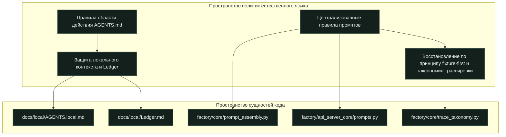
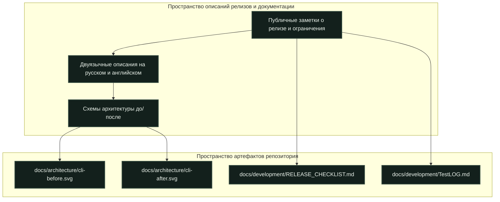
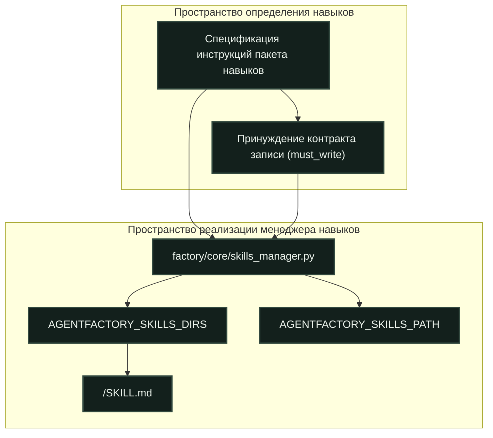

# Соглашения репозитория и правила внесения изменений

<details>
<summary>Релевантные исходные файлы</summary>

При генерации этой страницы вики в качестве контекста использовались следующие файлы:

- [AGENTS.md](AGENTS.md)
- [docs/architecture/cli-after.png](docs/architecture/cli-after.png)
- [docs/architecture/cli-after.svg](docs/architecture/cli-after.svg)
- [docs/architecture/cli-before-after.png](docs/architecture/cli-before-after.png)
- [docs/architecture/cli-before.png](docs/architecture/cli-before.png)
- [docs/architecture/cli-before.svg](docs/architecture/cli-before.svg)
- [docs/development/RELEASE_CHECKLIST.md](docs/development/RELEASE_CHECKLIST.md)
- [docs/development/SKILLS.md](docs/development/SKILLS.md)
- [docs/images/README.md](docs/images/README.md)
- [docs/licenses/DETOURS-LICENSE.txt](docs/licenses/DETOURS-LICENSE.txt)

</details>


Эта страница определяет канонические соглашения, операционные правила, стандарты документации, спецификации упаковки навыков, чек-листы проверки релизов и политики управления сторонними лицензиями, действующие в кодовой базе Igorek-Harness.

---

## Операционные правила и границы области действия AGENTS.md

Корневой файл `AGENTS.md` [AGENTS.md:1-129]() устанавливает обязательные правила поведения для людей-участников и автоматических агентов, работающих в репозитории. Английский определен как основной язык комментариев в исходном коде, докстрингов, переиспользуемых навыков, сообщений коммитов и технической документации [AGENTS.md:3-5]. Переводы и ответы для пользователя должны сохранять язык, на котором он говорит [AGENTS.md:5].

Операционные границы строго ограничивают выполнение непроверенных задач:
* **Ограничения на субагентов**: автоматическим агентам запрещено запускать субагентов или внешние агентские задачи без явного разрешения пользователя [AGENTS.md:10].
* **Защита локального контекста**: игнорируемые записи, специфичные для конкретной машины (`docs/local/AGENTS.local.md`, `docs/local/handoff.md` и `docs/local/Ledger.md`), содержат незавершенную работу и предыдущие проверки [AGENTS.md:17-19]. Участники должны сохранять отложенную работу локально и никогда не добавлять в индекс архивы, криптографические ключи, данные Vault, базы данных, логи, личные артефакты задач или наборы инструментов [AGENTS.md:20-21].
* **Гигиена индексирования**: участники должны добавлять в индекс конкретные проверенные пути к файлам по отдельности; индексирование по маске (`git add .`) строго запрещено [AGENTS.md:22].


*Заголовок: сопоставление политик с сущностями кода*
Источники: `AGENTS.md:7-61`, `factory/core/prompt_assembly.py`, `factory/api_server_core/prompts.py`, `factory/core/trace_taxonomy.py`

---

## Структура документации и требования к публичным релизам

Публичная документация размещается в `docs/`, тогда как корневые README и файлы обнаружения остаются в стандартных местах [AGENTS.md:27]. Публичные заметки о релизе должны описывать видимое пользователю поведение, сценарии использования, поддерживаемые платформы и жесткие эксплуатационные ограничения, не раскрывая приватные инженерные обсуждения, внутренние сравнения с референсами или неутвержденные заметки о происхождении [AGENTS.md:104-108].

При архитектурном изменении сопровождающие должны добавить в описания релиза наглядную схему «до/после» вместе с техническим пояснением [AGENTS.md:119-121]. Описания релизов должны быть представлены кратко на русском и английском с совпадающим смыслом [AGENTS.md:116].


*Заголовок: связь документации и архитектурных схем*
Источники: `AGENTS.md:102-121`, `docs/development/RELEASE_CHECKLIST.md:1-54`, `docs/architecture/cli-before.svg`, `docs/architecture/cli-after.svg`

---

## Архитектура упаковки и обнаружения навыков

Навыки — это модульные пакеты инструкций, загружаемые `factory/core/skills_manager.py` [docs/development/SKILLS.md:3-5]. Установленные пользовательские навыки и опциональные интеграции хранятся отдельно от основного пакета исходного кода [docs/development/SKILLS.md:4-5].

### Формат пакета и обнаружение
Каждый пакет навыков должен хранить свою точку входа в `<skill-name>/SKILL.md` [docs/development/SKILLS.md:9-10]. Вспомогательные скрипты и ресурсы остаются рядом с точкой входа [docs/development/SKILLS.md:10-11]. Блоки YAML-frontmatter внутри `SKILL.md` объявляют метаданные и контракты исполнения, например `must_write: true`, который требует верификации вызова инструмента записи перед принятием результата [docs/development/SKILLS.md:14-24].

Обнаружение пакетов выполняется путем обработки переопределений окружения `AGENTFACTORY_SKILLS_DIRS` или устаревшего `AGENTFACTORY_SKILLS_PATH` [docs/development/SKILLS.md:28-30]. Если переопределения не заданы, менеджер сканирует папку `skills/` локального каталога данных [docs/development/SKILLS.md:29-31].


*Заголовок: поток данных обнаружения и загрузки навыков*
Источники: `docs/development/SKILLS.md:1-41`, `factory/core/skills_manager.py`

---

## Готовность к релизу и чек-лист проверки

Стабильные релизы продукта и публикации исходников — отдельные вехи, управляемые через `docs/development/RELEASE_CHECKLIST.md` [docs/development/RELEASE_CHECKLIST.md:1-4].

### Команды CI и зафиксированные зависимости
Участники должны запускать тесты с зафиксированными зависимостями в условиях, идентичных CI [AGENTS.md:64-71]:
```bash
uv sync --locked --dev
uv run --no-sync python -u tools/run_tests.py --coverage
npm --prefix desktop ci
npm --prefix desktop test
```

Результаты тестов, собранные подтесты, метрики покрытия кода и проверки нативного UI должны постоянно фиксироваться в `docs/development/TestLOG.md` [AGENTS.md:73-75]. Пропуск или удаление упавших тестов для создания видимости зеленого набора тестов строго запрещен [AGENTS.md:75].

---

## Сторонние уведомления и лицензии компонентов

Igorek-Harness интегрирует отдельные сторонние кодовые базы, инструменты и заголовочные файлы, требующие строгого сохранения уведомлений об авторских правах и файлов лицензий рядом с соответствующими ресурсами [AGENTS.md:28, 109]. 

Например, бинарная инъекция и перехват функций в Windows используют Microsoft Detours, распространяемые по лицензии MIT [docs/licenses/DETOURS-LICENSE.txt:1-24]. При изменении или упаковке встроенных компонентов времени выполнения участники не должны никогда удалять уведомления лицензий, заголовки об авторских правах или блоки указания стороннего авторства [AGENTS.md:109].

Источники: `docs/licenses/DETOURS-LICENSE.txt:1-24`, `AGENTS.md:28`
