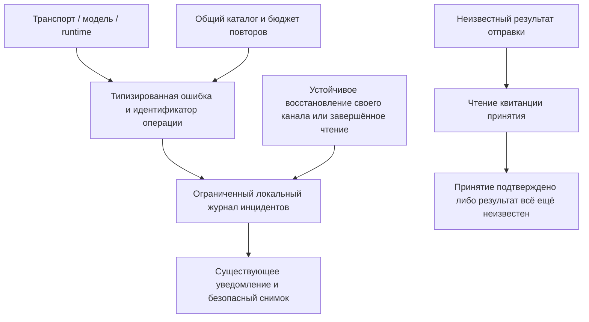

# Диагностика ошибок и нестабильная сеть

Игорёк различает неудачную операцию, потерю связи и неизвестный результат действия. Отключение телефона или десктопа не означает, что принятая сервером задача остановилась.

## Что означает счётчик?

«100 наблюдений» означает, что приложение повторно зарегистрировало один инцидент. Это не доказывает сто отдельных отключений сервера. У инцидента есть время первого и последнего наблюдения и отдельное состояние; у автоматических попыток — собственный счётчик и время следующей попытки, когда оно известно. Новый сбой после восстановления создаёт новый инцидент.

## Что происходит автоматически?

Безопасные запросы чтения могут повторяться в пределах ограниченного бюджета. Поток событий переподключается с задержками и паузой после серии попыток. Восстановление подтверждается устойчивой готовностью либо успешным завершением именно того запроса чтения, который завершился ошибкой. Одно работающее соединение не снимает ошибку другого компонента. Отклонённый сертификат, ошибки доступа и ограничений требуют внимания, а не бесконечных повторов. Система сама не переключает модель, не меняет ключи и не перезапускает задачу.

Если ответ на отправку сообщения потерян, результат остаётся неизвестным. Клиент проверяет серверную квитанцию отдельным запросом чтения с исходным ключом операции. Совпавшая квитанция подтверждает принятие сообщения без повторной отправки, но не завершение задачи. Если квитанцию установить не удалось, неизвестность сохраняется. При ручном повторе сохранённого ожидающего сообщения используется прежний ключ. Это не универсальная гарантия однократного исполнения любых операций и инструментов.

## Что видно пользователю?

Существующие уведомления показывают код, идентификатор, состояние и известные сведения о попытках. Прочтение уведомления не означает восстановления связи. Диагностика активности различает недавний прогресс, ожидание вашего ответа, длительную работу и отсутствие подтверждённого прогресса; наблюдатель не может остановить работу. Ошибка сохраняет профиль и модель, выбранные в момент её возникновения.

На десктопе и в Web UI используйте существующее копирование диагностики. На Android удерживайте уведомление, чтобы скопировать локальный безопасный снимок. В него входят ограниченные метаданные, недавние наблюдения и состояние записи диагностики; исходные запросы, аргументы инструментов, токены и частные адреса подключения не включаются. Автоматическая отправка диагностики наружу не настроена.

## Поток данных

Точный [контракт](https://github.com/Endorpheen/Igorek-Harness/blob/main/docs/architecture/ERROR_DIAGNOSTICS.md) описывает коды, хранение, API и ограничения. После авторизации bridge предоставляет `GET /mobile/v1/diagnostics` и `GET /mobile/v1/operations/{key}?session_id={session_id}`. Web UI проксирует их через `/api/diagnostics` и `/api/operations/{key}`. Эти запросы не перезапускают и не повторяют работу.

## Границы проверки

Тесты Python, Node и Android проверяют воспроизводимые сбои, сопоставление квитанций, скрытие секретов, ошибки хранилища и ограничения повторов. Android также использует отдельный локальный TLS-сервер с закреплённым сертификатом. Физическое переключение VPN и приёмка на настоящей Windows 11 требуют отдельных проверок; синтетические тесты их не доказывают. Неопределённая транспортная ошибка браузера не устанавливает VPN как причину.

## Добровольно отправить отчёт в поддержку

Адрес поддержки — **igorek-dot@tutamail.com**. Автоматической загрузки нет. Выберите **Отправить диагностику** внутри существующего центра уведомлений или окна диагностики/обзора, проверьте отчёт и получателя и решите, продолжать ли передачу. Прежнее копирование сохранено.

- **Linux / Windows:** выберите новое имя JSON-файла в окне сохранения. Игорёк откроет письмо; прикрепите сохранённый файл и опишите проблему. Если почтовое приложение не настроено, файл останется для ручной отправки.
- **Web:** сохраните предложенный JSON-файл, затем откройте показанную ссылку на почту и прикрепите файл вручную.
- **Android:** откройте центр уведомлений и выберите действие диагностики. Просмотрите локальный отчёт, затем нажмите **Поделиться отчётом**. Выберите почтовое приложение в системном меню, проверьте получателя и подтвердите отправку в нём. Другие приложения могут не учитывать подсказку получателя.

В отчёте — версия и платформа, коды ошибок и идентификаторы операций, профиль и модель, ограниченная история инцидентов и состояние записи диагностики. Исходная переписка, аргументы инструментов, ключи, частные адреса подключения и локальные пути исключены. Размер файла ограничен 512 КиБ; пропуски истории отмечаются. Недоступность backend не мешает экспортировать локальные наблюдения. Отмена просмотра не отправляет отчёт.

Открытие почты или системного меню **не подтверждает доставку**. Игорёк не входит в ящик поддержки и не отправляет письма от вашего имени. Реальная доставка и работа физических почтовых приложений/Tuta не покрываются синтетическими проверками.

