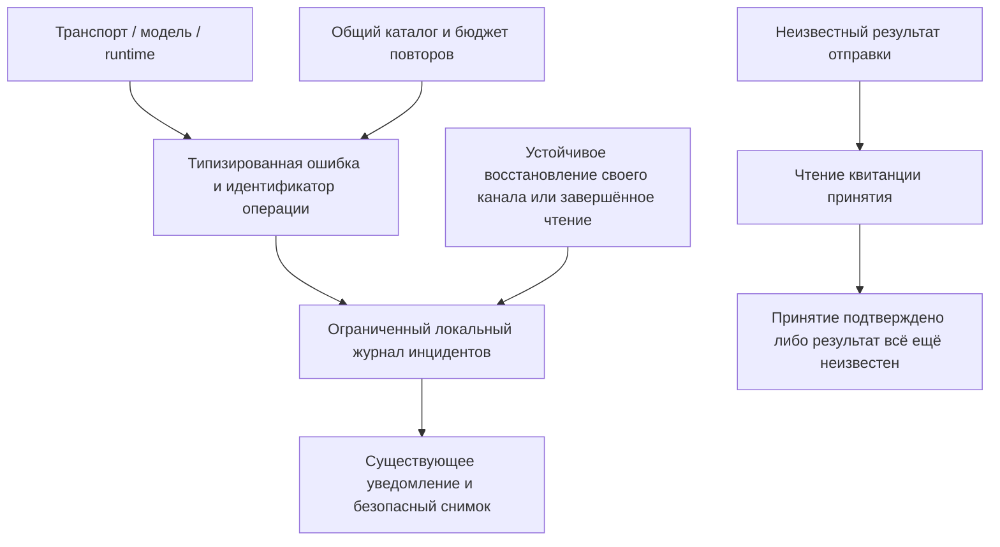

# Диагностика ошибок и нестабильная сеть

Игорёк различает неудачную операцию, потерю связи и неизвестный результат действия. Отключение телефона или десктопа не означает, что принятая сервером задача остановилась.

## Что означает счётчик?

«100 наблюдений» означает, что приложение повторно зарегистрировало один инцидент. Это не доказывает сто отдельных отключений сервера. У инцидента есть время первого и последнего наблюдения и отдельное состояние; у автоматических попыток — собственный счётчик и время следующей попытки, когда оно известно. Новый сбой после восстановления создаёт новый инцидент.

Отдельные инциденты могут иметь одинаковый текст. Android различает их по постоянным идентификаторам при открытии центра уведомлений, в том числе после обновления приложения; очищать данные приложения не требуется.

## Что происходит автоматически?

Безопасные запросы чтения могут повторяться в пределах ограниченного бюджета. Поток событий переподключается с задержками и паузой после серии попыток. Восстановление подтверждается устойчивой готовностью либо успешным завершением именно того запроса чтения, который завершился ошибкой. Одно работающее соединение не снимает ошибку другого компонента. Отклонённый сертификат, ошибки доступа и ограничений требуют внимания, а не бесконечных повторов. Система сама не переключает модель, не меняет ключи и не перезапускает задачу.

Если ответ на отправку сообщения потерян, результат остаётся неизвестным. Клиент проверяет серверную квитанцию отдельным запросом чтения с исходным ключом операции. Совпавшая квитанция подтверждает принятие сообщения без повторной отправки, но не завершение задачи. Если квитанцию установить не удалось, неизвестность сохраняется. При ручном повторе сохранённого ожидающего сообщения используется прежний ключ. Это не универсальная гарантия однократного исполнения любых операций и инструментов.

## Что видно пользователю?

На Android восстановленные инциденты автоматически исчезают из списка уведомлений и счётчика колокольчика, включая сохранённые до обновления. Недавние восстановления доступны в сгруппированной сводке общего отчёта; его можно открыть и при пустом списке. Нерешённые инциденты остаются видимыми.

Существующие уведомления показывают код, идентификатор, состояние и известные сведения о попытках. Прочтение уведомления не означает восстановления связи. Диагностика активности различает недавний прогресс, ожидание вашего ответа, длительную работу и отсутствие подтверждённого прогресса; наблюдатель не может остановить работу. Ошибка сохраняет профиль и модель, выбранные в момент её возникновения.

На десктопе и в Web UI используйте существующее копирование диагностики. На Android удерживайте уведомление, чтобы скопировать только выбранный инцидент в структурированном JSON с понятным описанием. В него входят ограниченные метаданные, недавние наблюдения и состояние записи диагностики; исходные запросы, аргументы инструментов, токены и частные адреса подключения не включаются. Автоматическая отправка диагностики наружу не настроена.

Android 0.1.117 (118): долгое нажатие копирует только выбранный инцидент — структурированный JSON до 8 КиБ с понятным описанием, состоянием, временем UTC, идентификаторами для поиска в журналах и не более чем четырьмя предыдущими событиями. Последнее событие записывается один раз; у предыдущих сохраняются только отличающиеся поля (null означает отсутствие поля в том событии). Пустые поля опускаются, отсутствующие идентификаторы не придумываются. Подтверждение явно сообщает, что скопирован только этот инцидент.

Отдельное действие **«Общий диагностический отчёт»** показывает предпросмотр до 32 КиБ: максимум десять активных инцидентов, с приоритетом неподтверждённых исходов и случаев, требующих внимания. Восстановленные за последние сутки сгруппированы по коду, компоненту, направлению соединения, HTTP-статусу и типу исключения: число инцидентов и наблюдений, первое и последнее время вместо повторения полных событий. Групп не больше двенадцати; пропуски деталей, событий и групп, а также исключённые старые восстановления подсчитаны. Локальный журнал по-прежнему ограничен 50 инцидентами и восемью наблюдениями на инцидент. **«Скопировать общий отчёт»** копирует именно предпросмотр; отправка выполняется отдельным явным действием.

### Старые события и состояние прочтения на Android

Android 0.1.118 (119): открытие сохранённого чата и переключение сессий не создают новые наблюдения об ошибках. Уведомления регистрируются при получении новых событий, после проверки повторной доставки и уже обработанных номеров. Известный ID события не открывает восстановленный инцидент заново. Ошибка задачи без структурированной причины отмечается как неизвестная ошибка задачи, а не как выдуманный внутренний сбой отрисовки. Обновление убирает только прежние копии уведомлений, структурно помеченные как результат отображения истории; сама история чатов/задач и настоящая диагностика модели и транспорта сохраняются.

**«Прочитать»** подтверждает прочтение и убирает уведомление из непрочитанного счётчика. Это не означает, что ошибочная задача стала успешной или соединение восстановилось. Прочтение сохраняется при переходах и восстановлении истории. **«Очистить»** удаляет сохранённые уведомления; открытие старого чата и повторная доставка его событий не создают их заново. Действительно новый сбой по-прежнему появляется. Ошибки ввода и вложений используют тот же постоянный журнал, поэтому общий отчёт и колокольчик показывают одни и те же записи.

## Поток данных

Точный [контракт](https://github.com/Endorpheen/Igorek-Harness/blob/main/docs/architecture/ERROR_DIAGNOSTICS.md) описывает коды, хранение, API и ограничения. После авторизации bridge предоставляет `GET /mobile/v1/diagnostics` и `GET /mobile/v1/operations/{key}?session_id={session_id}`. Web UI проксирует их через `/api/diagnostics` и `/api/operations/{key}`. Эти запросы не перезапускают и не повторяют работу.

## Границы проверки

Тесты Python, Node и Android проверяют воспроизводимые сбои, сопоставление квитанций, скрытие секретов, ошибки хранилища и ограничения повторов. Android также использует отдельный локальный TLS-сервер с закреплённым сертификатом. Физическое переключение VPN и приёмка на настоящей Windows 11 требуют отдельных проверок; синтетические тесты их не доказывают. Неопределённая транспортная ошибка браузера не устанавливает VPN как причину.

## Добровольно отправить отчёт в поддержку

Адрес поддержки — **igorek-dot@tutamail.com**. Автоматической загрузки нет. Выберите **Отправить диагностику** внутри существующего центра уведомлений или окна диагностики/обзора, проверьте отчёт и получателя и решите, продолжать ли передачу. Прежнее копирование сохранено.

- **Linux / Windows:** выберите новое имя JSON-файла в окне сохранения. Игорёк откроет письмо; прикрепите сохранённый файл и опишите проблему. Если почтовое приложение не настроено, файл останется для ручной отправки.
- **Web:** сохраните предложенный JSON-файл, затем откройте показанную ссылку на почту и прикрепите файл вручную.
- **Android:** откройте центр уведомлений и выберите действие диагностики. Просмотрите локальный отчёт, затем нажмите **Поделиться отчётом**. Выберите почтовое приложение в системном меню, проверьте получателя и подтвердите отправку в нём. Другие приложения могут не учитывать подсказку получателя.

В отчёте — версия и платформа, коды ошибок и идентификаторы операций, профиль и модель, ограниченная история инцидентов и состояние записи диагностики. Исходная переписка, аргументы инструментов, ключи, частные адреса подключения и локальные пути исключены. Файлы desktop/web ограничены 512 КиБ. Общий отчёт Android ограничен 32 КиБ, копия выбранного инцидента — 8 КиБ; пропуски отмечаются. Недоступность backend не мешает экспортировать локальные наблюдения. Отмена просмотра не отправляет отчёт.

Открытие почты или системного меню **не подтверждает доставку**. Игорёк не входит в ящик поддержки и не отправляет письма от вашего имени. Реальная доставка и работа физических почтовых приложений/Tuta не покрываются синтетическими проверками.

## Отображение ошибок в Android

Сообщения о системных ошибках и сбоях задач отображаются только в центре уведомлений. Чаты, список сессий и диалоги операций не дублируют их отдельными строками и карточками. Колокольчик доступен и вне чата, в том числе на экране подключения. Состояние связи, запросы подтверждения и обычный ход задачи остаются на своих местах. Для тихих фоновых таймаутов потока событий сохранена прежняя политика видимости; записи остаются в диагностике.

### Ошибки MCP-инструментов

Ответы внешнего MCP-инструмента с `isError=true` сохраняют этот статус в stdio-обёртке grep.app. К тексту сбоя не добавляется утверждение о найденных результатах. Внешняя служба по-прежнему может отклонять запросы; это считается недоступностью, а не успешным поиском.

### Причины сбоев инструментов и подтверждённое восстановление

Для ошибки инструмента показываются инструмент/сервис/действие и конкретный код либо ограниченное описание с удалёнными секретами. Например, `host_service → files` с `invalid_service_fields` сообщает о неверных полях вызова вместо неизвестной ошибки. Для сбоя модели сохраняется явная причина ответа сервиса вместе с HTTP/системной классификацией; причины не угадываются по словам в сообщении.

Время события bridge приходит в секундах и один раз переводится в миллисекунды. Типизированная диагностика уже содержит миллисекунды. Старые наблюдения, в которых секунды ошибочно считались миллисекундами, исправляются при загрузке журнала.

Успешный последующий вызов закрывает инцидент соответствующей операции. Вызовы для конкретного ресурса должны совпадать по аргументам; для отклонённых вызовов host-service учитываются значимые поля действия. Неопределённые исходы и ошибки других операций остаются активными. Успешное завершение задачи может закрыть отклонённый вызов с неверными параметрами; отдельное основание поясняет, что сам отклонённый вызов не выполнялся. Восстановленные инциденты исключены из списка и счётчика колокольчика. Открытие истории чата может уточнить и закрыть уже известный инцидент с сохранением его идентификатора и признака прочтения; новые уведомления по старым ошибкам не создаются. В ограниченном диагностическом отчёте остаются причина, состояние и основание восстановления.
