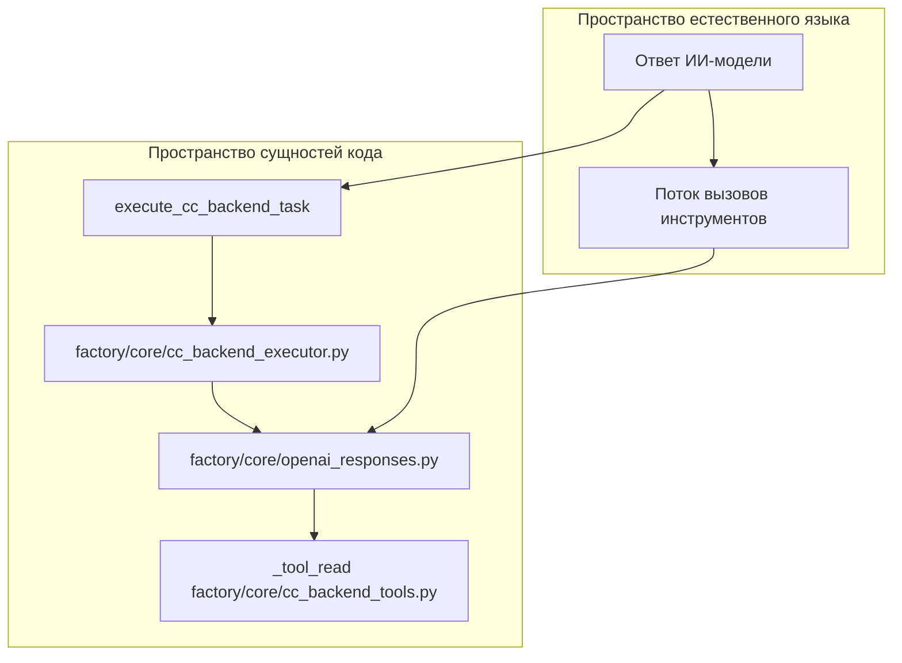
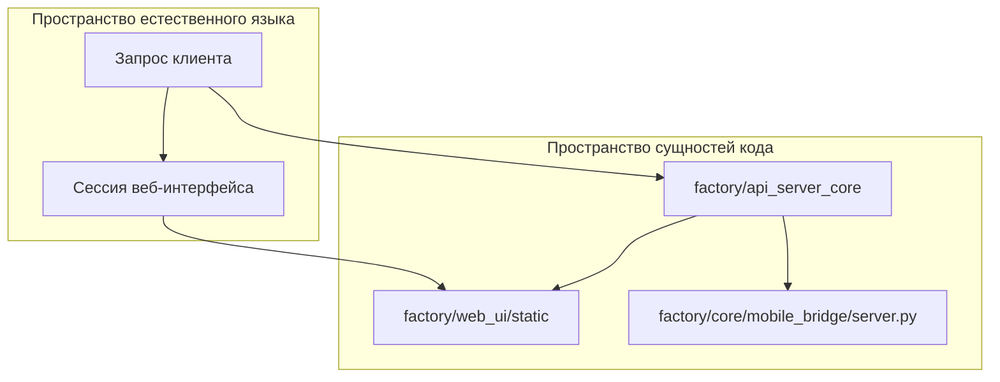

# Ядро Python-агента (factory/)

Использованные исходные файлы

Следующие файлы использовались как контекст при генерации этой страницы вики:

- [desktop/tests/session-summary.test.cjs](desktop/tests/session-summary.test.cjs)
- [docs/images/session-sources-flow.png](docs/images/session-sources-flow.png)
- [docs/images/session-sources-flow.svg](docs/images/session-sources-flow.svg)
- [factory/core/cc_backend_executor.py](factory/core/cc_backend_executor.py)
- [factory/core/cc_backend_tools.py](factory/core/cc_backend_tools.py)
- [factory/core/cc_backend_trace.py](factory/core/cc_backend_trace.py)
- [factory/core/mobile_bridge/server.py](factory/core/mobile_bridge/server.py)
- [factory/core/openai_responses.py](factory/core/openai_responses.py)
- [factory/core/worker.py](factory/core/worker.py)
- [pyproject.toml](pyproject.toml)
- [tests/test_cc_backend_read_tool.py](tests/test_cc_backend_read_tool.py)
- [tests/test_openai_responses.py](tests/test_openai_responses.py)

Пакет `factory/` содержит Python-бэкенд Igorek-Harness: он служит исполняющим движком для задач ИИ-агентов, безопасной изоляции рабочего пространства, управления учётными данными, веб-API и фоновой обработки. Он координирует взаимодействие между локальными/удалёнными языковыми моделями, циклами вызова инструментов и песочницами операционной системы.

Подробнее об отдельных подсистемах — в дочерних разделах ниже:
- [Цикл выполнения модели и wire-адаптеры](#2.1)
- [Подсистема изоляции и чекпоинты](#2.2)
- [Vault и секреты](#2.3)
- [Ядро API-сервера и веб-интерфейс](#2.4)
- [Воркеры, планировщик и рантайм](#2.5)

---

## 2.1 Цикл выполнения модели и wire-адаптеры

Подсистема выполнения модели управляет многоходовыми циклами взаимодействия с инструментами, преобразует payload провайдеров и обрабатывает потоковые ответы. Основной цикл выполнения приводится в действие функцией `execute_cc_backend_task` из `factory/core/cc_backend_executor.py`, которая рассылает запросы на совместимые эндпоинты, обрабатывает блоки `tool_use` и возвращает результаты выполнения модели, пока не будет получен терминальный ответ [factory/core/cc_backend_executor.py:1-6]().

Wire-адаптеры, такие как `factory/core/openai_responses.py`, преобразуют внутренние структуры сообщений в специфичные для провайдера payload'ы Server-Sent Events (SSE), отфильтровывая неподдерживаемые опции [factory/core/openai_responses.py:1-60](). Модуль также реализует диагностические процедуры для сбоев TLS, таймаутов транспорта и структурной трассировки через `factory/core/cc_backend_trace.py` [factory/core/cc_backend_trace.py:28-50]().

Источники: [factory/core/cc_backend_executor.py:1-6](), [factory/core/openai_responses.py:1-60](), [factory/core/cc_backend_trace.py:28-50](), [factory/core/cc_backend_tools.py:1-10]()

Подробнее см. [Цикл выполнения модели и wire-адаптеры](#2.1).

---

## 2.2 Подсистема изоляции и чекпоинты

Подсистема изоляции, расположенная в `factory/core/isolation/`, обеспечивает надёжные границы рабочего пространства с помощью примитивов контейнеризации — Bubblewrap (`bwrap`) на Linux, ограниченных токенов безопасности на Windows — и строгого контроля исходящего сетевого трафика. Она реализует механизмы брокера для операций на хосте, снапшоты рабочего пространства и управление чекпоинтами, чтобы откатывать незакоммиченные изменения или применять read-only представления Git [factory/core/worker.py:71-76]().

Подробнее см. [Подсистема изоляции и чекпоинты](#2.2).

Источники: [factory/core/worker.py:71-76]()

---

## 2.3 Vault и секреты

Пакет `factory/core/vault/` отвечает за шифрованное хранение API-ключей и переменных окружения: в него входят криптографические утилиты, детекторы сканирования содержимого на утечку секретов, движки редактирования логов и безопасный импорт окружения [factory/core/worker.py:77-79]() [pyproject.toml:39](). Он предотвращает случайную утечку учётных данных в логах, трассировках суб-агентов и сетевых запросах.

Подробнее см. [Vault и секреты](#2.3).

Источники: [factory/core/worker.py:77-79](), [pyproject.toml:39]()

---

## 2.4 Ядро API-сервера и веб-интерфейс

Слой API внутри `factory/api_server_core` реализует рантаймы провайдеров (Anthropic, OpenRouter), движки рабочих процессов и оценщики политик безопасности. Он напрямую взаимодействует со статическими ассетами фронтенда и серверными контроллерами, поставляемыми в `factory/web_ui/` [pyproject.toml:19-23]().

Источники: [pyproject.toml:19-23](), [factory/core/mobile_bridge/server.py:1-30]()

Подробнее см. [Ядро API-сервера и веб-интерфейс](#2.4).

---

## 2.5 Воркеры, планировщик и рантайм

Фоновая обработка управляется воркер-циклами, определёнными в `factory/core/worker.py`. Демон-воркер берёт в аренду задачи из очереди, удерживает мьютексы рантайма, запускает запланированные агентские задания и возвращает застрявшие или «мертвые» задачи, используя транзакционные механизмы на уровне базы данных [factory/core/worker.py:3-17]().

Подробнее см. [Воркеры, планировщик и рантайм](#2.5).

Источники: [factory/core/worker.py:3-17]()
