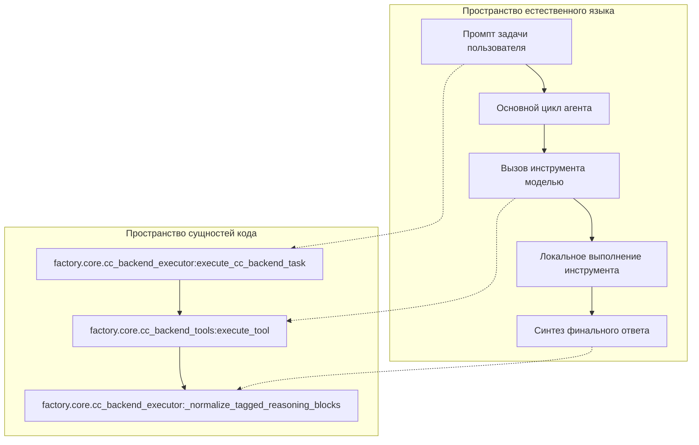
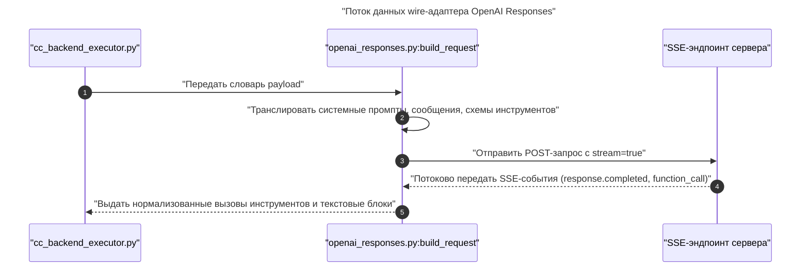

# Цикл выполнения модели и wire-адаптеры

Использованные исходные файлы

Следующие файлы использовались как контекст при генерации этой страницы вики:

- [factory/core/cc_backend_executor.py](factory/core/cc_backend_executor.py)
- [factory/core/cc_backend_trace.py](factory/core/cc_backend_trace.py)
- [factory/core/openai_responses.py](factory/core/openai_responses.py)
- [pyproject.toml](pyproject.toml)
- [tests/fixtures/context_overflow/llama_server.json](tests/fixtures/context_overflow/llama_server.json)
- [tests/test_cc_backend_context_window.py](tests/test_cc_backend_context_window.py)
- [tests/test_openai_responses.py](tests/test_openai_responses.py)

## Назначение и область охвата

Эта страница описывает цикл выполнения модели и протокольные адаптеры, которые обеспечивают взаимодействие с LLM в ядре Python-агента (`factory/`). Центральный оркестратор управляет многоходовым выполнением инструментов, преобразует wire-форматы через SSE-адаптеры, анализирует диагностику транспортных сбоев и порождает события трассировки.

Как родительская страница, этот раздел даёт высокоуровневый архитектурный обзор. Детали реализации управления контекстом или политик инструментов — на дочерних страницах:
- [Компакция контекста и история сессии](#2.1.1)
- [Инструменты, промпты и политика](#2.1.2)

Источники: `factory/core/cc_backend_executor.py:1-6`, `factory/core/openai_responses.py:1-3`

---

## Многоходовый цикл выполнения (`execute_cc_backend_task`)

Ядро исполнения сосредоточено вокруг `execute_cc_backend_task` в `factory/core/cc_backend_executor.py`. Эта функция управляет жизненным циклом многоходовой беседы: отправляет запросы в LLM-бэкенд, получает директивы `tool_use`, выполняет локальные инструменты через `execute_tool` и возвращает выходные данные обратно в цикле, пока модель не выдаст чисто текстовый или завершающий ответ [factory/core/cc_backend_executor.py:1-6]().

*Рисунок 1: Сопоставление высокоуровневых ходов агента с сущностями кода цикла выполнения.*

Источники: `factory/core/cc_backend_executor.py:1-181`, `factory/core/cc_backend_tools.py:1-30`

---

## SSE wire-адаптер OpenAI Responses

Модуль `factory/core/openai_responses.py` выступает специализированным wire-адаптером для формата OpenAI Responses API: он преобразует внутренние структуры (входные данные инструментов, сообщения, блоки рассуждений, изображения) в корректные SSE-запросы, отфильтровывая неподдерживаемые опции Chat Completions [factory/core/openai_responses.py:1-60]().

*Рисунок 2: Последовательность преобразования запроса и обработки SSE-ответа.*

Источники: `factory/core/openai_responses.py:1-137`, `tests/test_openai_responses.py:56-78`

---

## Повторы, TLS и диагностика транспорта

Транспортные сбои и сетевые аномалии обрабатываются отказоустойчивой логикой повторов и диагностическими хелперами. Функция `_is_transient_network_error` в `factory/core/cc_backend_executor.py` анализирует коды ошибок и строковые шаблоны, чтобы определить, безопасно ли повторять попытку при обрыве соединения, сбое разрешения имени или таймауте [factory/core/cc_backend_executor.py:117-150]().

Для детальной диагностики `model_failure_diagnostics` в `factory/core/cc_backend_trace.py` извлекает структурную телеметрию о типах TLS-ошибок (`tls_error_type`, `tls_reason`), фазах транспорта и категориях HTTP-статусов [factory/core/cc_backend_trace.py:28-50]().

Источники: `factory/core/cc_backend_executor.py:110-150`, `factory/core/cc_backend_trace.py:12-50`

---

## Трассировка и телеметрия

Телеметрия выполнения управляется через переменные контекста и декораторы с областью видимости. Обёртка `scoped_agent_trace` в `factory/core/cc_backend_trace.py` внедряет иерархические идентификаторы сессий (`root_session_id`, `agent_session_id`, `subagent_id`) в контексты выполнения [factory/core/cc_backend_trace.py:86-112](). События трассировки асинхронно дописываются через `append_cc_backend_trace` в соответствии с таксономией `CcTraceEvent` [factory/core/cc_backend_executor.py:26]().

Источники: `factory/core/cc_backend_trace.py:86-112`, `factory/core/cc_backend_executor.py:26`

---

## Дочерние страницы

Подробнее об отдельных компонентах подсистем — на следующих дочерних страницах:
- **[Компакция контекста и история сессии](#2.1.1)** — Описывает реактивную компакцию, разрешение токенов контекстного окна, отслеживание изменений и автоматические сводки.
- **[Инструменты, промпты и политика](#2.1.2)** — Описывает `cc_backend_tools`, сборку промптов, процессы одобрения и разрешений, guard-защиту команд и политики доступа к файлам.

Источники: `factory/core/cc_backend_executor.py:30-52`
