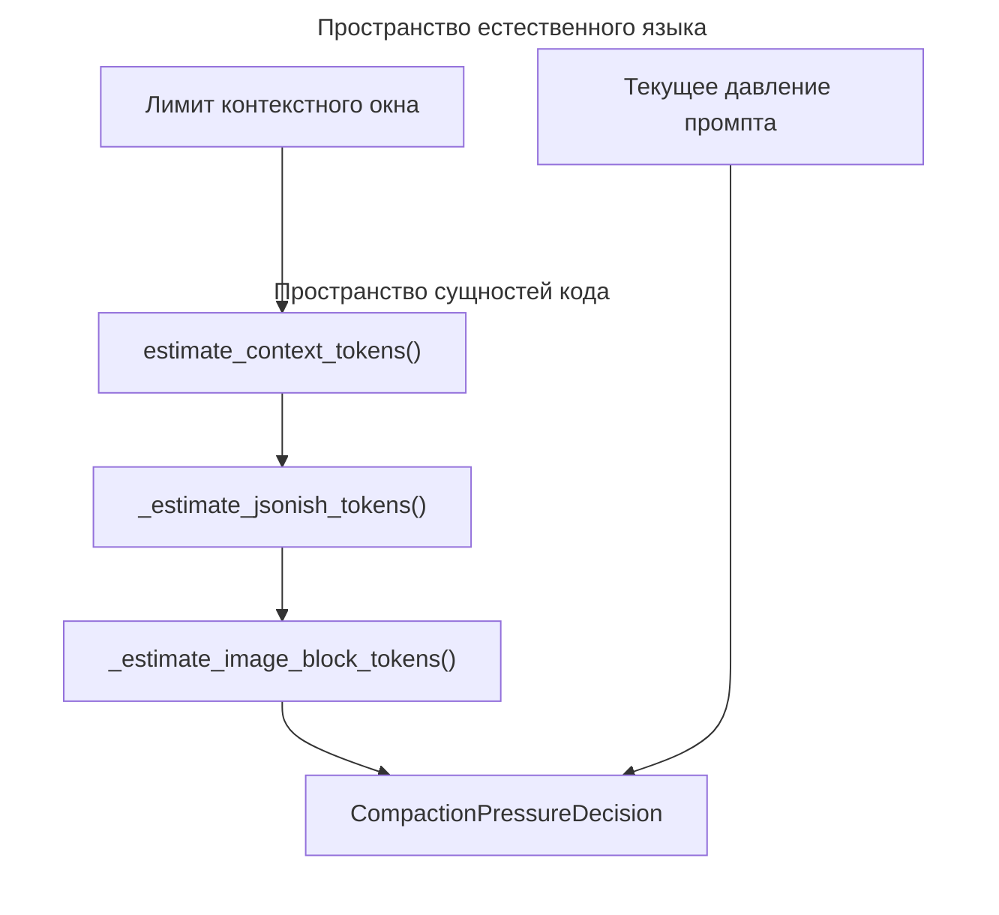
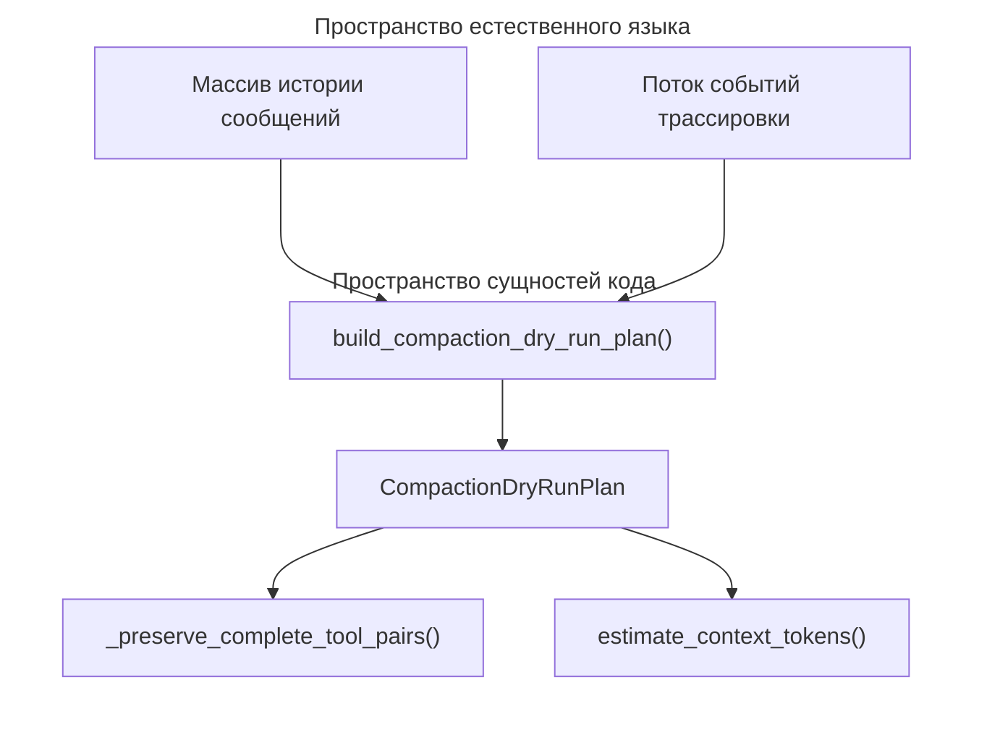

# Компакция контекста и история сессии

<details>
<summary>Использованные исходные файлы</summary>

Следующие файлы использовались как контекст при генерации этой страницы вики:

- [desktop/tests/composer-model.test.cjs](desktop/tests/composer-model.test.cjs)
- [desktop/tests/text-stream.test.cjs](desktop/tests/text-stream.test.cjs)
- [factory/core/runtime.py](factory/core/runtime.py)
- [factory/core/session_changes.py](factory/core/session_changes.py)
- [factory/core/session_compaction.py](factory/core/session_compaction.py)
- [factory/core/session_history.py](factory/core/session_history.py)
- [tests/fixtures/context_overflow/llama_server_98k.json](tests/fixtures/context_overflow/llama_server_98k.json)

</details>


## Назначение и область охвата

Подсистема компакции контекста и истории сессий отвечает за управление временем жизни токенов, давлением на контекстное окно, сжатие исторических событий и отслеживание изменений кода по задачам в ядре Python-агента (`factory/core/`). Пока длинные сессии coding-агента накапливают ходы, результаты инструментов и большие файловые диффы, эта подсистема динамически оценивает давление на контекст, планирует и выполняет безопасную компакцию, не отбрасывая ожидающие одобрения и неразрешённые ошибки инструментов, ведёт независимую от провайдера историю сессии и сериализует детальные метрики изменений файлов для последующих потребителей — таких как мобильный мост и фронтенды UI.

Источники: `factory/core/session_compaction.py:1-70`, `factory/core/session_history.py:1-44`, `factory/core/session_changes.py:1-30`

---

## Определение контекстного окна и оценка давления

Рантайм агента непрерывно сопоставляет размер запроса с доступными контекстными окнами модели, используя эвристические оценки токенов, чтобы не зависеть от тяжёлых внешних токенизаторов. Подсчёт токенов реализован в `estimate_context_tokens()` и `_estimate_jsonish_tokens()`, которые аппроксимируют текст, JSON-структуры и закодированные в base64 данные изображений [factory/core/session_compaction.py:72-123]().


*Источники: `factory/core/session_compaction.py:72-123`*

Давление на контекст инкапсулируется в `CompactionPressureDecision`, которая соотносит действия с настраиваемыми порогами (`DEFAULT_DRY_RUN_THRESHOLD`, `DEFAULT_MANUAL_THRESHOLD`, `DEFAULT_REACTIVE_THRESHOLD`) [factory/core/session_compaction.py:24-26, 59-70]():

| Константа порога | Значение по умолчанию | Действие при срабатывании | Описание |
| :--- | :--- | :--- | :--- |
| `DEFAULT_DRY_RUN_THRESHOLD` | `0.72` | `dry_run` | Выполняет немодифицирующую проверку, чтобы оценить предстоящие границы компакции. |
| `DEFAULT_MANUAL_THRESHOLD` | `0.82` | `manual` | Рекомендует или инициирует компакцию сессии по запросу пользователя. |
| `DEFAULT_REACTIVE_THRESHOLD` | `0.90` | `reactive` | Автоматически запускает реактивную компакцию, чтобы предотвратить ошибки переполнения контекста. |

Источники: `factory/core/session_compaction.py:24-26`, `factory/core/session_compaction.py:59-70`

---

## Планирование компакции сессии и пробные прогоны

Когда давление на контекст выходит за пределы безопасного запаса, планировщик строит консервативный план компакции через `build_compaction_dry_run_plan()` [factory/core/session_compaction.py:125-139](). Планировщик гарантирует, что критическое операционное состояние никогда не будет выброшено при сжатии в сводку. В частности, он проверяет блокирующие причины, такие как:
- `pending_approval`: активное выполнение инструмента, ожидающее подтверждения пользователя [factory/core/session_compaction.py:16]().
- `unresolved_failed_tool_result`: выполнения инструментов, завершившиеся ошибками, требующими коррекции со стороны агента [factory/core/session_compaction.py:17]().
- `unresolved_post_turn_guard`: активные post-turn guard-проверки команд и файловых политик [factory/core/session_compaction.py:18]().
- `no_compactable_messages`: недостаточная глубина истории сообщений, чтобы сжатие имело смысл [factory/core/session_compaction.py:19]().


*Источники: `factory/core/session_compaction.py:125-188`*

Если сессию можно сжать, итоговый `CompactionArtifact` упаковывает текст сводки, метаданные границы и список охваченных исторических ID в долговременную запись [factory/core/session_compaction.py:51-57]().

Источники: `factory/core/session_compaction.py:31-57`, `factory/core/session_compaction.py:125-188`

---

## Долговременная история сессии и построение рабочей истории

Сохранение сессий и свидетельства продолжения между ходами управляются в `factory/core/session_history.py`. Функция `read_history()` разбирает построчно записанные JSON-записи с диска, отфильтровывая допустимые роли (`user`, `assistant`, `tool`, `reasoning`) [factory/core/session_history.py:13-24]().

`history_record_id()` назначает стабильные идентификаторы элементам истории, используя явный `history_id`, сопоставления задача-пользователь, ID сообщений или хэши содержимого [factory/core/session_history.py:27-35]().

`build_working_history()` собирает активный контекст промпта из сырых записей и событий трассировки [factory/core/session_history.py:38-43]():
1. Проходит по сырым записям журнала, исключая указанные ID сообщений и оборачивая внешние свидетельства OpenCode или исторические результаты инструментов [factory/core/session_history.py:48-58]().
2. Объединяет события трассировки (такие как пакеты инструментов, ответы и steer-дельты), привязанные к соответствующим позициям задачи [factory/core/session_history.py:69-99]().
3. Применяет утилиты редактирования (`redact_text()`, `redact_value()`) для защиты чувствительных секретов [factory/core/session_history.py:10-11, 101, 114]().
4. Если существует сводка компакции (`compaction.completed`), более старые охваченные записи удаляются и заменяются единым блоком памяти сессии (`[Session memory carried forward]`) [factory/core/session_history.py:73-75, 104-111]().

Источники: `factory/core/session_history.py:1-116`

---

## Отслеживание изменений по задачам

Модификации файлов, выполняемые агентом, отслеживаются через `TaskChangeTracker` в `factory/core/session_changes.py` [factory/core/session_changes.py:107-117](). 

Каждый раз при выполнении инструмента `Write` или `Edit` трекер фиксирует добавления и удаления, сравнивая целевой файл с его базовым снапшотом, полученным от менеджера чекпоинтов [factory/core/session_changes.py:136-163](). Добавленные и удалённые строки вычисляются рендерингом unified diff (`count_line_changes()`) [factory/core/session_changes.py:49-61]().

Сохранённые изменения задач сериализуются как отдельные JSON-файлы в каталоге данных рантайма [factory/core/session_changes.py:8-11, 36-39]():
```python
<data_root>/session_changes/<task_id>.json
```

Эти записи могут читаться напрямую последующими компонентами, например мобильным мостом, без миграций базы данных [factory/core/session_changes.py:8-11](). Внутренние каталоги рантайма (такие как `.checkpoints`, `.tool_results` и `.codex`) автоматически исключаются из подсчёта изменений с помощью `is_internal_path()` [factory/core/session_changes.py:27, 75-86]().

Источники: `factory/core/session_changes.py:1-174`
