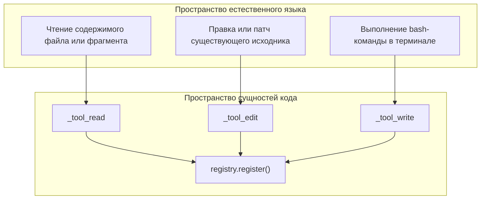
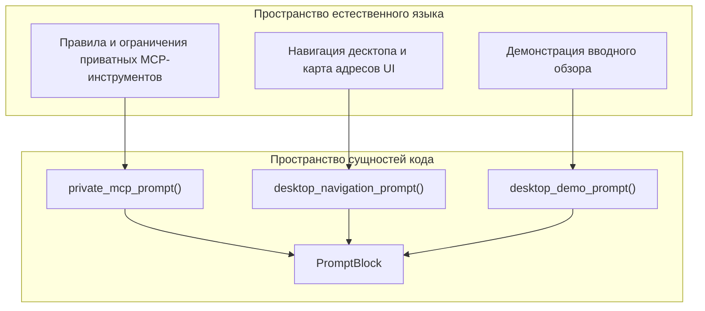
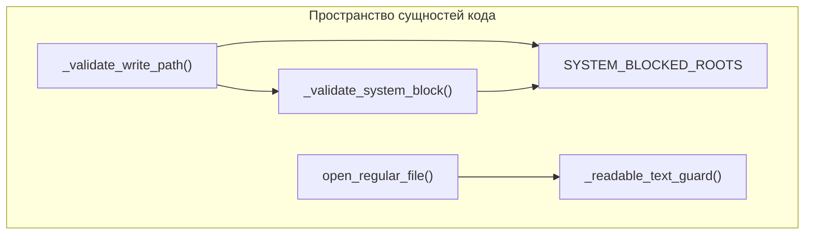

# Инструменты, промпты и политика

Использованные исходные файлы

Следующие файлы использовались как контекст при генерации этой страницы вики:

- [desktop/tests/session-summary.test.cjs](desktop/tests/session-summary.test.cjs)
- [docs/PROJECT_LAYOUT.md](docs/PROJECT_LAYOUT.md)
- [docs/architecture/ISOLATION.md](docs/architecture/ISOLATION.md)
- [docs/architecture/POLICY.md](docs/architecture/POLICY.md)
- [docs/architecture/RICH_CLI_RENDERING_EXPLAINED.md](docs/architecture/RICH_CLI_RENDERING_EXPLAINED.md)
- [docs/development/CROSS_PLATFORM_DESKTOP.md](docs/development/CROSS_PLATFORM_DESKTOP.md)
- [docs/development/FIRST_RUN_ACCEPTANCE.md](docs/development/FIRST_RUN_ACCEPTANCE.md)
- [docs/images/session-sources-flow.png](docs/images/session-sources-flow.png)
- [docs/images/session-sources-flow.svg](docs/images/session-sources-flow.svg)
- [factory/core/cc_backend_tools.py](factory/core/cc_backend_tools.py)
- [factory/core/mobile_bridge/server.py](factory/core/mobile_bridge/server.py)
- [factory/core/prompt_assembly.py](factory/core/prompt_assembly.py)
- [tests/test_cc_backend_read_tool.py](tests/test_cc_backend_read_tool.py)

## Назначение и область охвата

Эта страница документирует ключевые подсистемы, отвечающие за выполнение действий агента, сборку системных промптов, применение политик разрешений и защиту операций с файловой системой в Python-ядре Igorek-Harness. В частности, она охватывает реестр инструментов и их реализации (`factory/core/cc_backend_tools.py`), конвейеры построения промптов (`factory/core/prompt_assembly.py`), уровни доступа и правила выполнения (`docs/architecture/POLICY.md`), а также механизмы guard-защиты файловой системы и команд.

---

## 1. Реестр инструментов и их реализации (`cc_backend_tools`)

Бэкенд агента объявляет доступные возможности через `factory/core/cc_backend_tools.py`, который регистрирует инструменты на уровне модуля с помощью центрального реестра (`registry.register()`) [factory/core/cc_backend_tools.py:1-10] [factory/core/cc_backend_tools.py:72-75]. Вызывающий код взаимодействует с этими возможностями через обёртки `get_tool_schemas()` и `execute_tool()` [factory/core/cc_backend_tools.py:8-10]. Поддерживаемые базовые инструменты: `Write`, `Read`, `Bash`, `Edit`, `Glob`, `Grep`, `SessionSearch`, `web_search` и `web_extract` [factory/core/cc_backend_tools.py:3-5].

### Сопоставление естественного языка с пространством сущностей инструментов

*Источники: [factory/core/cc_backend_tools.py:1-75](), [tests/test_cc_backend_read_tool.py:6-20]()*

---

## 2. Движок сборки промптов (`prompt_assembly`)

Системные промпты, инструкции по интеграции MCP, каталоги навигации и интерактивные демо-сценарии собираются динамически через `factory/core/prompt_assembly.py`. Модуль опирается на классы данных `PromptBlock` и вспомогательные методы вроде `_clean_text()` и `_append_block()`, чтобы строить ограниченные по размеру структуры промптов [factory/core/prompt_assembly.py:104-123].

Ключевые генераторы промптов:
- `private_mcp_prompt()`: настраивает правила безопасности и операционные лимиты для интеграций с провайдерами (например, документация OpenAI или Google Calendar) [factory/core/prompt_assembly.py:10-28].
- `desktop_navigation_prompt()`: загружает статическую карту UI из `web_ui/static/navigation.json`, чтобы дать агенту точные markdown-ссылки маршрутизации `igorek://ui/...` [factory/core/prompt_assembly.py:49-61].
- `desktop_demo_prompt()`: генерирует последовательные ограниченные многоходовые промпты для встроенного вводного обзора [factory/core/prompt_assembly.py:78-101].

### Сопоставление естественного языка с пространством сущностей промптов

*Источники: [factory/core/prompt_assembly.py:10-62](), [factory/core/prompt_assembly.py:104-123]()*

---

## 3. Уровни доступа и политика выполнения

Безопасность выполнения и режимы разрешений описаны в `docs/architecture/POLICY.md` и применяются через `factory/config/inference-policy.yaml` [docs/architecture/POLICY.md:1-4]. Сервер сначала учитывает переопределения уровня сессии и только затем откатывается к глобальным настройкам [docs/architecture/POLICY.md:31-32].

Матрица безопасности сопоставляет уровни доступа конкретным режимам security, guard и файловой системы:

| Уровень | `security_mode` | `guard_mode` | `filesystem_mode` |
| --- | --- | --- | --- |
| `strict` | `enforce` | `on` | `workspace` |
| `standard` | `observe` | `on` | `workspace` |
| `trusted` | `observe` | `warn` | `workspace` |
| `full` | `disabled` | `off` | `full-dangerous` |

*Источники: [docs/architecture/POLICY.md:22-30]*

---

## 4. Политики защиты файлов и команд

Операции файловых инструментов выполняют строгую нормализацию путей и проверки границ, чтобы предотвратить несанкционированный доступ за пределы рабочей директории или к ограниченным системным путям.

### Валидация путей и записи

Операции записи и правки проверяют целевые пути через `_validate_write_path()` с использованием `SYSTEM_BLOCKED_ROOTS` и режимов разрешения файловой системы (`workspace`, `user-read`, `full-dangerous`) [factory/core/cc_backend_tools.py:76-90] [factory/core/cc_backend_tools.py:192-212]. 

*Источники: [factory/core/cc_backend_tools.py:76-90](), [factory/core/cc_backend_tools.py:192-217]()*  

### Защита содержимого и чтения

- **Бинарные файлы и изображения**: `_readable_text_guard()` проверяет MIME-типы и образцы блоков с помощью `_looks_binary()`, не допуская вывода бинарных данных или «прочтения» изображений через текстовые инструменты `Read` [factory/core/cc_backend_tools.py:148-174].
- **Чтения без границ**: операции чтения ограничивают число символов (`_DEFAULT_MAX_READ_CHARS` = 200 000; `_DEFAULT_MAX_UNBOUNDED_READ_CHARS` = 50 000), защищая контекстное окно модели и требуя явных параметров `offset` и `limit` для больших данных [factory/core/cc_backend_tools.py:108-119] [tests/test_cc_backend_read_tool.py:45-72].

*Источники: [factory/core/cc_backend_tools.py:108-119](), [factory/core/cc_backend_tools.py:148-174](), [tests/test_cc_backend_read_tool.py:45-72]()*
