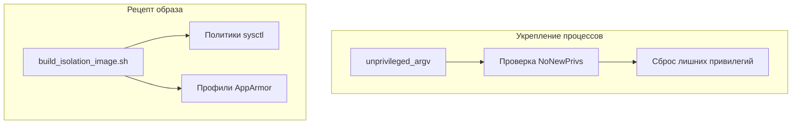
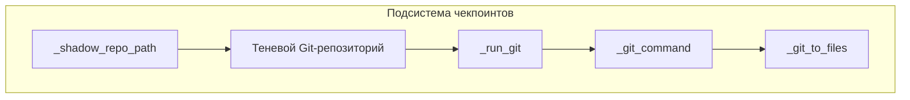
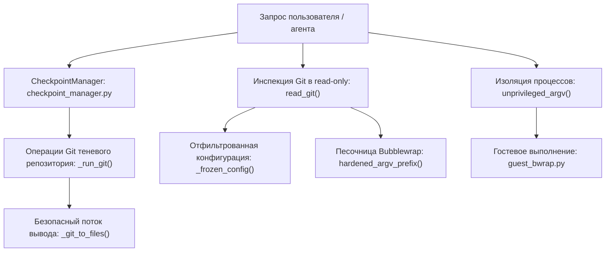

# Подсистема изоляции и чекпоинты

Использованные исходные файлы

Следующие файлы использовались как контекст при генерации этой страницы вики:

- [docs/PROJECT_LAYOUT.md](docs/PROJECT_LAYOUT.md)
- [docs/architecture/ISOLATION.md](docs/architecture/ISOLATION.md)
- [docs/architecture/POLICY.md](docs/architecture/POLICY.md)
- [docs/architecture/RICH_CLI_RENDERING_EXPLAINED.md](docs/architecture/RICH_CLI_RENDERING_EXPLAINED.md)
- [docs/development/CROSS_PLATFORM_DESKTOP.md](docs/development/CROSS_PLATFORM_DESKTOP.md)
- [docs/development/FIRST_RUN_ACCEPTANCE.md](docs/development/FIRST_RUN_ACCEPTANCE.md)
- [factory/core/checkpoint_manager.py](factory/core/checkpoint_manager.py)
- [factory/core/readonly_git.py](factory/core/readonly_git.py)
- [factory/scripts/build_isolation_image.sh](factory/scripts/build_isolation_image.sh)
- [tests/test_checkpoint_process.py](tests/test_checkpoint_process.py)
- [tests/test_guest_process_privileges.py](tests/test_guest_process_privileges.py)

Подсистема изоляции (`factory/core/isolation/`) и инфраструктура чекпоинтов (`factory/core/checkpoint_manager.py`, `factory/core/readonly_git.py`) обеспечивают границы безопасности между рантаймом агента на хосте и выполнением недоверенного гостевого кода. Этот слой отвечает за гостевые песочницы bubblewrap (`bwrap`), контроль исходящего трафика, одобрение операций на хосте, лимиты передачи рабочего пространства, теневые Git-репозитории и выполнение Git в режиме read-only.

Источники: `factory/scripts/build_isolation_image.sh:1-33`, `docs/architecture/ISOLATION.md:1-28`

---

## Гостевые окружения Bubblewrap и укрепление процессов

Гостевое выполнение изолирует произвольные команды, запускаемые агентом, за счёт контроля kernel capabilities, ограничений пространств имён и флагов процессов. Модуль `factory/core/isolation/guest_process.py` предоставляет хелперы, например `unprivileged_argv()`, гарантирующие, что порождённые дочерние процессы сохраняют `NoNewPrivs` и работают безопасно, даже если их локальные переменные окружения изменены.

Базовые гостевые окружения задаются shell-рецептами вроде `factory/scripts/build_isolation_image.sh`, который настраивает непривилегированные user namespaces (`kernel.unprivileged_userns_clone = 1`), профили AppArmor (`bwrap-userns-restrict`) и проверки готовности (`igorek-guest-bwrap-probe`).

*Рисунок 1: Архитектура укрепления гостевых процессов и сборки образа.*

Источники: `tests/test_guest_process_privileges.py:9-48`, `factory/scripts/build_isolation_image.sh:70-91`

---

## Менеджер чекпоинтов и теневые репозитории

Подсистема чекпоинтов отслеживает состояния рабочего пространства, поддерживая изолированные теневые Git-репозитории под корнем данных (`<data_root>/checkpoints/<hash>`). 

Ключевые функции в `factory/core/checkpoint_manager.py`:
- `_shadow_repo_path()`: вычисляет 16-символьный SHA-256-хэш абсолютного пути рабочей директории для изоляции теневых ref'ов [factory/core/checkpoint_manager.py:104-108]().
- `_run_git()`: выполняет команды Git CLI в теневом репозитории с отключёнными хуками (`core.hooksPath=/dev/null`) и мониторами файловой системы (`core.fsmonitor=false`) [factory/core/checkpoint_manager.py:134-167]().
- `_git_to_files()`: передаёт вывод subprocess через временные файлы, предотвращая дедлоки при срабатывании таймаутов subprocess на Windows или Linux [factory/core/checkpoint_manager.py:30-44]().

*Рисунок 2: Поток выполнения чекпоинтов и сопоставление с кодом изоляции процессов.*

Источники: `factory/core/checkpoint_manager.py:21-78`, `tests/test_checkpoint_process.py:11-41`

---

## Изоляция read-only Git

Чтобы проверять состояние репозитория, не выполняя произвольные хуки репозитория, clean-фильтры или переопределения конфигурации, `factory/core/readonly_git.py` реализует жёстко ограниченную процедуру выполнения через `read_git()` [factory/core/readonly_git.py:124-158]().

Read-only окружение:
1. Фильтрует ключи конфигурации по явному белому списку через regex `SAFE_KEYS` (например, версия формата репозитория, правила fetch для remote) [factory/core/readonly_git.py:19-21]().
2. Задаёт строгие переменные окружения через `git_environment()`, отключая терминальные запросы, необязательные блокировки и отложенные fetch'и [factory/core/readonly_git.py:30-47]().
3. Запускает Git внутри строгой песочницы bubblewrap с `--unshare-net`, read-only монтированием системных каталогов (`/usr`, `/lib`, `/bin`) и ограниченными лимитами ресурсов [factory/core/readonly_git.py:141-158]().

Источники: `factory/core/readonly_git.py:1-48`, `factory/core/readonly_git.py:124-158`

---

## Поток данных подсистемы изоляции и чекпоинтов

Следующая диаграмма показывает, как внешние взаимодействия с кодом проходят через компоненты изоляции и чекпоинтов, напрямую связывая операции на естественном языке с соответствующими символами и модулями Python.

*Рисунок 3: Подсистема изоляции и сопоставление сущностей кода.*

Источники: `factory/core/isolation/guest_bwrap.py:1-25`, `factory/core/checkpoint_manager.py:30-54`, `factory/core/readonly_git.py:124-158`
